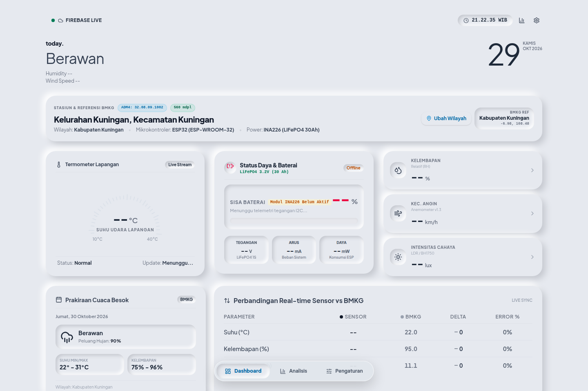
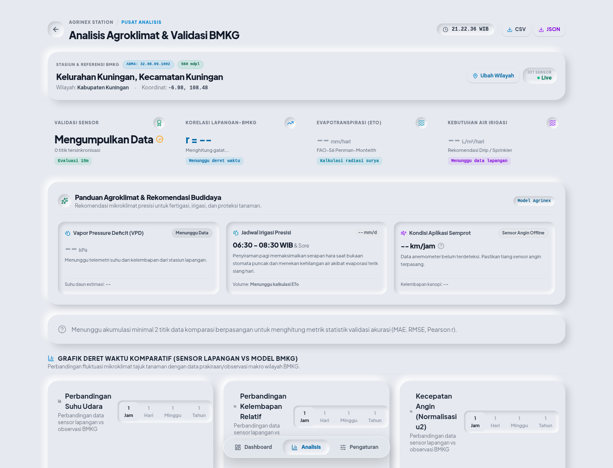
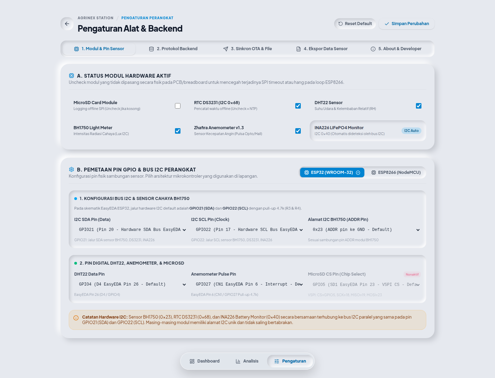
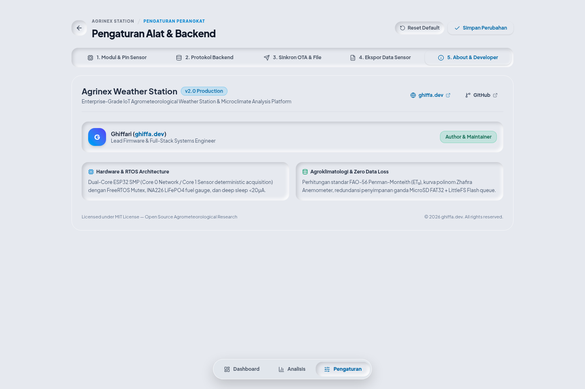
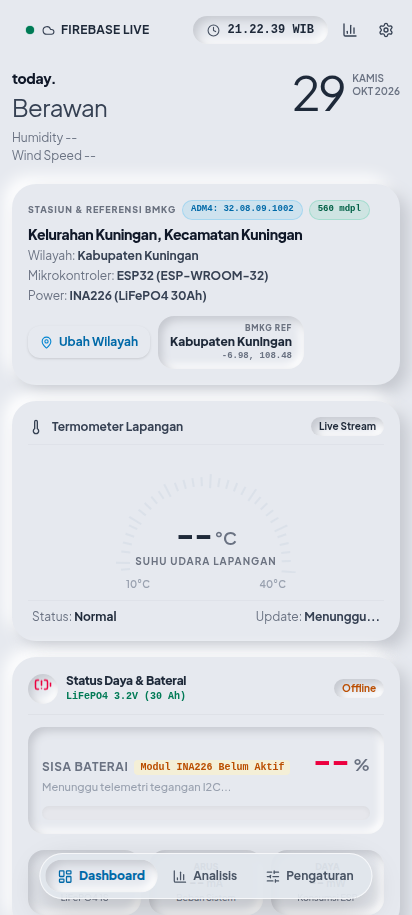

# Agrinex Weather Station 🌦️⚡

[](https://platformio.org/)
[](https://www.espressif.com/)
[](https://www.freertos.org/)
[](https://react.dev/)
[](https://vitejs.dev/)
[](https://tailwindcss.com/)
[](https://firebase.google.com/)
[](https://supabase.com/)
[](https://ghiffa.dev)
[](LICENSE)

**Agrinex Weather Station** adalah platform stasiun cuaca agro-klimatologi cerdas kelas produksi (*enterprise-grade*) berbasis **ESP32 Dual-Core (FreeRTOS)** dan **ESP8266**, dikembangkan oleh [**ghiffa.dev**](https://ghiffa.dev). Dirancang khusus untuk pemantauan presisi iklim mikro pertanian, penghitungan evapotranspirasi standar internasional (**FAO-56 Penman-Monteith**), monitoring daya baterai solar panel (**INA226 LiFePO4**), serta ketahanan data mutlak (*Zero Data Loss*) melalui penyimpanan berlapis MicroSD dan LittleFS.

---

## 📸 Pratinjau Antarmuka (*Dashboard Previews*)

<p align="center">
  
</p>

<details open>
<summary><b>🔍 Tangkapan Layar Lengkap Sistem (Analisis, Pengaturan, About & Mobile)</b></summary>
<br/>

| **Pusat Analisis Agroklimat (FAO-56 & WMO)** | **Pengaturan Perangkat & Pinout EasyEDA** |
|:---:|:---:|
|  |  |

| **Tentang Aplikasi & Developer (`ghiffa.dev`)** | **Tampilan Responsif Mobile PWA** |
|:---:|:---:|
|  |  |

</details>

---

## 🌟 Fitur Utama (*Key Capabilities*)

### 1. ⚡ Edge Computing & Arsitektur FreeRTOS Dual-Core (ESP32)
- **Core 1 (APP_CPU) — Prioritas 3 (Real-Time):**
  - Sampling deterministik berkala tanpa jitter menggunakan `vTaskDelayUntil()`.
  - Akuisisi sensor I2C (BH1750, RTC DS3231, INA226), 1-Wire (DHT22), dan penghitungan pulsa hardware interrupt Anemometer.
  - Perlindungan memori *thread-safe* dengan **FreeRTOS Mutex** (`sensorMutex`).
- **Core 0 (PRO_CPU) — Prioritas 1 (Background Cloud Ingestion):**
  - Mengelola koneksi TLS/HTTPS & LwIP stack secara asinkron tanpa memblokir pembacaan sensor maupun server lokal.
  - Pengiriman telemetri periodik ke backend dan pemrosesan antrean data offline.

### 2. 🔋 Sistem Daya Mandiri & Monitoring Baterai LiFePO4 (INA226)
- **High-Precision Power Monitoring:** Mengukur tegangan bus ($V_{bus}$), shunt voltage ($V_{shunt}$), arus ($I_{mA}$), dan konsumsi daya ($P_{mW}$) via sensor I2C **INA226** (shunt resistor 0.1 $\Omega$).
- **LiFePO4 1S (3.2V, 30Ah) Smart Fuel Gauge:** Algoritma estimasi *State-of-Charge* (SoC) presisi dengan kompensasi kenaikan tegangan semu (*float absorption charge*) saat modul pengisian surya TP5000 aktif.
- **Ultra-Low Power Deep Sleep:** Konsumsi arus terpangkas ke **$<20\,\mu\text{A}$** dengan penonaktifan radio WiFi/baseband, RTC Slow Memory boot counter (`RTC_DATA_ATTR`), dan timer wake-up internal tanpa memerlukan kabel jumper tambahan pada ESP32.

### 3. 🛡️ Toleransi Gangguan & Zero Data Loss
- **Dual Storage Redundancy:**
  - **Penyimpanan Primer:** MicroSD Card fisik (FAT32, format file CSV timestamped).
  - **Penyimpanan Sekunder:** Flash LittleFS partisi internal `/q/` sebagai antrean offline otomatis saat jaringan internet seluler/WiFi terputus.
- **Auto Replay Queue:** Saat koneksi pulih, antrean data LittleFS otomatis diunggah secara berurutan dan dihapus dari flash memori setelah konfirmasi HTTP status `200 OK`.

### 4. 🔄 Multi-Protocol Cloud Ingestion
Stasiun mendukung 4 protokol backend yang dapat dialihkan secara dinamis tanpa flash ulang firmware:
1. **Cloud Firestore (Firebase):** Direct HTTPS REST API dengan validasi schema `firestore.rules`.
2. **Supabase Database:** PostgREST direct insertion dengan API Key authorization.
3. **MQTT Broker:** Kompatibel dengan broker MQTT publik/privat (EMQX, HiveMQ, Mosquitto).
4. **Custom HTTPS REST Webhook:** Ingestion ke server aplikasi atau serverless endpoint kustom.

### 5. 🌐 Web Dashboard Neumorphic & PWA Modern
- **Agroclimatology Metrics:** Kalkulasi otomatis Evapotranspirasi Acuan ($ET_0$ FAO-56), Vapor Pressure Deficit (VPD), Titik Embun (*Dew Point*), dan Heat Index.
- **BMKG Live Integration:** Komparasi data stasiun lokal dengan data prakiraan cuaca resmi BMKG terdekat berdasarkan kode wilayah ADM4 (Provinsi, Kota/Kab, Kecamatan, Kelurahan/Desa).
- **On-Device Portal (`/settings` & `/api/config`):** Pengaturan konfigurasi pin GPIO, toggle modul hardware, dan backend langsung melalui browser di jaringan lokal stasiun.
- **Ekspor Data:** Download log telemetri ke format **CSV (UTF-8 BOM untuk Microsoft Excel)** dan **JSON**.

---

## 📐 Skematik Rangkaian & Pemetaan Pin Hardware (EasyEDA)

Sistem telah diuji dan diverifikasi menggunakan skematik **ESP-WROOM-32 (V1.0)** dan fallback **NodeMCU v2 (ESP8266)**:

| Modul Sensor / Komponen | Antarmuka / Jalur | Pin ESP32 (EasyEDA) | Pin ESP8266 (NodeMCU) | Keterangan Rangkaian |
| :--- | :--- | :--- | :--- | :--- |
| **I2C Bus (SDA)** | I2C Data | **GPIO 21** (Pin 20) | **D2 (GPIO 4)** | Paralel ke BH1750, DS3231, INA226 (Pull-up 4.7k R3) |
| **I2C Bus (SCL)** | I2C Clock | **GPIO 22** (Pin 17) | **D1 (GPIO 5)** | Clock bus I2C (Pull-up 4.7k R4) |
| **INA226 Battery Monitor** | I2C Address `0x40` | **GPIO 21 / 22** | **D2 / D1** | Memonitor tegangan baterai LiFePO4 (3.2V, 30Ah) |
| **RTC DS3231** | I2C Address `0x68` | **GPIO 21 / 22** | **D2 / D1** | Real-Time Clock dengan baterai backup CR2032 |
| **BH1750 Light Sensor** | I2C Address `0x23` | **GPIO 21 / 22** | **D2 / D1** | Pengukur intensitas cahaya (Lux) |
| **DHT22 (AM2302)** | 1-Wire Data | **GPIO 4** (Pin 26) | **D4 (GPIO 2)** | Sensor suhu (-40 s/d 80°C) & kelembapan (0-100%) |
| **Zhafira Anemometer v1.3**| Pulse Interrupt | **GPIO 27** (Pin 6) | **D3 (GPIO 0)** | Hardware interrupt dengan pull-up 4.7k R1 |
| **MicroSD Card (SPI)** | CS (Chip Select) | **GPIO 5** (Pin 23) | **D8 (GPIO 15)** | Jalur VSPI hardware (Pull-up 10k R2) |
| | SCK (Clock) | **GPIO 18** (Pin 22) | **D5 (GPIO 14)** | Hardware SPI Clock |
| | MISO (Master In) | **GPIO 19** (Pin 21) | **D6 (GPIO 12)** | Hardware SPI MISO |
| | MOSI (Master Out)| **GPIO 23** (Pin 16) | **D7 (GPIO 13)** | Hardware SPI MOSI |
| **Status LED Indicator** | Output Digital | **GPIO 2** (Onboard) | **D4 (LED_BUILTIN)**| Heartbeat & indikator transmisi data |

---

## 🧮 Model Matematis & Formulasi Sensor

### 1. Kecepatan Angin (*Zhafira Anemometer v1.3*)
Kecepatan angin dihitung berdasarkan frekuensi rotasi pulsa ($f = \frac{\Delta \text{pulsa}}{\Delta t}$):
$$v \,(\text{m/s}) = -0.0181 f^2 + 1.3859 f + 1.4055 \quad (\text{Threshold: } v \le 1.5\,\text{m/s} \to 0)$$
$$v \,(\text{km/h}) = v \,(\text{m/s}) \times 3.6$$

### 2. Evapotranspirasi Acuan ($ET_0$ — FAO-56 Penman-Monteith)
$$ET_0 = \frac{0.408 \Delta (R_n - G) + \gamma \frac{900}{T + 273} u_2 (e_s - e_a)}{\Delta + \gamma (1 + 0.34 u_2)}$$
- $\Delta$: Kemiringan kurva tekanan uap jenuh ($\text{kPa}/^\circ\text{C}$)
- $R_n$: Radiasi netto pada permukaan vegetasi ($\text{MJ}/\text{m}^2/\text{hari}$)
- $G$: Fluks panas tanah ($\approx 0$ untuk perhitungan harian)
- $T$: Rata-rata temperatur udara harian ($^\circ\text{C}$)
- $u_2$: Kecepatan angin pada ketinggian 2 meter ($\text{m/s}$)
- $e_s - e_a$: Defisit tekanan uap jenuh / VPD ($\text{kPa}$)
- $\gamma$: Konstanta psikrometrik ($\text{kPa}/^\circ\text{C}$)

---

## 📁 Struktur Repositori

```text
weather-station-agrinex/
├── firmware/                       # ⚡ Source Code Firmware PlatformIO (C++)
│   ├── platformio.ini              # Konfigurasi dual-env (esp32dev & nodemcuv2)
│   ├── include/
│   │   ├── config.h                # Pinout EasyEDA, konstanta sensor & timing
│   │   ├── config.private.h.example# Template kredensial WiFi (Git-safe)
│   │   ├── device_config.h         # Model konfigurasi dinamis LittleFS & JSON serializer
│   │   └── web_portal.h            # HTTP Web Server & form konfigurasi on-device
│   └── src/
│       └── main.cpp                # FreeRTOS tasks, sensor sampling, WiFi & cloud ingestion
│
├── web/                            # 🌐 Web Dashboard Monitoring & PWA (React 19 + TS)
│   ├── src/
│   │   ├── core/                   # Domain entities, types, & business logic
│   │   ├── data/                   # API clients (BMKG, Firebase, Supabase)
│   │   └── presentation/           # Atomic components, views (Dashboard, Analytics, Settings)
│   ├── vite.config.ts              # Konfigurasi Vite & PWA Service Worker
│   ├── tailwind.config.js          # Skema warna Neumorphic & utility classes
│   └── package.json
│
├── docs/                           # 📚 Dokumentasi Desain & Audit
│   ├── PRD.md                      # Product Requirements Document
│   ├── ALGORITHMS_SPEC.md          # Spesifikasi matematika agroklimatologi
│   ├── DATA_CONTRACTS.md           # Skema JSON & kontrak API
│   ├── QA_AUDIT_REPORT.md          # Laporan audit arsitektur & code review
│   └── SPRINT_PLAN.md              # Roadmap pengembangan sistem
│
├── data/                           # 📊 Dataset Benchmark Validasi
│   ├── data_bmkg_harian.csv        # Data iklim BMKG harian
│   ├── data_node_sensor.csv        # Log telemetri stasiun lapangan
│   └── deployment_log.csv          # Riwayat operasional stasiun
│
├── tools/                          # 🛠️ Skrip Utilitas & Database
│   ├── visualize.py                # Visualizer live telemetri serial (Python)
│   └── database/                   # Database SQLite $ET_0$ & skrip init
│
├── firestore.rules                 # 🔒 Production Firestore Security Rules
└── .gitignore                      # Git exclusion list (build artifacts & private keys)
```

---

## 🚀 Panduan Memulai (*Quick Start*)

### Prasyarat
- [PlatformIO Core / IDE Extension](https://platformio.org/)
- [Node.js](https://nodejs.org/) v18.0.0 atau lebih baru & `npm`
- Mikrokontroler: **ESP32 Dev Module** (Direkomendasikan) atau NodeMCU v2 ESP8266
- Kabel Micro-USB / USB-C data

---

### 1. Konfigurasi & Flash Firmware (ESP32 / ESP8266)

1. Masuk ke direktori `firmware/`:
   ```bash
   cd firmware
   ```

2. Buat file kredensial pribadi:
   ```bash
   cp include/config.private.h.example include/config.private.h
   ```
   Edit file `include/config.private.h` dengan SSID dan password WiFi Anda:
   ```cpp
   #define WIFI_SSID     "NamaWiFiAnda"
   #define WIFI_PASSWORD "PasswordWiFiAnda"
   ```

3. Hubungkan board ESP32 ke komputer via USB, lalu kompilasi dan flash:
   ```bash
   # Untuk ESP32 (Rekomendasi)
   pio run -e esp32dev -t upload

   # Untuk ESP8266 (NodeMCU v2)
   pio run -e nodemcuv2 -t upload
   ```

4. Buka Serial Monitor untuk melihat log FreeRTOS & alamat IP stasiun:
   ```bash
   pio device monitor -b 115200
   ```

---

### 2. Menjalankan Web Dashboard Lokal

1. Masuk ke direktori `web/`:
   ```bash
   cd web
   ```

2. Instal dependensi:
   ```bash
   npm install
   ```

3. Jalankan server pengembangan Vite:
   ```bash
   npm run dev
   ```
   Akses dashboard di browser pada URL `http://localhost:5173`.

4. Untuk membuat build produksi (*production build*):
   ```bash
   npm run build
   ```
   Aset siap saji akan dibuat di folder `web/dist/`.

---

## 🔒 Aturan Keamanan Firestore (`firestore.rules`)

Untuk menjamin integritas data telemetri di Firebase Cloud Firestore, file `firestore.rules` menerapkan validasi ketat (*immutable append-only log*):
- Dokumen telemetri hanya boleh dibuat (`create`), dilarang di-`update` atau di-`delete`.
- Tipe data dan batas rentang nilai wajib divalidasi (Suhu $-20^\circ\text{C}$ s/d $80^\circ\text{C}$, Kelembapan $0\%$ s/d $100\%$, Kecepatan angin $\ge 0\,\text{km/h}$).
- Mencegah injeksi atribut tak dikenal menggunakan `.keys().hasOnly(...)`.

---

## 👨‍💻 Kontributor & Lisensi

- **Author / Lead Engineer:** [Ghiffari](https://github.com/ghiffa08)
- **Official Website / Portfolio:** [https://ghiffa.dev](https://ghiffa.dev)
- **GitHub Profile:** [@ghiffa08](https://github.com/ghiffa08)
- **Lisensi:** Proyek ini dilisensikan di bawah lisensi **MIT** — lihat file [LICENSE](LICENSE) untuk rincian lengkap.
