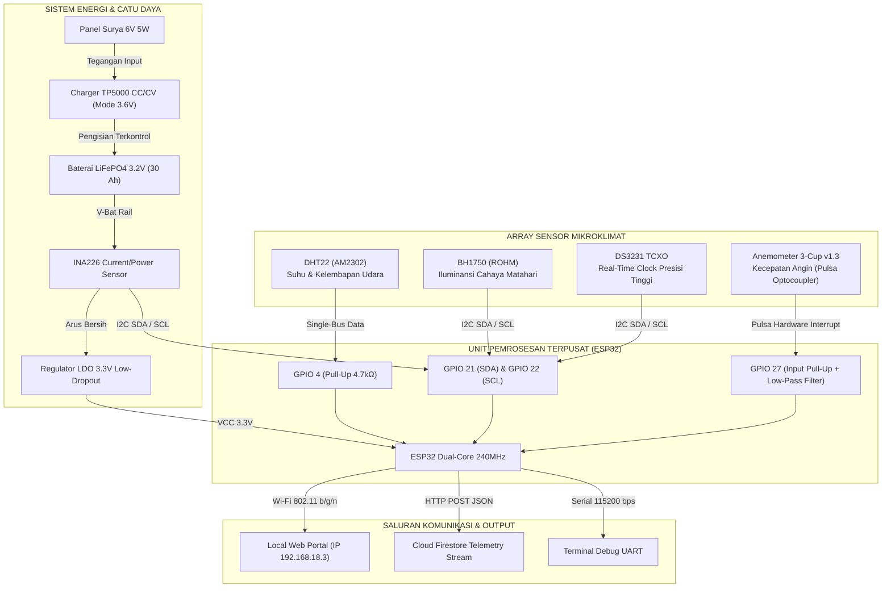

# BAB I: DESAIN SISTEM & ARSITEKTUR PERANGKAT KERAS (HARDWARE)

---

## 1.1 Latar Belakang & Urgensi Pemantauan Mikroklimat In-Situ

Data meteorologi yang dipublikasikan oleh stasiun Badan Meteorologi, Klimatologi, dan Geofisika (BMKG) umumnya diperoleh dari stasiun pengamatan synoptik atau model prakiraan numerik cuaca (*Numerical Weather Prediction / NWP*) berskala meso/makro dengan resolusi spasial berkisar antara $2 \times 2\text{ km}$ hingga $10 \times 10\text{ km}$. Pada kawasan pertanian berbukit atau dataran menengah - seperti wilayah Kabupaten Kuningan, Jawa Barat yang berada pada ketinggian rata-rata 560 meter di atas permukaan laut (mdpl) - kondisi iklim mikro (*microclimate*) di permukaan lahan sangat dipengaruhi oleh topografi lokal, kanopi tanaman, serta tutupan tanah lokal.

Perbedaan signifikan kerap terjadi antara data model BMKG dan kondisi nyata di lahan pertanian (*microclimate discrepancy*):
1. **Fluktuasi Suhu Tajuk (*Canopy Temperature*):** Akumulasi panas radiasi pada permukaan tanaman sering kali lebih tinggi daripada suhu udara ambien stasiun synoptik pada siang hari, dan sebaliknya lebih dingin akibat pelepasan radiasi terestrial di malam hari.
2. **Kelembapan Relatif Permukaan (*Boundary Layer Humidity*):** Evapotranspirasi vegetasi lokal menciptakan lapisan jenuh mikro di sekitar tanaman yang menentukan risiko perkecambahan spora jamur patogen (*blight / powdery mildew*).
3. **Laju Aliran Angin Lokal:** Hambatan mekanis tanaman dan kontur bukit mendistorsi kecepatan angin regional. Padahal, kecepatan angin permukaan acuan 2 meter ($u_2$) merupakan parameter penting dalam penghitungan evaporasi air tanah.

Oleh karena itu, diperlukan **Stasiun Cuaca Mikroklimat Pertanian Mandiri (Agrinex Weather Station)** yang mampu beroperasi tanpa henti secara *autonomous*, mengumpulkan data fisik riil secara *real-time*, mengomparasikan deviasinya terhadap model BMKG, serta menghitung kebutuhan air irigasi harian berbasis persamaan baku agrometeorologi internasional.

---

## 1.2 Topologi & Arsitektur Sistem Perangkat Keras

Sistem dirancang dengan arsitektur terdesentralisasi yang menggabungkan unit komputasi tertanam (*edge microcontroller*), sensor multi-parameter berpresisi tinggi, serta sistem catu daya surya mandiri (*solar-powered energy storage*).

---

## 1.3 Spesifikasi Mikrokontroler ESP32

Unit pemroses utama yang digunakan adalah modul **ESP32-WROOM-32D**. Alasan pemilihan chip ini dibandingkan mikrokontroler tradisional (seperti ATmega328P atau STM32F103) meliputi:
- **Arsitektur Dual-Core:** Ditenagai oleh dua mikroprosesor Xtensa 32-bit LX6 dengan clock hingga 240 MHz. Komputasi dibagi secara independen:
  - *Core 0 (Pro CPU):* Menangani tumpukan protokol jaringan Wi-Fi, HTTP Server REST API, serialisasi JSON, dan streaming telemetri.
  - *Core 1 (App CPU):* Didedikasikan untuk akuisisi sensor berkala, penanganan interupsi berkecepatan tinggi pada anemometer, pemulihan bus I2C, dan kalkulasi fisika.
- **Memori Internal yang Memadai:** Memiliki 520 KB SRAM terintegrasi serta 4 MB Quad-SPI Flash memory yang dialokasikan untuk partisi *firmware* aplikasi dan sistem berkas **LittleFS** (untuk menyimpan tabel konfigurasi alat, log kalibrasi, dan riwayat sementara).
- **Wi-Fi Terintegrasi 802.11 b/g/n:** Mendukung konektivitas nirkabel 2.4 GHz dengan daya pancar hingga $+20.5\text{ dBm}$, memungkinkan komunikasi data jarak jauh di area perkebunan terbuka.

---

## 1.4 Spesifikasi Teknis Sensor & Transduser

| Sensor | Antarmuka Fisik | Parameter Terukur | Rentang Operasional | Akurasi & Resolusi | Peran dalam Agrometeorologi |
| :--- | :--- | :--- | :--- | :--- | :--- |
| **DHT22 (AM2302)** | Single-Bus Digital (GPIO 4) | Suhu Udara ($T$) & Kelembapan Relatif ($RH$) | $-40^\circ\text{C} \text{ s/d } +80^\circ\text{C}$ $0\% \text{ s/d } 100\%\text{ RH}$ | Suhu: $\pm 0.5^\circ\text{C}$ (Res: $0.1^\circ\text{C}$) RH: $\pm 2\%$ (Res: $0.1\%$) | Analisis defisit tekanan uap jenuh air ($VPD$) dan kurva diurnal suhu. |
| **BH1750 (ROHM)** | I2C (Alamat: `0x23` atau `0x5C`) | Intensitas Cahaya / Iluminansi | $1 \text{ s/d } 65.535\text{ Lux}$ (dapat diperluas ke 100k) | $\pm 5\%$, respon spektral menyerupai sensitivitas visual manusia | Dikonversi ke Irradiansi Surya ($W/m^2$) untuk menghitung radiasi netto ($R_n$). |
| **Anemometer v1.3 (Zhafira)** | Hardware Interrupt Digital (GPIO 27) | Frekuensi Pulsa Putaran Mangkuk | $0 \text{ s/d } 180\text{ km/jam}$ ($0 \text{ s/d } 50\text{ m/s}$) | Frekuensi optocoupler terkalibrasi: $1\text{ putaran/detik} \approx 2.4\text{ km/jam}$ | Normalisasi angin ke ketinggian 2 meter ($u_2$) untuk evaporasi Penman-Monteith. |
| **INA226 (Texas Inst.)** | I2C (Alamat: `0x40`) | Tegangan Bus, Arus Pengisian/Beban, Daya | Tegangan: $0 \text{ s/d } 36\text{ V}$ Arus: $\pm 20\text{ A}$ (R-Shunt $0.1\ \Omega$) | 16-bit ADC, galat gain maksimal $0.1\%$, resolusi arus $\approx 1\text{ mA}$ | Pemantauan *State-of-Charge* (SoC) baterai LiFePO4 dan kesehatan panel surya. |
| **DS3231 (Maxim)** | I2C (Alamat: `0x68`) | Waktu Real-Time (Detik, Menit, Jam, Kalender) | $-40^\circ\text{C} \text{ s/d } +85^\circ\text{C}$ | TCXO Akurasi: $\pm 2\text{ ppm}$ ($< 1\text{ menit/tahun}$) | Pemberian stempel waktu (*timestamp*) presisi tinggi saat stasiun kehilangan jaringan NTP. |

---

## 1.5 Sistem Catu Daya & Manajemen Energi LiFePO4

Tantangan utama stasiun cuaca luar ruangan (*outdoor weather station*) adalah keandalan daya listrik jangka panjang di bawah terik matahari ekstrem dan hari berawan berkepanjangan (*cloudy days autonomy*).

### 1.5.1 Pemilihan Kimia Baterai: Mengapa LiFePO4?
Dibandingkan dengan baterai Lithium-Ion (NMC) konvensional:
1. **Ketahanan Suhu Tinggi:** Baterai Lithium Iron Phosphate ($\text{LiFePO}_4$) memiliki batas dekomposisi termal di atas $270^\circ\text{C}$ (jauh lebih aman dibanding Li-Ion yang mengalami *thermal runaway* pada suhu $150^\circ\text{C}$). Hal ini krusial mengingat kotak *enclosure* stasiun di lapangan dapat mencapai suhu internal $> 45^\circ\text{C}$.
2. **Siklus Hidup (*Cycle Life*):** Baterai LiFePO4 mampu bertahan hingga lebih dari 2.000 hingga 3.000 siklus *deep-discharge* (80% DoD) sebelum kapasitasnya turun ke 80%, dibandingkan Li-Ion yang biasanya terdegradasi setelah 500 siklus.
3. **Profil Kurva Pelepasan Tegangan yang Datar (*Flat Discharge Curve*):**
   - Tegangan nominal: $3.2\text{ V}$
   - Tegangan penuh saat pengisian: $3.65\text{ V}$
   - Tegangan saat pelepasan hampir habis: $3.0\text{ V}$
   - Tegangan batas bawah (*cutoff*): $2.5\text{ V}$
   Tegangan keluaran berada stabil pada rentang $3.15\text{ V} - 3.25\text{ V}$ untuk 85% kapasitasnya, meminimalkan disipasi daya pada regulator tegangan mikrokontroler.

### 1.5.2 Modul Pengisian TP5000 CC/CV
Modul pengisian menggunakan chip **TP5000** bertipe *switch-mode buck charger* berefisiensi tinggi ($> 90\%$). Pin konfigurasi solder diatur secara khusus pada posisi LiFePO4 ($3.6\text{ V}$ batas tegangan pengisian maksimum) untuk mencegah *overcharge* yang berbahaya.

### 1.5.3 Analisis Neraca Energi (*Energy Budget Calculation*)
- Konsumsi daya rata-rata ESP32 dengan sensor aktif: $I_{\text{avg}} \approx 85\text{ mA}$ pada $3.3\text{ V}$ ($P_{\text{avg}} \approx 0.28\text{ Watt}$).
- Konsumsi energi harian ($24\text{ jam}$):
  $$E_{\text{day}} = 0.28\text{ W} \times 24\text{ jam} = 6.72\text{ Wh} \quad (2.1\text{ Ah pada } 3.2\text{ V})$$
- Dengan kapasitas baterai terpasang sebesar **30 Ah** ($96\text{ Wh}$), stasiun cuaca memiliki ketahanan operasional otonom (*autonomy reserve*) tanpa sinar matahari selama:
  $$\text{Ketahanan} = \frac{30\text{ Ah}}{2.1\text{ Ah/hari}} \approx 14.2\text{ Hari}$$
- Panel surya $6\text{ V } 5\text{ W}$ pada rata-rata penyinaran efektif 4 jam menghasilkan:
  $$E_{\text{harvest}} = 5\text{ W} \times 4\text{ jam} \times 0.75 \text{ (efisiensi sistem)} = 15\text{ Wh/hari}$$
  Energi panen harian ($15\text{ Wh}$) lebih dari dua kali lipat konsumsi harian alat ($6.72\text{ Wh}$), menjamin baterai selalu terisi penuh dalam siklus operasional normal.

---

## 1.6 Skematik Perkabelan, Integritas Sinyal & Proteksi EMI

Pemasangan sensor di area perkebunan rentan terhadap induksi elektromagnetik dari petir tidak langsung, kabel transmisi, dan gangguan elektrostatik:

1. **Pull-Up Resistor Bus I2C:**
   Jalur SDA (GPIO 21) dan SCL (GPIO 22) menggunakan resistor pull-up eksternal sebesar $4.7\text{ k}\Omega$ ke rel $3.3\text{ V}$. Pemilihan nilai ini menyeimbangkan antara waktu transisi naik sinyal (*rise time*) dan konsumsi arus statis, memastikan frekuensi transmisi bus $100\text{ kHz}$ berjalan stabil tanpa *ringing*.
2. **Kompensasi Kabel Panjang Anemometer:**
   Kabel anemometer yang membentang dari puncak tiang ($1.5 - 2\text{ meter}$) ke dalam kotak instrumen bertindak sebagai antena penerima noise frekuensi tinggi. Diimplementasikan:
   - Resistor pull-up kuat eksternal $3.3\text{ k}\Omega$ menuju $3.3\text{ V}$.
   - Kapasitor keramik decoupler $100\text{ nF}$ paralel terhadap ground untuk meredam lonjakan tegangan transien (*hardware low-pass filter* dengan frekuensi cutoff $\approx 480\text{ Hz}$).
   - Isolasi optocoupler pada sensor fisik sebelum sinyal memasuki pin interupsi GPIO 27 ESP32.
3. **Decoupling Catu Daya Sensor:**
   Setiap modul sensor (DHT22, BH1750, INA226, DS3231) dilengkapi dengan kapasitor bypass $100\text{ nF}$ multi-layer ceramic capacitor (MLCC) yang ditempatkan sedekat mungkin dengan pin VCC modul untuk meminimalkan *voltage dip* saat sensor melakukan konversi pengukuran.

---

## 1.7 Skema Rangkaian Elektronika Terpadu (Schematic Circuit Diagram)

Perancangan skema rangkaian elektronika stasiun cuaca Agrinex dilakukan menggunakan platform otomasi desain elektronik (EDA) EasyEDA versi 1.0 (diperbarui per 20 Oktober 2026). Skema ini mengintegrasikan seluruh subsistem ke dalam satu kesatuan sirkuit yang rapi, modular, dan memiliki proteksi kelistrikan yang andal.

*Gambar 1.1: Skema Rangkaian Elektronika Utama Stasiun Cuaca Agrinex (EasyEDA Schematic1 v1.0).*

Pembedahan blok fungsional pada skema rangkaian mencakup:
1. **Unit Pemroses Inti (U3 - ESP-WROOM-32):**
   - Pin `VIN` (Pin 1) menerima pasokan tegangan teregulasi `+5V` dari konverter daya, distabilkan oleh kapasitor elektrolit C2 ($470\ \mu\text{F}$) untuk mencegah fluktuasi tegangan saat transmisi Wi-Fi aktif.
   - Jalur I2C terhubung pada pin GPIO 21 (`SDA`, Pin 20) dan GPIO 22 (`SCL`, Pin 17), diperkuat oleh resistor pull-up eksternal R3 dan R4 masing-masing $4.7\text{ k}\Omega$ ke rel `VCC` ($3.3\text{ V}$).
   - Pin GPIO 27 (Pin 6) difungsikan sebagai input interupsi perangkat keras yang terhubung ke konektor anemometer CN1 dengan resistor pull-up R1 ($4.7\text{ k}\Omega$).
   - Pin GPIO 4 / GPIO 32 terhubung ke konektor sensor DHT22 (CN3) untuk komunikasi data digital satu kabel (*single-bus*).
   - Antarmuka SPI untuk modul MicroSD (SD1) terhubung ke pin GPIO 5 (`CS`), GPIO 18 (`SCK`), GPIO 19 (`MISO`), dan GPIO 23 (`MOSI`), dengan resistor pull-up R2 ($10\text{ k}\Omega$) pada pin Chip Select.
   - Pin GPIO 32 (Pin 10) difungsikan sebagai sinyal kontrol gerbang (*gate control*) untuk transistor MOSFET daya Q1 melalui resistor pembagi R5 ($10\text{ k}\Omega$).

2. **Subsistem Catu Daya & Manajemen Energi Terbarukan:**
   - **Konektor Input Panel Surya (U5 - TB007-508-02BE):** Menerima daya fotovoltaik dari panel surya eksternal dan meneruskannya ke pin input `IN+` dan `IN-` modul pengisian U6.
   - **Modul Pengisian Baterai Surya (U6 - TP5000 Type-C):** Mengatur proses pengisian sel baterai LiFePO4 dengan metode CC/CV bertegangan ambang batas $3.6\text{ V}$.
   - **Konektor Baterai (U4 - TB007-508-02BE):** Menghubungkan sel baterai LiFePO4 $3.2\text{ V}$ $30\text{ Ah}$. Kutub positif baterai dilewatkan secara seri melalui sensor arus INA226 (I1).
   - **Sensor Daya & Arus Presisi Tinggi (I1 - INA226 Module):** Mengukur tegangan bus baterai dan drop tegangan pada resistor shunt $0.1\ \Omega$ untuk memantau aliran arus masuk maupun arus beban, berkomunikasi dengan mikrokontroler via I2C (`0x40`).
   - **Modul Step-Up Boost Converter (U2 - TPS61088):** Menaikkan tegangan baterai ($3.0 - 3.65\text{ V}$) menjadi tegangan teregulasi stabil `+5V` untuk menyuplai pin `VIN` ESP32 dengan efisiensi konversi tinggi ($>90\%$).
   - **Sakelar Beban Daya Terkendali (Q1 - IRLZ44NPBF & U1):** Transistor MOSFET N-channel tipe logic-level yang dapat memutus atau mengalirkan daya ke terminal beban eksternal (Power Out U1) secara otomatis berdasarkan instruksi firmware.

3. **Array Antarmuka Sensor & Jam Waktu Nyata:**
   - **Konektor Anemometer (CN1 - XH2.54 3-Pin):** Pinout VCC, Signal (GPIO 27), GND.
   - **Konektor Suhu & Kelembapan DHT22 (CN3 - XH2.54 3-Pin):** Pinout VCC, Data (GPIO 4), GND.
   - **Konektor Intensitas Cahaya BH1750 (CN4 - XH2.54 4-Pin):** Pinout VCC, SCL (GPIO 22), SDA (GPIO 21), GND.
   - **Modul RTC DS3231 (RTC1):** Modul jam presisi tinggi berbasis osilator terkompensasi suhu (TCXO) dengan backup baterai koin CR2032 terhubung paralel pada bus I2C.
   - **Modul Pembaca MicroSD (SD1):** Modul penyimpanan data lokal SPI kecepatan tinggi.

---

## 1.8 Desain Tata Letak PCB dan Fabrikasi Papan Sirkuit (PCB Layout & Layer Routing)

Papan sirkuit cetak (*Printed Circuit Board / PCB*) dirancang dengan standar industri 2 lapis (*double-sided PCB*) untuk menjamin keandalan mekanis dan integritas sinyal di lingkungan luar ruangan.

*Gambar 1.2: Tata Letak Komponen dan Jalur Tembaga Sisi Atas (Top Copper & Silkscreen) PCB Stasiun Cuaca Agrinex.*

*Gambar 1.3: Jalur Tembaga dan Bidang Referensi Ground (Bottom Copper & Ground Pour) PCB Stasiun Cuaca Agrinex.*

*Gambar 1.4: Diagram Penempatan Komponen Fisik (Component Placement / Silkscreen Outline) PCB Stasiun Cuaca Agrinex.*

Fitur rancang bangun PCB stasiun cuaca Agrinex meliputi:
1. **Pemisahan Jalur Daya dan Jalur Sinyal (*Power & Signal Segregation*):**
   Jalur tembaga pembawa arus besar dari panel surya, modul charger TP5000, baterai, dan boost converter TPS61088 dirancang dengan lebar jejak (*trace width*) ekstra lebar ($> 1.5\text{ mm}$) pada lapisan atas untuk meminimalkan resistansi jalur dan mencegah kenaikan suhu papan.
2. **Bidang Ground Plane Luas (*Solid Ground Pour*):**
   Lapisan bawah PCB didominasi oleh bidang tembaga ground referensi kontinu. Bidang ground ini berfungsi sebagai perisai pelindung (*electromagnetic shielding*) terhadap derau induktif frekuensi tinggi serta menyediakan jalur arus balik berimpedansi sangat rendah bagi sirkuit digital ESP32 dan pulsa anemometer.
3. **Konektor Berstandar Industri:**
   - Jalur kabel daya luar ruangan (Panel Surya U5, Baterai U4, dan Beban U1) menggunakan terminal blok baut kencang berjarak $5.08\text{ mm}$ (tipe TB007-508-02BE) yang kokoh dan tahan terhadap getaran angin di tiang penyangga.
   - Seluruh koneksi sensor eksternal (Anemometer CN1, DHT22 CN3, BH1750 CN4) menggunakan header soket wafer berkunci JST-XH $2.54\text{ mm}$ yang mencegah kesalahan polaritas saat perakitan di lapangan.
4. **Tanda Hak Cipta dan Identitas Akademik Silkscreen:**
   Lapisan silkscreen PCB secara resmi mencantumkan identitas lisensi riset akademik pada bagian bawah papan: *"Weather Station 2026, Copyright Universitas Kuningan, 2026"*.

---

## 1.9 Daftar Komponen Fisik dan Bill of Materials (BOM)

Seluruh komponen perangkat keras yang terpasang pada papan sirkuit utama stasiun cuaca Agrinex tercatat secara sistematis dalam daftar kebutuhan komponen (*Bill of Materials / BOM*).

*Gambar 1.5: Tabel Resmi Bill of Materials (BOM) Fabrikasi Hardware PCB Stasiun Cuaca Agrinex.*

Tabel 1.2 merinci 14 jenis komponen fisik yang digunakan beserta referensi nomor part pabrikan dan kode pemesanan industri:

| No. | Jumlah | Komponen / Nilai | Designator | Footprint / Paket | Spesifikasi & Produsen | Referensi Part Supplier |
| :---: | :---: | :--- | :---: | :--- | :--- | :--- |
| 1 | 1 | Kapasitor Elektrolit 470 µF | C2 | CAP-TH 10.0mm Pitch 5.0mm | 470 µF 63V Low-ESR (Econd PH471M063G200B000) | LCSC C51953331 |
| 2 | 1 | Konektor Anemometer (3-Pin) | CN1 | CONN-TH Wafer XH2.54-3P | Konektor Wafer Vertikal 2.54mm (XUNPU) | LCSC C22390468 |
| 3 | 1 | Konektor DHT22 (3-Pin) | CN3 | CONN-TH Wafer XH2.54-3P | Konektor Wafer Vertikal 2.54mm (XUNPU) | LCSC C22390468 |
| 4 | 1 | Konektor BH1750 (4-Pin) | CN4 | CONN-TH Wafer XH2.54-4P | Konektor Wafer Vertikal 2.54mm (XUNPU) | LCSC C22390479 |
| 5 | 1 | Modul Sensor Daya INA226 | I1 | Modul INA226 Breakout | 16-bit High-Side Current & Power Monitor I2C | LCSC / Module |
| 6 | 1 | Transistor MOSFET Daya N-CH | Q1 | TO-220-3 Through-Hole | IRLZ44NPBF Logic-Level N-Channel 55V 47A (Infineon) | LCSC C38774 |
| 7 | 3 | Resistor 4.7 kΩ (1/8W) | R1, R3, R4 | RES-TH Metal Film Pitch 7.7mm | 4.7 kΩ ±5% 0.125W Through-Hole (VO CR1/8W-39K) | LCSC Resistor |
| 8 | 2 | Resistor 10 kΩ (1/8W) | R2, R5 | RES-TH Metal Film Pitch 7.7mm | 10 kΩ ±5% 0.125W Through-Hole (VO CR1/8W-39K) | LCSC Resistor |
| 9 | 1 | Modul RTC DS3231 Presisi | RTC1 | Modul RTC DS3231 Header | I2C RTC TCXO Presisi Tinggi dengan Backup CR2032 | Arduino DS3231 |
| 10 | 1 | Modul Pembaca MicroSD SPI | SD1 | Modul TF-Card Reader SPI | Modul SPI High-Speed MicroSD Card (GREATZT) | AliExpress / LCSC |
| 11 | 3 | Terminal Blok Baut 2-Pin | U1, U4, U5 | CONN-TH 2-Pin Pitch 5.08mm | Terminal Blok Baut TB007-508-02BE 16A 300V (CUI) | LCSC C3816270 |
| 12 | 1 | Modul Boost Converter 5V | U2 | Modul TPS61088 Step-Up | Synchronous Boost Converter High-Efficiency 5V | Module TPS61088 |
| 13 | 1 | Mikrokontroler ESP32 | U3 | Modul ESP-WROOM-32 30-Pin | Dual-Core 32-bit Xtensa LX6 240 MHz, 4MB Flash | Espressif Systems |
| 14 | 1 | Modul Charger Baterai Surya | U6 | Modul TP5000 Type-C | Charger Baterai LiFePO4 Switch-Mode CC/CV 3.6V | Module TP5000 |
