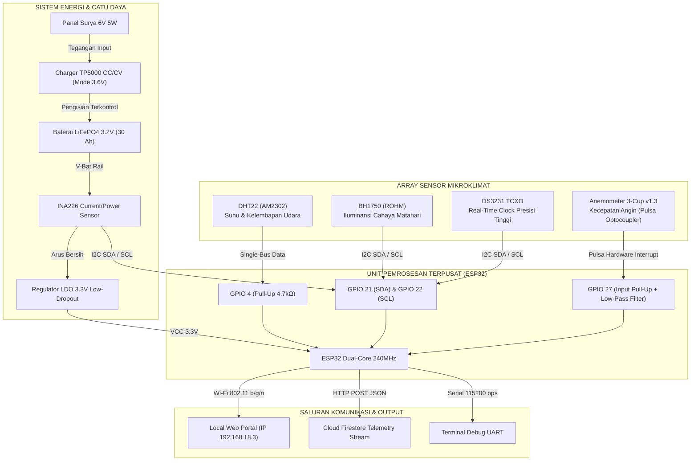

# BAB I: DESAIN SISTEM & ARSITEKTUR PERANGKAT KERAS (HARDWARE)

---

## 1.1 Latar Belakang & Urgensi Pemantauan Mikroklimat In-Situ

Data meteorologi yang dipublikasikan oleh stasiun Badan Meteorologi, Klimatologi, dan Geofisika (BMKG) umumnya diperoleh dari stasiun pengamatan synoptik atau model prakiraan numerik cuaca (*Numerical Weather Prediction / NWP*) berskala meso/makro dengan resolusi spasial berkisar antara $2 \times 2\text{ km}$ hingga $10 \times 10\text{ km}$. Pada kawasan pertanian berbukit atau dataran menengah—seperti wilayah Kabupaten Kuningan, Jawa Barat yang berada pada ketinggian rata-rata 560 meter di atas permukaan laut (mdpl)—kondisi iklim mikro (*microclimate*) di permukaan lahan sangat dipengaruhi oleh topografi lokal, kanopi tanaman, serta tutupan tanah lokal.

Perbedaan signifikan kerap terjadi antara data model BMKG dan kondisi nyata di lahan pertanian (*microclimate discrepancy*):
1. **Fluktuasi Suhu Tajuk (*Canopy Temperature*):** Akumulasi panas radiasi pada permukaan tanaman sering kali lebih tinggi daripada suhu udara ambien stasiun synoptik pada siang hari, dan sebaliknya lebih dingin akibat pelepasan radiasi terestrial di malam hari.
2. **Kelembapan Relatif Permukaan (*Boundary Layer Humidity*):** Evapotranspirasi vegetasi lokal menciptakan lapisan jenuh mikro di sekitar tanaman yang menentukan risiko perkecambahan spora jamur patogen (*blight / powdery mildew*).
3. **Laju Aliran Angin Lokal:** Hambatan mekanis tanaman dan kontur bukit mendistorsi kecepatan angin regional. Padahal, kecepatan angin permukaan acuan 2 meter ($u_2$) merupakan parameter penting dalam penghitungan evaporasi air tanah.

Oleh karena itu, diperlukan **Stasiun Cuaca Mikroklimat Pertanian Mandiri (Agrinex Weather Station)** yang mampu beroperasi tanpa henti secara *autonomous*, mengumpulkan data fisik riil secara *real-time*, mengomparasikan deviasinya terhadap model BMKG, serta menghitung kebutuhan air irigasi harian berbasis persamaan baku agrometeorologi internasional.

---

## 1.2 Topologi & Arsitektur Sistem Perangkat Keras

Sistem dirancang dengan arsitektur terdesentralisasi yang menggabungkan unit komputasi tertanam (*edge microcontroller*), sensor multi-parameter berpresisi tinggi, serta sistem catu daya surya mandiri (*solar-powered energy storage*).

---

## 1.3 Spesifikasi Mikrokontroler ESP32

Unit pemroses utama yang digunakan adalah modul **ESP32-WROOM-32D**. Alasan pemilihan chip ini dibandingkan mikrokontroler tradisional (seperti ATmega328P atau STM32F103) meliputi:
- **Arsitektur Dual-Core:** Ditenagai oleh dua mikroprosesor Xtensa 32-bit LX6 dengan clock hingga 240 MHz. Komputasi dibagi secara independen:
  - *Core 0 (Pro CPU):* Menangani tumpukan protokol jaringan Wi-Fi, HTTP Server REST API, serialisasi JSON, dan streaming telemetri.
  - *Core 1 (App CPU):* Didedikasikan untuk akuisisi sensor berkala, penanganan interupsi berkecepatan tinggi pada anemometer, pemulihan bus I2C, dan kalkulasi fisika.
- **Memori Internal yang Memadai:** Memiliki 520 KB SRAM terintegrasi serta 4 MB Quad-SPI Flash memory yang dialokasikan untuk partisi *firmware* aplikasi dan sistem berkas **LittleFS** (untuk menyimpan tabel konfigurasi alat, log kalibrasi, dan riwayat sementara).
- **Wi-Fi Terintegrasi 802.11 b/g/n:** Mendukung konektivitas nirkabel 2.4 GHz dengan daya pancar hingga $+20.5\text{ dBm}$, memungkinkan komunikasi data jarak jauh di area perkebunan terbuka.

---

## 1.4 Spesifikasi Teknis Sensor & Transduser

| Sensor | Antarmuka Fisik | Parameter Terukur | Rentang Operasional | Akurasi & Resolusi | Peran dalam Agrometeorologi |
| :--- | :--- | :--- | :--- | :--- | :--- |
| **DHT22 (AM2302)** | Single-Bus Digital (GPIO 4) | Suhu Udara ($T$) & Kelembapan Relatif ($RH$) | $-40^\circ\text{C} \text{ s/d } +80^\circ\text{C}$ $0\% \text{ s/d } 100\%\text{ RH}$ | Suhu: $\pm 0.5^\circ\text{C}$ (Res: $0.1^\circ\text{C}$) RH: $\pm 2\%$ (Res: $0.1\%$) | Analisis defisit tekanan uap jenuh air ($VPD$) dan kurva diurnal suhu. |
| **BH1750 (ROHM)** | I2C (Alamat: `0x23` atau `0x5C`) | Intensitas Cahaya / Iluminansi | $1 \text{ s/d } 65.535\text{ Lux}$ (dapat diperluas ke 100k) | $\pm 5\%$, respon spektral menyerupai sensitivitas visual manusia | Dikonversi ke Irradiansi Surya ($W/m^2$) untuk menghitung radiasi netto ($R_n$). |
| **Anemometer v1.3 (Zhafira)** | Hardware Interrupt Digital (GPIO 27) | Frekuensi Pulsa Putaran Mangkuk | $0 \text{ s/d } 180\text{ km/jam}$ ($0 \text{ s/d } 50\text{ m/s}$) | Frekuensi optocoupler terkalibrasi: $1\text{ putaran/detik} \approx 2.4\text{ km/jam}$ | Normalisasi angin ke ketinggian 2 meter ($u_2$) untuk evaporasi Penman-Monteith. |
| **INA226 (Texas Inst.)** | I2C (Alamat: `0x40`) | Tegangan Bus, Arus Pengisian/Beban, Daya | Tegangan: $0 \text{ s/d } 36\text{ V}$ Arus: $\pm 20\text{ A}$ (R-Shunt $0.1\ \Omega$) | 16-bit ADC, galat gain maksimal $0.1\%$, resolusi arus $\approx 1\text{ mA}$ | Pemantauan *State-of-Charge* (SoC) baterai LiFePO4 dan kesehatan panel surya. |
| **DS3231 (Maxim)** | I2C (Alamat: `0x68`) | Waktu Real-Time (Detik, Menit, Jam, Kalender) | $-40^\circ\text{C} \text{ s/d } +85^\circ\text{C}$ | TCXO Akurasi: $\pm 2\text{ ppm}$ ($< 1\text{ menit/tahun}$) | Pemberian stempel waktu (*timestamp*) presisi tinggi saat stasiun kehilangan jaringan NTP. |

---

## 1.5 Sistem Catu Daya & Manajemen Energi LiFePO4

Tantangan utama stasiun cuaca luar ruangan (*outdoor weather station*) adalah keandalan daya listrik jangka panjang di bawah terik matahari ekstrem dan hari berawan berkepanjangan (*cloudy days autonomy*).

### 1.5.1 Pemilihan Kimia Baterai: Mengapa LiFePO4?
Dibandingkan dengan baterai Lithium-Ion (NMC) konvensional:
1. **Ketahanan Suhu Tinggi:** Baterai Lithium Iron Phosphate ($\text{LiFePO}_4$) memiliki batas dekomposisi termal di atas $270^\circ\text{C}$ (jauh lebih aman dibanding Li-Ion yang mengalami *thermal runaway* pada suhu $150^\circ\text{C}$). Hal ini krusial mengingat kotak *enclosure* stasiun di lapangan dapat mencapai suhu internal $> 45^\circ\text{C}$.
2. **Siklus Hidup (*Cycle Life*):** Baterai LiFePO4 mampu bertahan hingga lebih dari 2.000 hingga 3.000 siklus *deep-discharge* (80% DoD) sebelum kapasitasnya turun ke 80%, dibandingkan Li-Ion yang biasanya terdegradasi setelah 500 siklus.
3. **Profil Kurva Pelepasan Tegangan yang Datar (*Flat Discharge Curve*):**
   - Tegangan nominal: $3.2\text{ V}$
   - Tegangan penuh saat pengisian: $3.65\text{ V}$
   - Tegangan saat pelepasan hampir habis: $3.0\text{ V}$
   - Tegangan batas bawah (*cutoff*): $2.5\text{ V}$
   Tegangan keluaran berada stabil pada rentang $3.15\text{ V} - 3.25\text{ V}$ untuk 85% kapasitasnya, meminimalkan disipasi daya pada regulator tegangan mikrokontroler.

### 1.5.2 Modul Pengisian TP5000 CC/CV
Modul pengisian menggunakan chip **TP5000** bertipe *switch-mode buck charger* berefisiensi tinggi ($> 90\%$). Pin konfigurasi solder diatur secara khusus pada posisi LiFePO4 ($3.6\text{ V}$ batas tegangan pengisian maksimum) untuk mencegah *overcharge* yang berbahaya.

### 1.5.3 Analisis Neraca Energi (*Energy Budget Calculation*)
- Konsumsi daya rata-rata ESP32 dengan sensor aktif: $I_{\text{avg}} \approx 85\text{ mA}$ pada $3.3\text{ V}$ ($P_{\text{avg}} \approx 0.28\text{ Watt}$).
- Konsumsi energi harian ($24\text{ jam}$):
  $$E_{\text{day}} = 0.28\text{ W} \times 24\text{ jam} = 6.72\text{ Wh} \quad (2.1\text{ Ah pada } 3.2\text{ V})$$
- Dengan kapasitas baterai terpasang sebesar **30 Ah** ($96\text{ Wh}$), stasiun cuaca memiliki ketahanan operasional otonom (*autonomy reserve*) tanpa sinar matahari selama:
  $$\text{Ketahanan} = \frac{30\text{ Ah}}{2.1\text{ Ah/hari}} \approx 14.2\text{ Hari}$$
- Panel surya $6\text{ V } 5\text{ W}$ pada rata-rata penyinaran efektif 4 jam menghasilkan:
  $$E_{\text{harvest}} = 5\text{ W} \times 4\text{ jam} \times 0.75 \text{ (efisiensi sistem)} = 15\text{ Wh/hari}$$
  Energi panen harian ($15\text{ Wh}$) lebih dari dua kali lipat konsumsi harian alat ($6.72\text{ Wh}$), menjamin baterai selalu terisi penuh dalam siklus operasional normal.

---

## 1.6 Skematik Perkabelan, Integritas Sinyal & Proteksi EMI

Pemasangan sensor di area perkebunan rentan terhadap induksi elektromagnetik dari petir tidak langsung, kabel transmisi, dan gangguan elektrostatik:

1. **Pull-Up Resistor Bus I2C:**
   Jalur SDA (GPIO 21) dan SCL (GPIO 22) menggunakan resistor pull-up eksternal sebesar $4.7\text{ k}\Omega$ ke rel $3.3\text{ V}$. Pemilihan nilai ini menyeimbangkan antara waktu transisi naik sinyal (*rise time*) dan konsumsi arus statis, memastikan frekuensi transmisi bus $100\text{ kHz}$ berjalan stabil tanpa *ringing*.
2. **Kompensasi Kabel Panjang Anemometer:**
   Kabel anemometer yang membentang dari puncak tiang ($1.5 - 2\text{ meter}$) ke dalam kotak instrumen bertindak sebagai antena penerima noise frekuensi tinggi. Diimplementasikan:
   - Resistor pull-up kuat eksternal $3.3\text{ k}\Omega$ menuju $3.3\text{ V}$.
   - Kapasitor keramik decoupler $100\text{ nF}$ paralel terhadap ground untuk meredam lonjakan tegangan transien (*hardware low-pass filter* dengan frekuensi cutoff $\approx 480\text{ Hz}$).
   - Isolasi optocoupler pada sensor fisik sebelum sinyal memasuki pin interupsi GPIO 27 ESP32.
3. **Decoupling Catu Daya Sensor:**
   Setiap modul sensor (DHT22, BH1750, INA226, DS3231) dilengkapi dengan kapasitor bypass $100\text{ nF}$ multi-layer ceramic capacitor (MLCC) yang ditempatkan sedekat mungkin dengan pin VCC modul untuk meminimalkan *voltage dip* saat sensor melakukan konversi pengukuran.
