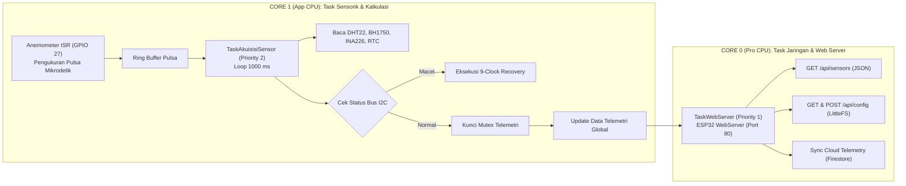

# BAB II: ARSITEKTUR FIRMWARE & EMBEDDED REAL-TIME OPERATING SYSTEM

---

## 2.1 Paradigma Pengembangan Firmware & PlatformIO

*Firmware* stasiun cuaca Agrinex dikembangkan dengan standar **C++17** menggunakan ekosistem **PlatformIO Core**. Pemilihan PlatformIO memberikan keunggulan manajemen dependensi pustaka (*library dependency tracking*) yang deterministik, konfigurasi partisi memori kustom melalui berkas `platformio.ini`, serta integrasi *build toolchain* GCC Xtensa 32-bit yang optimal.

### Konfigurasi Lingkungan (`platformio.ini`)
```ini
[env:esp32dev]
platform = espressif32
board = esp32dev
framework = arduino
monitor_speed = 115200
board_build.filesystem = littlefs
board_build.partitions = default_4MB.csv
build_flags = 
    -std=gnu++17
    -D CORE_DEBUG_LEVEL=0
lib_deps = 
    bblanchon/ArduinoJson @ ^6.21.4
    adafruit/DHT sensor library @ ^1.4.6
    adafruit/Adafruit Unified Sensor @ ^1.1.14
    claws/BH1750 @ ^1.3.0
    adafruit/Adafruit INA226 @ ^1.0.1
    adafruit/RTClib @ ^2.1.3
```

---

## 2.2 Arsitektur Multi-Tasking & FreeRTOS Dual-Core Scheduling

Untuk memastikan bahwa pembacaan sensor berkecepatan tinggi tidak terganggu oleh latensi transmisi jaringan Wi-Fi, *firmware* mengimplementasikan penjadwalan multithreading berbasis **FreeRTOS**.



### Pemisahan Tanggung Jawab Core:
1. **Core 1 (App CPU):**
   - **Prioritas Tinggi (Priority 2):** Eksekusi siklik pembacaan sensor setiap 1000 ms.
   - Melayani rutinitas penanganan interupsi (*Interrupt Service Routine / ISR*) perangkat keras untuk anemometer secara langsung dari RAM internal (*IRAM_ATTR*).
   - Memastikan tidak ada latensi atau *jitter* waktu saat menghitung laju putaran anemometer.
2. **Core 0 (Pro CPU):**
   - **Prioritas Standar (Priority 1):** Mengelola koneksi jaringan Wi-Fi, tumpukan TCP/IP, dan permintaan HTTP masuk pada REST API Web Server.
   - Menghindari pembekuan CPU (*watchdog trigger*) saat terjadi *timeout* jaringan internet atau koneksi Wi-Fi yang melemah.

---

## 2.3 State Machine Pemulihan Bus I2C (*I2C Bus Recovery Machine*)

### 2.3.1 Masalah Pembekuan Bus (*I2C Bus Lockup*)
Pada implementasi sensor lapangan, modul I2C (BH1750, DS3231, INA226) yang terhubung pada jalur SDA/SCL yang sama rentan mengalami kondisi *lockup*. Kondisi ini terjadi ketika mikroprosesor mengalami *reset* atau *brownout* saat sensor *slave* sedang mengirimkan bit data bernilai `0` (SDA ditarik ke level *LOW*). Akibatnya, jalur SDA tertahan *LOW* tanpa henti, dan pustaka I2C perangkat keras ESP32 akan membeku (*hang*) saat mencoba melakukan inisialisasi `Wire.begin()`.

### 2.3.2 Algoritma Pemulihan 9-Clock Pulses Bit-Banging
Untuk menanggulangi masalah ini tanpa memerlukan intervensi tombol reset manual, *firmware* menyematkan algoritma pemulihan otomatis sebelum bus I2C diinisialisasi:

```cpp
bool recoverI2CBus(int sdaPin, int sclPin) {
    pinMode(sdaPin, INPUT_PULLUP);
    pinMode(sclPin, INPUT_PULLUP);
    delayMicroseconds(10);

    // Cek apakah SDA macet di level LOW
    if (digitalRead(sdaPin) == LOW) {
        Serial.println(F("[I2C RECOVERY] Terdeteksi Bus Lockup: SDA tertahan LOW!"));
        
        // Alihkan SCL ke mode OUTPUT untuk melakukan bit-banging 9 clock pulses
        pinMode(sclPin, OUTPUT);
        for (int i = 0; i < 9; i++) {
            digitalWrite(sclPin, LOW);
            delayMicroseconds(10);
            digitalWrite(sclPin, HIGH);
            delayMicroseconds(10);
            
            // Jika slave telah melepaskan SDA kembali ke HIGH, hentikan pulsa
            if (digitalRead(sdaPin) == HIGH) {
                Serial.printf(F("[I2C RECOVERY] Slave melepaskan SDA pada clock ke-%d\n"), i + 1);
                break;
            }
        }
        
        // Bangkitkan kondisi I2C STOP secara manual: SCL HIGH lalu SDA HIGH
        pinMode(sdaPin, OUTPUT);
        digitalWrite(sdaPin, LOW);
        delayMicroseconds(10);
        digitalWrite(sclPin, HIGH);
        delayMicroseconds(10);
        digitalWrite(sdaPin, HIGH);
        delayMicroseconds(10);
    }
    
    // Kembalikan ke mode Wire I2C standar
    Wire.begin(sdaPin, sclPin);
    Wire.setClock(100000); // 100 kHz standard mode
    return (digitalRead(sdaPin) == HIGH && digitalRead(sclPin) == HIGH);
}
```

---

## 2.4 Algoritma Debounce & Microsecond Pulse-Width Filter Anemometer

### 2.4.1 Analisis Masalah Derau Transien & Kontak Mengambang
Anemometer tipe mangkok berputar (*cup anemometer*) v1.3 menggunakan piringan celah optik (*optical chopper disk*) atau sensor Hall magnetik yang terhubung ke pin interupsi GPIO 27. Saat kondisi hening (*calm / no wind*), mangkok anemometer sering kali berhenti tepat di batas ambang sensor (*optical edge transition*). Hembusan angin mikro yang sangat kecil dapat menyebabkan sinyal berosilasi bolak-balik puluhan kali dalam hitungan milidetik (*switch chatter*). Ditambah lagi dengan kabel sensor sepanjang 2 meter yang menangkap derau induksi elektromagnetik (EMI), pin interupsi dapat memicu ribuan interupsi palsu yang mengakibatkan pembacaan angin palsu (*abnormal wind spike* hingga ratusan km/jam).

### 2.4.2 Implementasi Filter Diskriminasi Lebar Pulsa Mikrodetik
Untuk mengeliminasi sinyal palsu secara presisi tanpa kehilangan pulsa rotasi nyata, *firmware* menerapkan filter berbasis waktu di tingkat interupsi (*hardware ISR*) dan *noise gate* frekuensi di tingkat perangkat lunak:

```cpp
volatile uint32_t g_validPulses = 0;
volatile uint32_t g_rejectedGlitches = 0;
volatile uint32_t g_lastInterruptUs = 0;
volatile uint32_t g_lastLowWidthUs = 0;

// ISR dieksekusi dari IRAM untuk kecepatan respons instan
void IRAM_ATTR anemometerISR() {
    uint32_t now = micros();
    uint32_t delta = now - g_lastInterruptUs;
    
    // 1. Filter Interval Minimum (Dead-Time Filter):
    // Kecepatan angin maksimum fisik 180 km/jam ekuivalen dengan frekuensi ~75 Hz (interval ~13.3 ms).
    // Pulsa dengan interval < 10 ms (10.000 µs) dipastikan merupakan pantulan derau (glitch).
    if (delta < 10000) {
        g_rejectedGlitches++;
        return;
    }
    
    // 2. Filter Lebar Pulsa Rendah (Pulse Width Discrimination):
    // Mengukur apakah transisi LOW bertahan cukup lama (> 500 µs) untuk membuktikan rotasi mekanis
    uint32_t lowStart = micros();
    while (digitalRead(ANEMOMETER_PIN) == LOW && (micros() - lowStart) < 2000) {
        // Tunggu transisi atau batas maksimum
    }
    uint32_t pulseWidth = micros() - lowStart;
    g_lastLowWidthUs = pulseWidth;
    
    if (pulseWidth < 500) { // Durasi transisi terlalu pendek (< 500 µs), tolak derau transien
        g_rejectedGlitches++;
        return;
    }
    
    g_validPulses++;
    g_lastInterruptUs = now;
}
```

### 2.4.3 Konversi Pulsa ke Kecepatan Angin
Setiap interval pengukuran $1\text{ detik}$, jumlah pulsa valid dihitung dan dikalibrasi:
$$V_{\text{km/jam}} = \left( \frac{\text{Pulsa Valid}}{\Delta t} \right) \times K_{\text{faktor}}$$
Dengan nilai konstanta $K_{\text{faktor}} = 2.4\text{ km/jam per Hz}$. Jika pulsa per detik berada di bawah ambang *Noise Gate* yang ditetapkan pengguna (contoh: $\le 2\text{ Hz}$), kecepatan angin otomatis dinolkan ($0.0\text{ km/jam}$).

---

## 2.5 Penyimpanan Konfigurasi Non-Volatile LittleFS

Konfigurasi stasiun tidak disimpan pada memori EEPROM terbatas, melainkan pada partisi berkas **LittleFS**.

### Keunggulan LittleFS:
1. **Ketahanan Kegagalan Daya (*Power-Loss Resilience*):** Menjamin integritas sistem berkas meskipun daya listrik mati mendadak di tengah proses penulisan konfigurasi.
2. **Wear Leveling Dinamis:** Menyebarkan siklus penulisan secara merata di seluruh sektor flash memory 4 MB, memperpanjang usia pakai chip ESP32 hingga puluhan tahun.
3. **Struktur Data JSON Terbuka:** Konfigurasi disimpan dalam berkas `/config.json` yang dapat dibaca, diedit, diunduh, dan dipulihkan langsung melalui web browser:

```json
{
  "station_name": "Kelurahan Kuningan, Kecamatan Kuningan",
  "elevation_m": 560,
  "latitude": -6.9788,
  "longitude": 108.4842,
  "sensor_interval_sec": 15,
  "cal_temp_offset": -4.8,
  "cal_hum_offset": 14.0,
  "cal_wind_noise_gate": 18
}
```

---

## 2.6 Arsitektur Embedded Web Server & REST API Portal

ESP32 menjalankan server web HTTP asinkron mandiri pada port `80` yang menyediakan antarmuka pemrograman aplikasi (REST API) lengkap:

| Metode HTTP | Jalur URL Endpoint | Fungsi & Deskripsi | Format Respon |
| :---: | :--- | :--- | :---: |
| `GET` | `/api/sensors` | Mengembalikan nilai pembacaan seluruh sensor terkini, waktu RTC, status baterai, dan diagnostik bus secara instan (latensi $< 50\text{ ms}$). | JSON |
| `GET` | `/api/config` | Mengambil seluruh konfigurasi stasiun yang tersimpan di berkas LittleFS. | JSON |
| `POST` | `/api/config` | Memperbarui parameter kalibrasi, nama stasiun, dan pinout, lalu menyimpannya secara permanen ke LittleFS. | JSON Status |
| `OPTIONS` | `/api/config` | Penanganan *CORS Preflight* otomatis untuk mengizinkan permintaan peramban lintas domain dari web app luar (Vercel/Cloudflare). | HTTP 204 |
| `GET` | `/api/status` | Menampilkan uptime sistem, sisa memori Free Heap, status modul I2C, dan jumlah *rejected glitches* anemometer. | JSON |
| `POST` | `/api/restart` | Melakukan *software reboot* mikrokontroler secara aman. | JSON Status |

### Penanganan Keamanan CORS (Cross-Origin Resource Sharing)
Untuk mengizinkan aplikasi web modern (seperti yang di-*hosting* di Vercel atau tunnel Cloudflare) mengakses REST API ESP32 tanpa diblokir oleh kebijakan keamanan peramban (*Same-Origin Policy*), setiap respons web portal menyematkan *header* standar:
```cpp
void sendCorsHeaders() {
    webServer.sendHeader("Access-Control-Allow-Origin", "*");
    webServer.sendHeader("Access-Control-Allow-Methods", "GET, POST, OPTIONS");
    webServer.sendHeader("Access-Control-Allow-Headers", "Content-Type, Authorization");
}
```
Metode `HTTP_OPTIONS` ditangani secara eksplisit pada seluruh endpoint untuk menyetujui *preflight handshake* dari peramban sebelum permintaan `POST` dijalankan.
