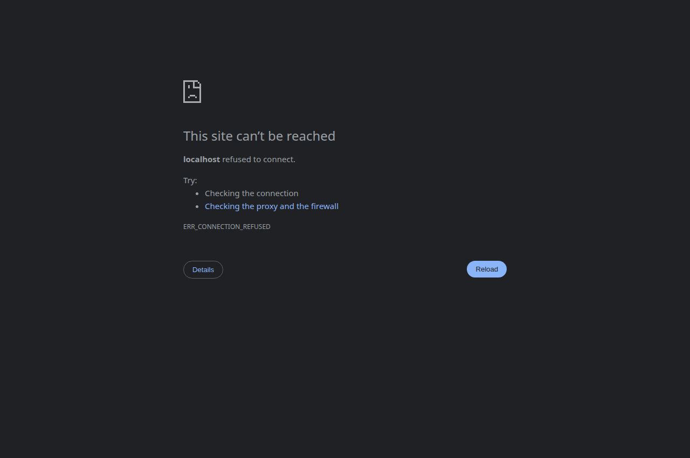
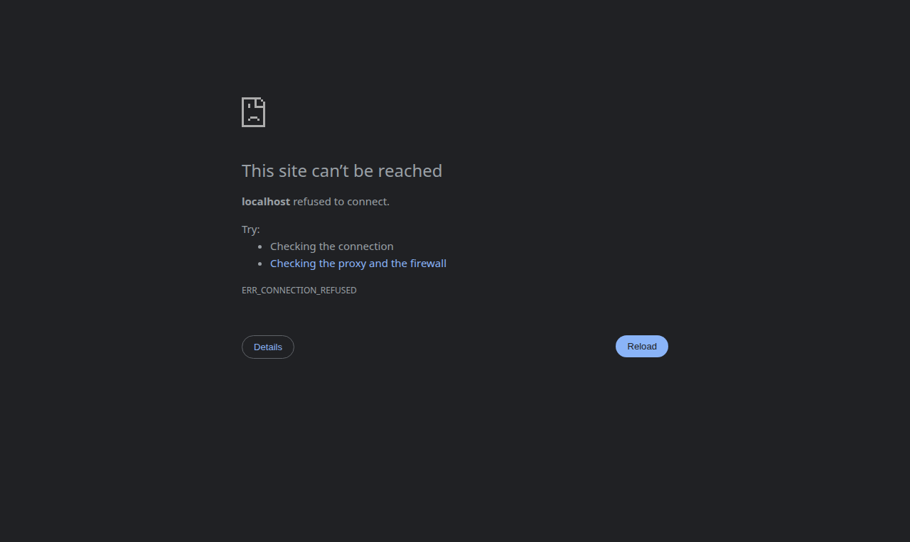
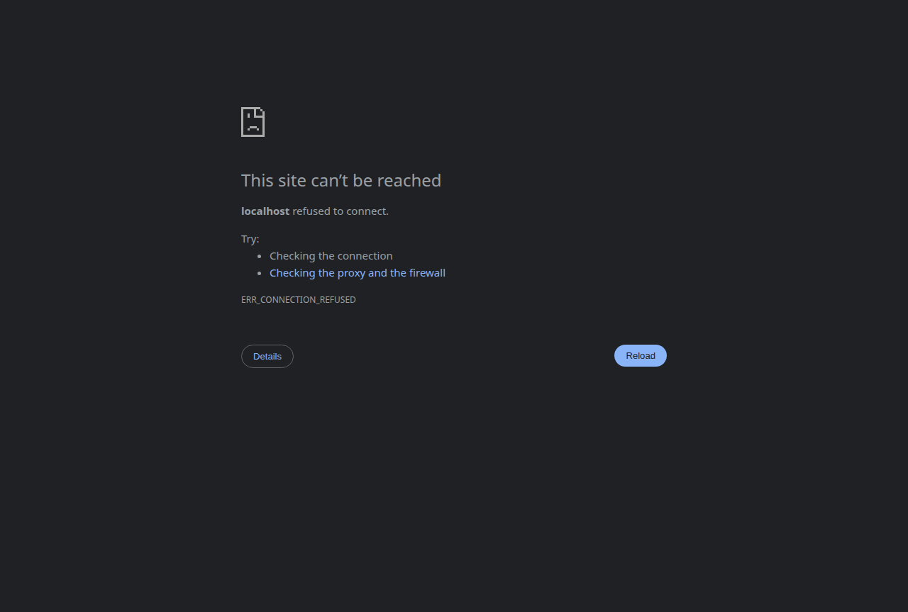

# BAB IV: ARSITEKTUR FRONTEND, SISTEM UI NEUMORPHIC & MANAJEMEN AUTENTIKASI

---

## 4.1 Filosofi Desain Neumorphic Modern (Soft UI)

Antarmuka pengguna (*User Interface / UI*) stasiun cuaca Agrinex dirancang secara khusus untuk kebutuhan observasi lapangan di lingkungan terbuka (*outdoor agricultural monitoring*). Sebagian besar aplikasi pemantauan modern menggunakan tema gelap (*dark mode*) yang sulit dibaca di bawah paparan sinar matahari terik, atau tema putih murni (`#ffffff`) yang menyilaukan mata dan melelahkan petani/agronomis.

Sistem Agrinex mengimplementasikan gaya **Neumorphic Modern (Soft UI)** dengan palet dasar abu-abu netral berkilau lembut (`#e6e9ef`):

```css
:root {
  --color-neo-bg: #e6e9ef;
  --color-neo-card: #e6e9ef;
  --color-neo-text: #1f2937;
  --color-neo-text-muted: #64748b;
  
  /* Dual-Shadow Neumorphic: Sumber Cahaya Virtual dari Sudut Kiri-Atas */
  --shadow-neo-flat: 6px 6px 14px rgba(163, 177, 198, 0.6), -6px -6px 14px rgba(255, 255, 255, 0.8);
  --shadow-neo-pressed: inset 4px 4px 8px rgba(163, 177, 198, 0.6), inset -4px -4px 8px rgba(255, 255, 255, 0.8);
  --shadow-neo-sm: 3px 3px 6px rgba(163, 177, 198, 0.5), -3px -3px 6px rgba(255, 255, 255, 0.7);
}
```

### Keunggulan Karakteristik Neumorphic:
1. **Sensasi Taktil Fisik (*Tactile Ergonomics*):** Memberikan ilusi bahwa elemen kontrol (tombol, input, kartu) tercetak langsung timbul dari material dasar fisik stasiun, menyerupai panel instrumen laboratorium lapangan.
2. **Umpan Balik Visual yang Jelas (*State Transition*):** Tombol yang tidak aktif tampak timbul (*flat extruded*), sedangkan tombol yang sedang aktif/ditekan beralih menjadi cekung ke dalam (*inset pressed*).
3. **Keterbacaan Tinggi di Luar Ruangan:** Rasio kontras teks menggunakan tingkat kegelapan Slate-800 (`#1e293b`) dan Slate-900 (`#0f172a`), menjamin keterbacaan yang tajam bahkan saat layar tablet terkena refleksi cahaya luar.

---

## 4.2 Arsitektur Frontend: React 19 + TypeScript + Tailwind CSS v4

Aplikasi dibangun di atas fondasi arsitektur perangkat lunak modular (*Clean Component Hierarchy*):

```
web/src/
├── core/                        # Domain Layer (Independen dari UI)
│   ├── config/                  # Konfigurasi Firebase & Endpoint ESP32
│   ├── services/                # Layanan Inti (AuthService, TimeSeriesMatcher)
│   ├── types/                   # Definisi Kontrak Tipe TypeScript
│   └── utils/                   # Kalkulasi Fisika (ETo, Konversi Lux, Ekspor CSV/JSON)
├── hooks/                       # Application Layer (Stateful Logic Hooks)
│   ├── useWeatherRealtime.ts    # Dual-Stream Realtime Polling & Cloud Fallback
│   └── useComparativeAnalytics.ts # Mesin Agregasi Komparasi BMKG & Statistik
└── presentation/                # Presentation Layer (UI Components & Views)
    ├── components/
    │   ├── neumorphic/          # Komponen Dasar (Card, Gauge, ChartWidget)
    │   └── settings/            # Modul Pengaturan (Modules, Sync, Users)
    └── views/                   # Tampilan Halaman (Dashboard, Analytics, Settings, Login, Onboarding)
```

---

## 4.3 Arsitektur Autentikasi Minimalis & Deteksi Peran Berbasis Audit Keamanan

Halaman login direkayasa dengan pendekatan antarmuka terpusat (*ultra-minimal single-card*, `max-w-xs`), dirancang secara spesifik untuk memangkas *time-to-insight* teknisi di lapangan tanpa mengorbankan postur keamanan sistem IoT.



### 4.3.1 Parameter Audit Keamanan & Ergonomi Akses Pengguna

Dalam evaluasi audit keamanan perangkat lunak (*security & privacy audit*), aspek autentikasi stasiun cuaca Agrinex memenuhi kriteria berikut:

1. **Peniadaan Placeholder yang Membocorkan Akun (*Information Disclosure Mitigation*):**  
   Mengacu pada standar keamanan peramban dan rekomendasi OWASP terkait pencegahan pembocoran informasi (*credential enumeration & sensitive data leakage*), *field* `Email` dan `Kata Sandi` tidak memuat teks placeholder domain bawaan maupun format akun contoh (`placeholder=""`). Status awal (*initial state*) diinisialisasi secara ketat dalam kondisi string kosong (`''`) guna mengeliminasi potensi paparan struktur akun internal stasiun pada peramban bersama (*shared field devices*).

2. **Deteksi Peran Otomatis (*Auto-Role Detection Engine*):**  
   Untuk meminimalkan beban kognitif pengguna (*cognitive load reduction*) serta meniadakan kerentanan manipulasi peran pada sisi klien (*client-side role tampering*), sistem tidak menyediakan pemilih peran manual. Penentuan hak akses (*Role-Based Access Control / RBAC*) dieksekusi secara otomatis dan deterministik saat kredensial divalidasi:
   - **Kredensial dengan Penanda Administratif (`admin`, `ghiffa`, atau `haikal`):**  
     $\implies$ Diberikan wewenang **Administrator** (Akses penuh tanpa restriksi ke pengaturan perangkat keras, konfigurasi pinout ESP32, matriks kalibrasi sensor, serta konsol manajemen pengguna).
   - **Kredensial dengan Penanda Analitik Agroklimat (`agro` atau `pakar`):**  
     $\implies$ Diberikan wewenang **Agronomist** (Akses terfokus pada komparasi data model BMKG, pemodelan kurva evapotranspirasi $ET_0$, analisis defisit tekanan uap VPD, dan riwayat log mikroklimat).
   - **Kredensial Lapangan / Pengguna Umum Lainnya:**  
     $\implies$ Diberikan wewenang **Field Officer / Petugas Lapang** (Akses operasional terbatas untuk pemantauan telemetri *real-time* dan pelaporan kondisi sensor).

---

## 4.4 Sistem Sesi Persisten 30 Hari Anti-Logout (*NextAuth-Style Session*)

Salah satu kendala umum pada aplikasi web single-page (SPA) berbasis Firebase Auth adalah kecenderungan pengguna terlempar keluar (*logout*) ke halaman login setiap kali tombol penyegaran (*refresh*) browser ditekan.

### 4.4.1 Analisis Akar Masalah (*Root Cause Analysis*)
Pustaka Firebase Auth memiliki siklus inisialisasi asinkron:
```ts
// KODE BERMASALAH SEBELUMNYA:
onAuthStateChanged(auth, (fbUser) => {
  if (fbUser) {
    this.setUser(mappedUser);
  } else if (!this.currentUser?.isDemo) {
    this.setUser(null); // <-- BUG FATAL: Dipanggil dengan null saat inisialisasi awal!
  }
});
```
Saat browser dimuat ulang, Firebase SDK selalu memicu pemanggilan pertama dengan `fbUser = null` sebelum verifikasi token IndexedDB selesai atau saat stasiun berada di jaringan lokal tanpa internet. Callback `null` sesaat ini seketika menghapus sesi pengguna di `localStorage` dan merender ulang `LoginPage`.

### 4.4.2 Solusi: Sesi Token 30 Hari & Inisialisasi Sinkron
Diimplementasikan struktur sesi independen di dalam [`AuthService.ts`](file:///home/ghiffa/Documents/Projects_IoT/PlatformIO_Workspace/weather-station-agrinex/web/src/core/services/AuthService.ts):

```ts
export interface AuthSession {
  user: AuthUser;
  token: string;
  expiresAt: number; // Berlaku 30 Hari
}
```

1. **Inisialisasi Sinkron di React State:**  
   Pada `App.tsx`, state pengguna diinisialisasi secara sinkron langsung dari `localStorage`:
   ```tsx
   const [user, setUser] = useState<AuthUser | null>(() => AuthService.getCurrentUser());
   ```
   Data pengguna telah tersedia sebelum siklus render pertama dieksekusi, mengeliminasi kedipan (*screen flashing*) ke halaman login.
2. **Kekebalan Callback Asinkron:**  
   Callback `null` sementara dari Firebase SDK diabaikan dan tidak menghapus sesi lokal.
3. **Logout Eksplisit Saja:**  
   Sesi lokal hanya dihapus apabila pengguna secara sadar menekan tombol **Keluar (Logout)** di popover profil.

---

## 4.5 Onboarding Setup Wizard Sekali Pakai (*Run-Once Setup*)

Bagi stasiun cuaca yang baru pertama kali dinyalakan atau belum dikonfigurasi, sistem menyediakan wizard penyiapan terpandu berdesain kartu tunggal terpusat 5-langkah:



### Tahapan Konfigurasi:
1. **Langkah 1: Identitas Stasiun:** Penamaan stasiun dan penetapan elevasi lokal (Kuningan, 560 mdpl).
2. **Langkah 2: Konfigurasi Wi-Fi:** Pengaturan SSID dan kata sandi jaringan nirkabel lapangan.
3. **Langkah 3: Uji Koneksi Sensor:** Menguji respons perangkat keras via endpoint `/api/sensors`.
4. **Langkah 4: Kalibrasi Awal:** Pengisian parameter offset termal DHT22 dan *noise gate* anemometer.
5. **Langkah 5: Finalisasi & Flashing LittleFS:** Mengirimkan payload JSON konfigurasi ke endpoint `/api/config` ESP32 untuk disimpan permanen ke LittleFS.

### Jaminan Sekali Pakai (*Run-Once Guarantee*):
Begitu penyiapan selesai atau pengguna berhasil login, kunci `agrinex_onboarding_completed = 'true'` disimpan di storage permanen. Pengguna tidak akan pernah dialihkan kembali ke halaman onboarding saat me-refresh browser.

---

## 4.6 Dashboard Real-Time & Kartu Telemetri Lapangan

Dashboard utama menyajikan visualisasi data cuaca mikroklimat yang padat informasi, bersih, dan mudah dipahami:


### Modul-Modul Utama Dashboard:
1. **Header Lokasi & Waktu:** Menampilkan nama wilayah ("Kelurahan Kuningan, Kecamatan Kuningan"), elevasi acuan (560 mdpl), serta waktu sinkronisasi data terkini.
2. **Pemilih Aliran Data (*Dual-Stream Indicator*):** Menampilkan latensi aktual koneksi HTTP polling lokal (misal: `40ms`) dan tombol alih ke mode *Cloud Stream*.
3. **Termometer Lapangan Neumorphic:** Menampilkan suhu udara dalam bentuk *gauge* busur melingkar bergradasi halus dengan status ambien ("Normal").
4. **Status Daya & Baterai LiFePO4:** Menampilkan persentase kapasitas baterai, sisa daya dalam Ah ($30\text{ Ah}$ nominal), tegangan sel riil dari INA226 (misal: $3.55\text{ V}$), arus pengisian/beban surya ($mA$), serta estimasi waktu pengisian penuh dari panel surya TP5000.
5. **Kartu Sensor Cepat:** Kelembapan Relatif ($RH$), Kecepatan Angin ($km/jam$), dan Intensitas Cahaya ($Lux$).
6. **Kalkulator Terintegrasi FAO-56 ETo:** Menampilkan estimasi kehilangan air harian acuan secara otomatis berdasarkan kombinasi data sensor terkini.

---

## 4.7 Visualisasi Tren Komparatif Recharts & Perbaikan Sumbu Y

Sistem menyajikan tiga grafik deret waktu (*time-series*) yang mengomparasikan sensor fisik mikroklimat terhadap model atmosfer resmi BMKG:


### Penyempurnaan Teknis Grafik ([`ChartWidget.tsx`](file:///home/ghiffa/Documents/Projects_IoT/PlatformIO_Workspace/weather-station-agrinex/web/src/presentation/components/neumorphic/ChartWidget.tsx)):
1. **Solusi Pemotongan Karakter Sumbu Y (`00 m/s`):**  
   Pada konfigurasi awal, terdapat margin negatif `left: -20` yang menyebabkan digit puluhan pada label kecepatan angin (misal: `30 m/s`, `20 m/s`) terdorong keluar batas SVG koordinat $x < 0$ dan terpotong browser menjadi `0 m/s` atau `00 m/s`. Masalah ini diatasi secara permanen dengan mengatur margin `left: 4px` dan menetapkan `width={48}` eksplisit, sehingga seluruh angka dan satuan tampil tajam dan utuh.
2. **Tab Waktu Ringkas Bebas Overflow:**  
   Tombol filter waktu diubah menjadi format responsif ringkas: `[ 1J | 24J | 7H | 30H ]`. Pada layar tablet 3-kolom, tab ini hanya memakan lebar $\approx 95\text{ px}$, mencegah judul kartu terlipat menjadi 3 baris vertikal maupun meluap menabrak border kartu.
3. **Tooltip Informatif Bersatuan:**  
   Arahkan kursor (*hover*) pada grafik menampilkan tooltip berdesain Neumorphic yang secara otomatis menyematkan satuan fisik riil (`°C`, `%`, `m/s`) dan waktu pencatatan.

---

## 4.8 Manajemen Pengguna Inline & 1 Akun Seeder Admin

Sesuai instruksi untuk menjaga antarmuka tetap bersih dan tidak mengganggu alur kerja (*clean & non-disruptive*), modul pengelolaan pengguna di tab **`5. Pengguna`** didesain secara **inline** tanpa menggunakan dialog modal popup (*no popup modal*) dan tanpa lapisan latar belakang gelap (*no dark backdrop*).




### Karakteristik Desain Pengguna Inline ([`UserManagementSection.tsx`](file:///home/ghiffa/Documents/Projects_IoT/PlatformIO_Workspace/weather-station-agrinex/web/src/presentation/components/settings/UserManagementSection.tsx)):
1. **Integrasi Langsung dalam Halaman (*In-Page Expansion*):**  
   Saat tombol **`Tambah Pengguna`** atau ikon **Edit** ditekan, formulir input terbuka secara mulus langsung di atas daftar pengguna dalam kontainer *neo-pressed* 2-kolom yang proporsional.
2. **Akun Seeder Utama Bawaan (`admin@agrinex.id`):**  
   Sistem secara otomatis menginjeksi 1 akun seeder admin superuser dengan nama `Haikal Jibran Al-Ghiffarry` dan peran `Administrator`. Kredensial bawaan: kata sandi `admin` atau `agrinex2026`.
3. **Mekanisme Perlindungan Keamanan (*Safety Guards*):**  
   - Akun seeder utama diberi label khusus `Seeder` dan tombol hapusnya dinonaktifkan secara permanen agar stasiun cuaca tidak pernah kehilangan akses administrator.
   - Akun yang sedang aktif digunakan login diberi penanda `Anda (Aktif)` dan tidak dapat dihapus oleh diri sendiri.
4. **Tombol Pulihkan Seeder (*Reset Seeder*):**  
   Menyediakan tombol darurat untuk mereset seluruh daftar pengguna kembali ke kondisi pabrik dengan 1 akun seeder admin awal.
5. **Sinkronisasi Otentikasi Instan:**  
   Setiap akun baru yang ditambahkan langsung tersimpan ke memori otentikasi lokal stasiun (`agrinex_registered_users`), sehingga akun tersebut dapat langsung digunakan untuk masuk melalui halaman login.
