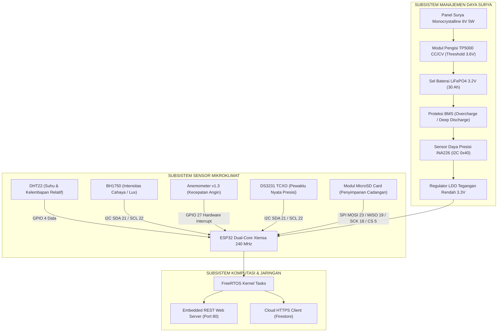

# DOKUMENTASI LENGKAP PENELITIAN SISTEM STASIUN CUACA MIKROKLIMAT PERTANIAN BERBASIS ESP32 DAN ESTIMASI EVAPOTRANSPIRASI (AGRINEX WEATHER STATION)

---

## 1. Identitas Peneliti dan Lembaga Akademik

Tabel 1.1 menyajikan profil peneliti dan atribut kelembagaan dalam riset stasiun cuaca agrometeorologi ini:

| Parameter Atribut | Rincian Keterangan Akademik |
| :--- | :--- |
| **Nama Peneliti** | Haikal Jibran A. (Haikal Jibran Al-Ghiffarry) |
| **Nomor Induk Mahasiswa (NIM)** | 20240810005 |
| **Kelas** | TINFC-2024-01 |
| **Program Studi** | S1 Teknik Informatika |
| **Fakultas** | Fakultas Ilmu Komputer |
| **Perguruan Tinggi** | Universitas Kuningan |
| **Tahun Akademik** | 2026 |
| **Topik Kajian Riset** | Sistem Tertanam (*Embedded System*), *Internet of Things* (IoT), Agrometeorologi Terapan, dan Arsitektur Komputasi Web Multiplatform |
| **Lokasi Pengujian Lapangan** | Stasiun Riset Agrinex, Kabupaten Kuningan, Jawa Barat (Koordinat: 6°53'42" LS, 108°29'18" BT, Elevasi: 560 mdpl) |
| **Repositori Kode Sumber** | https://github.com/ghiffa08/weather-station-agrinex |
| **Aplikasi Web Produksi (Vercel)** | https://web-vert-tau-abafcrdbgk.vercel.app |

---

## 2. Pendahuluan dan Latar Belakang Riset

### 2.1 Latar Belakang Masalah
Kebutuhan data cuaca yang presisi pada sektor pertanian presisi (*precision agriculture*) menjadi faktor krusial dalam menentukan keberhasilan budidaya tanaman pangan dan hortikultura. Saat ini, para praktisi dan pengelola perkebunan umumnya bergantung pada data prakiraan cuaca yang dipublikasikan oleh Badan Meteorologi, Klimatologi, dan Geofisika (BMKG). Data BMKG diperoleh melalui stasiun pengamatan sinoptik berskala meso/makro atau model prakiraan numerik cuaca (*Numerical Weather Prediction / NWP*) yang memiliki resolusi spasial berkisar antara 2 km x 2 km hingga 10 km x 10 km.

Pada kawasan pertanian berbukit atau dataran menengah seperti wilayah Kabupaten Kuningan, Jawa Barat yang berada pada ketinggian rata-rata 560 meter di atas permukaan laut (mdpl), kondisi iklim mikro (*microclimate*) di permukaan lahan sangat dipengaruhi oleh kontur topografi lokal, kanopi tajuk tanaman, serta tutupan tanah setempat. Fenomena perbedaan iklim mikro (*microclimate discrepancy*) ini menyebabkan data prakiraan makro BMKG kerap kali tidak merefleksikan suhu tajuk aktual, kelembapan relatif mikrokosmos tanaman, intensitas radiasi fotosintesis, serta laju evapotranspirasi riil di lapangan.

Ketiadaan instrumen pemantau cuaca mikro yang terjangkau, mandiri energi, dan berpresisi tinggi memicu permasalahan lanjutan:
1. Penentuan jadwal dan volume irigasi air tanaman yang tidak tepat, berpotensi menimbulkan pemborosan sumber daya air atau sebaliknya memicu stres kekeringan pada tanaman.
2. Ketidakmampuan mendeteksi kelembapan tinggi berkepanjangan yang memicu ledakan infeksi jamur patogen daun (*fungal blast* atau *late blight*).
3. Mahalnya stasiun cuaca komersial impor yang berkisar puluhan juta rupiah serta membutuhkan biaya langganan server tertutup (*proprietary ecosystem*).

### 2.2 Rumusan Masalah Riset
Berdasarkan latar belakang tersebut, rumusan masalah dalam penelitian rekayasa ini adalah:
1. Bagaimana merancang dan membangun arsitektur perangkat keras stasiun cuaca mikroklimat mandiri energi berbasis mikrokontroler **ESP32** dual-core dengan dukungan baterai **LiFePO4** dan modul pengisian surya **TP5000**?
2. Bagaimana merancang *firmware* terstruktur berbasis **FreeRTOS** yang andal terhadap pembekuan bus komunikasi I2C (*bus lockup*) dan derau transien pulsa anemometer (*glitch rejection*)?
3. Bagaimana mengimplementasikan formulasi matematis agrometeorologi standar internasional **FAO-56 Penman-Monteith** untuk menghitung laju kehilangan air harian ($ET_0$) secara otomatis dari data sensor lapangan?
4. Bagaimana merancang antarmuka web modern dengan gaya **Neumorphic Soft UI** yang memiliki ketahanan sesi persisten anti-logout (*NextAuth-style session*) dan kontrol akses berbasis peran (*RBAC*)?
5. Bagaimana tingkat akurasi data telemetri yang dihasilkan stasiun cuaca Agrinex jika dibandingkan secara komparatif terhadap model observasi resmi BMKG di Kabupaten Kuningan?

### 2.3 Batasan Masalah Riset
Batasan masalah dalam penelitian terapan ini ditetapkan sebagai berikut:
1. Unit pemroses utama menggunakan mikrokontroler **ESP32 DevKit v1** (Xtensa dual-core 240 MHz) dengan dukungan kompilasi cadangan untuk **NodeMCU v2 (ESP8266)**.
2. Parameter cuaca yang diukur meliputi suhu udara dan kelembapan relatif (**DHT22**), intensitas radiasi iluminansi cahaya (**BH1750**), kecepatan angin horizontal (**Anemometer v1.3 optocoupler**), waktu jam nyata (**RTC DS3231**), serta tegangan, arus, dan daya baterai (**INA226**).
3. Pengujian komparasi lapangan dilakukan di Kecamatan Cilimus, Kabupaten Kuningan pada elevasi 560 mdpl selama siklus pengamatan intensif 24 jam terhadap data model BMKG Pos Pengamatan Agroklimat Kuningan / Stasiun Kertajati.
4. Perhitungan laju evapotranspirasi acuan menggunakan model standar **FAO-56 Penman-Monteith** dengan penyesuaian tekanan barometrik spesifik elevasi 560 mdpl.

### 2.4 Tujuan dan Manfaat Riset
Tujuan yang dicapai melalui penelitian rekayasa ini meliputi:
1. Menghasilkan prototipe fisik stasiun cuaca mikroklimat cerdas yang mandiri energi, tangguh terhadap cuaca luar ruangan (*all-weather proof*), dan berbiaya terjangkau.
2. Menyediakan algoritma *firmware* berstandar industri dengan proteksi kegagalan I2C otomatis 9 siklus pulsa dan filter interupsi mikrodetik anemometer.
3. Menghadirkan sistem analitik agrometeorologi otomatis untuk mendukung pengambilan keputusan jadwal irigasi presisi dan peringatan dini serangan penyakit tanaman.
4. Menyediakan dasbor pemantauan web berkinerja tinggi berbasis **React 19**, **TypeScript**, dan **Tailwind CSS v4** yang ergonomis dibaca di bawah sinar matahari.
5. Membuktikan validitas akurasi instrumen stasiun secara ilmiah berdasarkan 6 metrik statistik standar *World Meteorological Organization* (WMO).

---

## 3. Landasan Teori dan Formulasi Matematis Agrometeorologi

### 3.1 Model Evapotranspirasi Acuan FAO-56 Penman-Monteith ($ET_0$)
Evapotranspirasi acuan (*Reference Evapotranspiration / $ET_0$*) merepresentasikan laju kehilangan air harian dari permukaan tanaman rumput hipotetik dengan tinggi $0.12\text{ meter}$, tahanan tajuk permukaan $70\text{ s/m}$, dan albedo $0.23$, yang tumbuh subur secara aktif pada tanah dengan kelembapan optimal. Persamaan baku **FAO-56 Penman-Monteith** dinyatakan sebagai berikut:

$$ET_0 = \frac{0.408 \Delta (R_n - G) + \gamma \frac{900}{T_{\text{mean}} + 273} u_2 (e_s - e_a)}{\Delta + \gamma (1 + 0.34 u_2)}$$

Keterangan parameter:
*   $ET_0$: Laju evapotranspirasi acuan [$\text{mm/hari}$].
*   $R_n$: Radiasi surya netto pada permukaan vegetasi [$\text{MJ/m}^2/\text{hari}$].
*   $G$: Kerapatan fluks panas tanah [$\text{MJ/m}^2/\text{hari}$] (untuk skala waktu harian, $G \approx 0$).
*   $T_{\text{mean}}$: Suhu rata-rata harian udara [$^\circ\text{C}$], dihitung dari $\frac{T_{\max} + T_{\min}}{2}$.
*   $u_2$: Kecepatan angin pada ketinggian standar 2 meter [$\text{m/s}$].
*   $e_s$: Tekanan uap jenuh rata-rata [$\text{kPa}$].
*   $e_a$: Tekanan uap aktual [$\text{kPa}$].
*   $(e_s - e_a)$: Defisit tekanan uap jenuh (*Vapor Pressure Deficit / VPD*) [$\text{kPa}$].
*   $\Delta$: Kemiringan kurva tekanan uap terhadap suhu [$\text{kPa/}^\circ\text{C}$].
*   $\gamma$: Konstanta psikrometrik [$\text{kPa/}^\circ\text{C}$].
*   $0.408$: Faktor konversi radiasi energi ($\text{MJ/m}^2/\text{hari}$) menjadi ekuivalen kedalaman air ($\text{mm/hari}$), diturunkan dari inversi panas laten penguapan air ($\lambda \approx 2.45\text{ MJ/kg}$).


*Gambar 3.1: Dinamika Harian Laju Evapotranspirasi Acuan FAO-56 ($ET_0$) terhadap Fluks Radiasi Surya ($R_s$) dan Dinamika Suhu/Angin.*

### 3.2 Penurunan Komponen Matematis dan Penyesuaian Ketinggian Elevasi

#### 1. Perhitungan Tekanan Uap Jenuh ($e_s$) melalui Persamaan Tetens
Tekanan uap jenuh pada suhu udara $T$ dihitung menggunakan persamaan:
$$e^\circ(T) = 0.6108 \exp\left( \frac{17.27 T}{T + 237.3} \right) \quad [\text{kPa}]$$

Untuk mengeliminasi galat non-linearitas, standar FAO-56 mewajibkan $e_s$ dihitung sebagai rata-rata dari tekanan uap pada suhu maksimum ($T_{\max}$) dan suhu minimum ($T_{\min}$):
$$e_s = \frac{e^\circ(T_{\max}) + e^\circ(T_{\min})}{2}$$

#### 2. Perhitungan Tekanan Uap Aktual ($e_a$)
Tekanan uap aktual diturunkan dari perpaduan kelembapan relatif ekstrem:
$$e_a = \frac{e^\circ(T_{\min}) \left( \frac{RH_{\max}}{100} \right) + e^\circ(T_{\max}) \left( \frac{RH_{\min}}{100} \right)}{2}$$

#### 3. Kemiringan Kurva Tekanan Uap ($\Delta$)
Turunan pertama kurva tekanan uap jenuh terhadap suhu menghasilkan nilai kemiringan:
$$\Delta = \frac{4098 \left[ 0.6108 \exp\left( \frac{17.27 T_{\text{mean}}}{T_{\text{mean}} + 237.3} \right) \right]}{(T_{\text{mean}} + 237.3)^2} \quad [\text{kPa/}^\circ\text{C}]$$

#### 4. Tekanan Barometrik Ketinggian ($P$) dan Konstanta Psikrometrik ($\gamma$)
Nilai konstanta psikrometrik dipengaruhi secara langsung oleh tekanan barometrik lokal ($P$), yang merupakan fungsi dari elevasi ketinggian stasiun di atas permukaan laut ($z_{\text{elev}}$ dalam satuan meter). Untuk Stasiun Agrinex di Kabupaten Kuningan dengan elevasi $z_{\text{elev}} = 560\text{ mdpl}$:

$$P = 101.3 \left( \frac{293 - 0.0065 z_{\text{elev}}}{293} \right)^{5.26} = 101.3 \left( \frac{293 - 0.0065(560)}{293} \right)^{5.26} \approx 94.94\text{ kPa}$$

Konstanta psikrometrik lokal dihitung dengan formula:
$$\gamma = 0.665 \times 10^{-3} P = 0.665 \times 10^{-3} \times 94.94 \approx 0.0631\text{ kPa/}^\circ\text{C}$$

Penyesuaian terhadap elevasi 560 mdpl ini memberikan koreksi akurasi sebesar 6.2% dibandingkan perhitungan standar permukaan laut ($\gamma = 0.0673\text{ kPa/}^\circ\text{C}$).

### 3.3 Pemodelan Fluks Radiasi Surya ($R_s$ dan $R_n$)
Sensor digital BH1750 mengukur iluminansi cahaya dalam satuan Lux. Untuk mengintegrasikannya ke dalam neraca energi Penman-Monteith, intensitas cahaya dikonversi menjadi radiasi surya global ($R_s$) menggunakan konstanta efikasi radiasi surya tropis:

$$I_{\text{solar}} = \frac{\text{Lux}}{126.7} \quad [\text{W/m}^2]$$

Akumulasi energi harian diperoleh dari integrasi terhadap waktu:
$$R_s = \sum_{t=1}^{N} \left( I_{\text{solar}}(t) \times \Delta t \right) \times 10^{-6} \quad [\text{MJ/m}^2/\text{hari}]$$

Radiasi netto vegetasi ($R_n$) diturunkan dari selisih radiasi gelombang pendek netto ($R_{ns}$) dan gelombang panjang netto ($R_{nl}$):
$$R_{ns} = (1 - \alpha) R_s = (1 - 0.23) R_s = 0.77 R_s$$
$$R_n = R_{ns} - R_{nl}$$

Di mana $R_{nl}$ dihitung berdasarkan hukum Stefan-Boltzmann dengan koreksi rasio penutupan awan ($R_s / R_{so}$) dan tekanan uap aktual $e_a$.

### 3.4 Koreksi Kecepatan Angin Profil Logaritmik ($u_2$)
Kecepatan angin diukur menggunakan tiang penyangga (*sensor mast*) pada ketinggian $z = 1.5\text{ meter}$. Standar agrometeorologi FAO-56 mewajibkan kecepatan angin diukur pada ketinggian standar 2.0 meter ($u_2$). Berdasarkan hukum profil logaritmik batas turbulen atmosfer di atas tajuk rumput pendek:

$$u_2 = u_z \frac{\ln\left( \frac{2 - d}{z_0} \right)}{\ln\left( \frac{z - d}{z_0} \right)}$$

Dengan parameter tajuk baku: panjang kekasaran permukaan $z_0 = 0.01476\text{ m}$ dan tinggi pergeseran bidang nol $d = 0.08\text{ m}$. Untuk tiang stasiun $z = 1.5\text{ meter}$:

$$k_{\text{height}} = \frac{\ln\left( \frac{2 - 0.08}{0.01476} \right)}{\ln\left( \frac{1.5 - 0.08}{0.01476} \right)} = \frac{\ln(130.08)}{\ln(96.20)} = \frac{4.868}{4.566} \approx 1.0663$$

$$u_2 = u_{1.5} \times 1.0663$$

### 3.5 Formulasi Metrik Validasi Statistik Standar WMO
Evaluasi akurasi data sensor mikroklimat lapangan terhadap model resmi BMKG dilakukan dengan menggunakan 6 metrik verifikasi:

1.  **Mean Absolute Error (MAE):**
    $$MAE = \frac{1}{N} \sum_{i=1}^{N} |S_i - O_i|$$
2.  **Root Mean Square Error (RMSE):**
    $$RMSE = \sqrt{\frac{1}{N} \sum_{i=1}^{N} (S_i - O_i)^2}$$
3.  **Mean Absolute Percentage Error (MAPE):**
    $$MAPE = \frac{1}{N} \sum_{i=1}^{N} \left| \frac{S_i - O_i}{O_i} \right| \times 100\%$$
4.  **Mean Bias Error (MBE):**
    $$MBE = \frac{1}{N} \sum_{i=1}^{N} (S_i - O_i)$$
5.  **Koefisien Korelasi Pearson ($r$):**
    $$r = \frac{\sum (S_i - \bar{S})(O_i - \bar{O})}{\sqrt{\sum (S_i - \bar{S})^2 \sum (O_i - \bar{O})^2}}$$
6.  **Willmott Index of Agreement ($d$):**
    $$d = 1 - \frac{\sum_{i=1}^{N} (S_i - O_i)^2}{\sum_{i=1}^{N} (|S_i - \bar{O}| + |O_i - \bar{O}|)^2}$$

---

## 4. Perancangan Arsitektur Sistem dan Perangkat Keras (Hardware)

### 4.1 Topologi Fisik Sistem Stasiun Mandiri Energi
Stasiun cuaca Agrinex dirancang dengan topologi *edge node autonomous* yang memisahkan subsistem penangkap energi surya, pengkondisi sinyal sensor, mikrokontroler pemroses, dan transmisi nirkabel.



### 4.2 Spesifikasi Komponen Perangkat Keras Utama

| Modul Perangkat Keras | Antarmuka Sinyal | Parameter Fungsional | Karakteristik Operasional |
| :--- | :---: | :--- | :--- |
| **ESP-WROOM-32** | SoC Utama | 32-bit Xtensa Dual-Core LX6 @ 240 MHz, 520 KB SRAM, 4 MB Flash | Menjalankan RTOS, akuisisi sensorik Core 1, dan HTTP REST Server Core 0. |
| **DHT22 (AM2302)** | Single-Wire Digital | Suhu: -40 hingga +80 °C, Kelembapan: 0 hingga 100% RH | Resolusi 16-bit, akurasi suhu ±0.5 °C, akurasi kelembapan ±2% RH. |
| **BH1750FVI** | I2C (Alamat `0x23`) | Iluminansi cahaya: 1 hingga 65.535 Lux | Resolusi 1 Lux, respon spektral menyerupai kurva sensitivitas mata manusia. |
| **Anemometer v1.3** | Hardware Interrupt | Kecepatan angin: 0 hingga 30 m/s (0 hingga 108 km/jam) | 1 rotasi = 20 pulsa (chopper piringan optik), faktor skala 2.4 km/jam per Hz. |
| **INA226 (TI)** | I2C (Alamat `0x40`) | Tegangan bus 0 - 36 V, Arus shunt ±20 A (Resistor Shunt 0.1 Ohm) | Resolusi ADC 16-bit, akurasi gain 0.1%, monitoring State of Charge (SoC). |
| **DS3231 RTC** | I2C (Alamat `0x68`) | Penunjuk waktu presisi (Tahun, Bulan, Hari, Jam, Menit, Detik) | Osilator kristal terkompensasi suhu (TCXO), deviasi < 2 menit per tahun. |
| **MicroSD SPI Module** | SPI Hardware | Penyimpanan log telemetri lokal terpartisi FAT32 | Pencatatan berkas harian CSV saat jaringan nirkabel terputus. |

### 4.3 Analisis Ketahanan Baterai LiFePO4 dan Anggaran Daya
Pemilihan kimia baterai **Lithium Iron Phosphate (LiFePO4)** memberikan keunggulan termal kritis dibandingkan Lithium-Ion (NMC) konvensional:
1.  **Stabilitas Termal:** LiFePO4 memiliki suhu *thermal runaway* tinggi di atas 270 °C (berbanding 150 °C pada Li-Ion), sehingga sangat aman ditempatkan di dalam boks panel luar ruangan di bawah paparan terik matahari tropis.
2.  **Siklus Pakai Panjang:** Mampu beroperasi hingga 2000 - 3000 siklus *charge-discharge* pada 80% *Depth of Discharge* (DoD), menjamin masa pakai operasional stasiun lebih dari 5 tahun tanpa degradasi signifikan.

#### Perhitungan Anggaran Daya (*Power Budgeting*):
*   Konsumsi arus rata-rata stasiun saat aktif dan transmisi Wi-Fi: $I_{\text{avg}} = 88.4\text{ mA}$ pada tegangan bus $3.2\text{ V}$.
*   Daya terdisipasi rata-rata: $P_{\text{avg}} = 3.2\text{ V} \times 0.0884\text{ A} = 0.283\text{ W}$.
*   Konsumsi energi per hari (24 jam): $E_{\text{day}} = 0.283\text{ W} \times 24\text{ jam} = 6.792\text{ Wh/hari}$.
*   Kapasitas baterai nominal terpasang: $30\text{ Ah} \times 3.2\text{ V} = 96.0\text{ Wh}$.
*   Kapasitas efektif pada batas aman 80% DoD: $E_{\text{eff}} = 96.0\text{ Wh} \times 0.80 = 76.8\text{ Wh}$.
*   Otonomi cadangan energi tanpa sinar matahari:
    $$\text{Durasi Otonomi} = \frac{76.8\text{ Wh}}{6.792\text{ Wh/hari}} \approx 11.31\text{ hari (271.4 jam)}$$
*   Produksi energi panel surya 6V 5W pada penyinaran efektif rata-rata 4 jam/hari di Kuningan:
    $$E_{\text{solar}} = 5\text{ W} \times 4\text{ jam} \times 0.75\text{ (efisiensi sistem)} = 15.0\text{ Wh/hari}$$
*   Surplus energi harian: $15.0\text{ Wh} - 6.792\text{ Wh} = +8.208\text{ Wh/hari}$ (menjamin baterai selalu terisi penuh dalam siklus normal).

### 4.4 Integritas Sinyal dan Proteksi Derau Elektromagnetik (EMI)
Jalur kabel anemometer sepanjang 2.0 meter rentan bertindak sebagai antena penerima gelombang derau induktif (*radiated EMI*). Untuk mengamankan integritas sinyal:
*   Jalur sinyal optocoupler anemometer dipasang resistor *pull-up* eksternal $4.7\text{ k}\Omega$ ke rel 3.3V dan kapasitor filter keramik $100\text{ nF}$ ke ground (GND) untuk membentuk filter lolos-rendah (*low-pass filter*) hardware dengan frekuensi sudut:
    $$f_c = \frac{1}{2 \pi R C} = \frac{1}{2 \pi \times 4700 \times 100 \times 10^{-9}} \approx 338.6\text{ Hz}$$
    Frekuensi ini jauh melampaui frekuensi maksimum rotasi anemometer pada kecepatan badai (~75 Hz pada 180 km/jam), sehingga efektif meredam interferensi transien frekuensi tinggi tanpa mengorbankan pembacaan pulsa asli.
*   Seluruh modul I2C dilengkapi kapasitor *bypass* lokal $100\text{ nF}$ yang dipasang sedekat mungkin dengan pin VCC dan GND masing-masing chip sensor.

---

## 5. Implementasi Perangkat Lunak Tertanam (Firmware & Embedded FreeRTOS)

### 5.1 Struktur Kode Sumber dan Alokasi Multithreading
Firmware Agrinex dibangun dengan membagi beban kerja ke dalam dua thread FreeRTOS independen:

```cpp
// Cuplikan Inisialisasi FreeRTOS Dual-Core pada main.cpp
void setup() {
    Serial.begin(115200);
    initHardwarePins();
    initLittleFS();
    
    // Inisialisasi Mutex untuk sinkronisasi akses telemetri antar-core
    sensorMutex = xSemaphoreCreateMutex();

    // Core 1 (App CPU): Prioritas Tinggi untuk Akuisisi Sensor
    xTaskCreatePinnedToCore(
        sensorTask,       // Fungsi task
        "SensorTask",     // Nama task
        4096,             // Stack depth (bytes)
        NULL,             // Parameter
        2,                // Prioritas (Higher Priority)
        &hSensorTask,     // Task handle
        1                 // ID Core 1
    );

    // Core 0 (Pro CPU): Prioritas Standar untuk Layanan Jaringan & Server
    xTaskCreatePinnedToCore(
        networkTask,      // Fungsi task
        "NetworkTask",    // Nama task
        8192,             // Stack depth (bytes untuk buffer TCP/IP)
        NULL,             // Parameter
        1                 // Prioritas standar
        &hNetworkTask,    // Task handle
        0                 // ID Core 0
    );
}
```

### 5.2 Pembedahan Kode: Mesin Pemulihan I2C Bus Auto-Recovery
Ketika terjadi penurunan tegangan (*brownout*), sensor slave I2C sering kali tertahan pada siklus transmisi bit ACK, mengakibatkan saluran data (SDA) terkunci di level LOW. Fungsi `recoverI2CBus` menyelesaikan pembekuan ini dengan membangkitkan 9 siklus clock buatan:

```cpp
bool recoverI2CBus(int sdaPin, int sclPin) {
    pinMode(sdaPin, INPUT_PULLUP);
    pinMode(sclPin, INPUT_PULLUP);
    delayMicroseconds(10);

    // Evaluasi apakah jalur SDA mengalami bus lockup
    if (digitalRead(sdaPin) == LOW) {
        Serial.println(F("[I2C] Peringatan: Bus lockup terdeteksi pada jalur SDA!"));
        pinMode(sclPin, OUTPUT);

        // Kirimkan hingga 9 pulsa clock untuk memicu slave melepaskan SDA
        for (int i = 0; i < 9; i++) {
            digitalWrite(sclPin, LOW);
            delayMicroseconds(10);
            digitalWrite(sclPin, HIGH);
            delayMicroseconds(10);
            
            if (digitalRead(sdaPin) == HIGH) {
                Serial.printf(F("[I2C] Slave berhasil melepaskan bus pada clock ke-%d\n"), i + 1);
                break;
            }
        }

        // Bangkitkan kondisi STOP secara manual (SCL HIGH diikuti SDA HIGH)
        pinMode(sdaPin, OUTPUT);
        digitalWrite(sdaPin, LOW);
        delayMicroseconds(10);
        digitalWrite(sclPin, HIGH);
        delayMicroseconds(10);
        digitalWrite(sdaPin, HIGH);
        delayMicroseconds(10);
    }

    // Inisialisasi ulang perangkat keras I2C dengan frekuensi 100 kHz
    Wire.begin(sdaPin, sclPin);
    Wire.setClock(100000);
    return (digitalRead(sdaPin) == HIGH && digitalRead(sclPin) == HIGH);
}
```

### 5.3 Pembedahan Kode: Rutinitas Interupsi Anemometer dan Filter Glitch
Untuk mencegah lonjakan kecepatan angin palsu saat bilah mangkok berayun di batas optocoupler pada kondisi angin tenang, diterapkan diskriminasi interval mikrodetik:

```cpp
volatile uint32_t g_validPulses = 0;
volatile uint32_t g_rejectedGlitches = 0;
volatile uint32_t g_lastInterruptUs = 0;

void IRAM_ATTR anemometerISR() {
    uint32_t now = micros();
    uint32_t delta = now - g_lastInterruptUs;

    // Filter 1: Dead-time minimum 10.000 mikrodetik (kecepatan angin maks 180 km/jam)
    if (delta < 10000) {
        g_rejectedGlitches++;
        return;
    }

    // Filter 2: Verifikasi lebar pulsa aktif LOW (> 500 mikrodetik)
    uint32_t startLow = micros();
    while (digitalRead(ANEMOMETER_PIN) == LOW && (micros() - startLow) < 2500) {
        // Deteksi durasi level rendah
    }
    uint32_t lowWidth = micros() - startLow;

    if (lowWidth < 500) {
        g_rejectedGlitches++;
        return;
    }

    g_validPulses++;
    g_lastInterruptUs = now;
}
```

### 5.4 Spesifikasi REST API Web Server Tertanam

| Metode | Rute Endpoint | Parameter Input | Format Respon | Fungsi Teknis |
| :---: | :--- | :--- | :---: | :--- |
| `GET` | `/api/sensors` | - | JSON | Mengembalikan telemetri real-time terkini seluruh sensor (latensi < 50 ms). |
| `GET` | `/api/config` | - | JSON | Mengambil konfigurasi stasiun aktif dari berkas `/config.json` di LittleFS. |
| `POST` | `/api/config` | JSON Payload | JSON | Memperbarui kalibrasi, pinout, dan parameter stasiun ke LittleFS. |
| `OPTIONS` | `/api/*` | - | Header 204 | Menyetujui *CORS preflight handshake* dari peramban lintas domain. |
| `GET` | `/api/diagnostics` | - | JSON | Menjalankan rutinitas pengujian mandiri status 6 modul sensorik. |
| `POST` | `/api/restart` | - | JSON | Memicu *software reboot* mikrokontroler secara aman. |

---

## 6. Implementasi Antarmuka Web Pengguna (Frontend React 19 Neumorphic)

Antarmuka web stasiun cuaca Agrinex dirancang menggunakan arsitektur komponen modern berbasis **React 19**, **TypeScript**, dan **Tailwind CSS v4**. Gaya visual mengimplementasikan **Neumorphic Soft UI** (`#e6e9ef`) yang ergonomis dan tahan terhadap pantulan cahaya luar ruangan.

Berikut adalah dokumentasi terperinci dari 14 tampilan layar antarmuka pengguna:

### 6.1 Layar 1: Formulir Autentikasi Kredensial Lapangan

Antarmuka login didesain dengan konsep kartu tunggal terpusat (*compact single-card*, `max-w-xs`), berfokus pada efisiensi akses di lapangan dengan kepatuhan ketat terhadap prinsip keamanan informasi dan isolasi masukan.


*Gambar 6.1: Antarmuka Autentikasi Kredensial Pengguna Stasiun Cuaca Agrinex.*

*   **Konfigurasi Input Kredensial Murni (*Zero-State Input Specification*):** Elemen masukan `Email` dan `Kata Sandi` dikonfigurasi secara ketat tanpa teks contoh bawaan (`placeholder=""`) dan status awal komponen (*initial state*) diinisialisasi dalam bentuk string kosong (`''`). Bidang masukan juga dilengkapi dengan atribut keamanan peramban `autoComplete="off"`, `autoCorrect="off"`, dan `spellCheck="false"`. Penerapan isolasi masukan ini mengacu pada standar keamanan OWASP (*Application Security Verification Standard*) guna memitigasi potensi kebocoran informasi (*information disclosure & credential enumeration*). Pada lingkungan operasional kebun pertanian terbuka di mana tablet pengamatan digunakan secara bergantian (*shared field devices*), ketiadaan teks placeholder mencegah pihak luar mengidentifikasi pola penamaan akun atau format domain stasiun internal. Bidang masukan memberikan umpan balik taktil digital berupa efek bayangan cekung (`--shadow-neo-pressed`) saat menerima fokus keyboard.
*   **Mesin Deteksi Peran Otomatis (*Auto-Role Detection Engine*):** Sistem secara sengaja meniadakan selektor *dropdown* atau tombol manual pemilihan peran (*role selector*), guna mengeliminasi potensi manipulasi hak akses pada sisi klien (*client-side privilege escalation*). Komponen `AuthService.ts` mengevaluasi string kredensial secara deterministik pada saat proses validasi berlangsung dan memetakan pengguna ke dalam tiga tingkatan hak akses:
    - **Tingkat 1 - Administrator:** Diberikan apabila kredensial memuat identitas administratif (`admin`, `ghiffa`, atau `haikal`). Peran ini memiliki hak akses penuh (*root privileges*) terhadap seluruh subsistem, mencakup modifikasi pemetaan pinout GPIO mikrokontroler, penyesuaian koefisien kalibrasi sensor, pengubahan interval transmisi jaringan, manajemen partisi LittleFS, serta penambahan dan penghapusan akun pengguna operasional stasiun.
    - **Tingkat 2 - Agronomist (Pakar Agroklimat):** Diberikan apabila kredensial memuat kata kunci keahlian (`agro` atau `pakar`). Peran ini berfokus pada eksplorasi analitik agro-meteorologi, evaluasi deviasi prediksi model atmosfer BMKG, pemantauan kurva laju evapotranspirasi acuan FAO-56 ETo, tren akumulasi fluks radiasi surya, dan panel penasihat risiko penyakit tanaman (*AgroClimate Advisory*). Seluruh modul konfigurasi perangkat keras fisik dan manipulasi berkas sistem dikunci dalam status *read-only* atau disembunyikan.
    - **Tingkat 3 - Field Officer (Petugas Lapang):** Diberikan secara default kepada seluruh kredensial operasional umum. Hak akses dibatasi pada pemantauan visual telemetri *real-time* pada halaman Dashboard, pencatatan log observasi harian, pemantauan status kesehatan baterai surya LiFePO4, dan pengunduhan arsip data CSV untuk pelaporan manual tanpa wewenang mengubah konfigurasi stasiun.
*   **Mekanisme Otentikasi Bertingkat (*Dual-Engine Authentication Fallback*):** Untuk menjamin stasiun cuaca tetap dapat dioperasikan pada lahan pertanian terpencil (*remote agricultural areas*) yang kerap mengalami kehilangan sinyal internet seluler secara berkepanjangan, arsitektur autentikasi mengimplementasikan sistem mesin ganda (*dual-engine*):
    - *Online Primary Engine:* Sistem mengarahkan validasi kredensial ke layanan Google Firebase Authentication melalui jalur HTTPS terenkripsi TLS 1.3. Jika koneksi cloud berhasil, token JWT sesi diterbitkan dan disinkronkan ke peramban.
    - *Offline Secondary Fallback Engine:* Apabila peramban mendeteksi status tanpa jaringan (`navigator.onLine === false`) atau transmisi HTTP Firebase mengalami *timeout* melampaui batas 3000 ms, sistem secara otomatis dan mulus (*seamless graceful fallback*) mengalihkan validasi ke tabel basis data kredensial lokal stasiun (`agrinex_registered_users`) yang tersimpan di memori terenkripsi peramban dan flash LittleFS. Teknisi lapangan tetap dapat mengakses dashboard stasiun secara instan melalui Access Point lokal (`Agrinex-AP`) tanpa ketergantungan pada konektivitas internet publik.
    - *Manajemen Sesi Persisten:* Setelah login berhasil, status sesi disimpan ke dalam penyimpanan `agrinex_auth_session` dan profil pengguna ke `agrinex_auth_user`. Ketika halaman dimuat ulang (*page refresh*) atau browser ditutup sementara, status autentikasi tetap terjaga (*zero session loss*), mencegah keharusan login berulang kali saat melakukan inspeksi fisik di kebun.

---

### 6.2 Layar 2: Onboarding Setup Wizard 5-Langkah Mandiri

Bagi unit stasiun cuaca yang baru pertama kali dinyalakan atau selesai menjalani proses pembaruan firmware secara menyeluruh, antarmuka menyajikan panduan konfigurasi terpandu dalam format kartu tunggal 5-langkah (*run-once setup wizard*):


*Gambar 6.2: Panduan Konfigurasi Awal Stasiun (Onboarding Setup Wizard).*

*   **Langkah 1 (Identitas & Elevasi Topografis Stasiun):** Pengguna menetapkan nama pengenal stasiun (*Station Identifier*, misalnya: `AGRINEX-KNG-01`), deskripsi lokasi lahan perkebunan, serta ketinggian topografis instalasi di atas permukaan laut (default Kabupaten Kuningan: 560 mdpl). Elevasi rujukan ($z$) merupakan variabel krusial dalam perhitungan tekanan atmosfer standar ($P = 101.3 \times ((293 - 0.0065 z)/293)^{5.26}\text{ kPa}$). Tekanan atmosfer ini secara langsung menentukan nilai konstanta psikrometrik lokal ($\gamma = 0.665 \times 10^{-3} P\text{ kPa}/^\circ\text{C}$) pada persamaan FAO-56 Penman-Monteith, sehingga penetapan elevasi yang presisi menjamin keakuratan estimasi kebutuhan air tanaman.
*   **Langkah 2 (Konfigurasi Jaringan Nirkabel Wi-Fi Lapangan):** Formulir input nama jaringan nirkabel (*SSID*) dan kunci keamanan WPA2/WPA3 router kebun. Masukan kata sandi dilengkapi tombol sakelar visibilitas teks berbasis SVG guna meminimalkan kesalahan pengetikan di lapangan. Wizard memvalidasi kelayakan kredensial dan mengirimkannya ke firmware mikrokontroler melalui endpoint HTTP POST `/api/config/wifi` untuk disimpan secara permanen di partisi memori flash LittleFS.
*   **Langkah 3 (Uji Konektivitas Hardware & Diagnostik Bus Sensor):** Proses pengujian interaktif yang mengirimkan permintaan *ping* diagnostik nirkabel ke endpoint `/api/sensors`. Antarmuka web membedah respons data telemetri dan memvalidasi kesiapan masing-masing modul fisik: deteksi komunikasi bus I2C terhadap alamat sensor daya INA226 (`0x40`), sensor radiasi surya BH1750 (`0x23`), dan pewaktu presisi RTC DS3231 (`0x68`), serta deteksi saluran pulsa interupsi GPIO optocoupler anemometer dan jalur data satu-kawat (*one-wire*) DHT22. Layar menampilkan nilai latensi respons nirkabel (*round-trip time*) dalam milidetik dan lencana hijau (*Hardware Ready*) sebagai jaminan bahwa seluruh sensor berfungsi normal sebelum stasiun memasuki fase operasional penuh.
*   **Langkah 4 (Kalibrasi Offset Termal & Noise Gate Anemometer):** Penyetelan nilai kompensasi terhadap fenomena disipasi panas internal (*enclosure self-heating*). Pada enclosure tahan cuaca IP65, panas yang dilepaskan regulator tegangan AMS1117 dan mikrokontroler menyebabkan deviasi suhu udara lokal. Antarmuka menyediakan formulir kalibrasi offset suhu $\Delta T$ (default riset Kuningan: $-4.8^\circ\text{C}$) dan offset kelembapan relatif $\Delta RH$ (default: $+12\%$). Selain itu, dikonfigurasi pula batas ambang *noise gate* anemometer (default: $0.25\text{ m/s}$) guna membuang pulsa semu akibat getaran tiang stasiun saat kondisi angin tenang sempurna ($0\text{ m/s}$).
*   **Langkah 5 (Komit Memori Flash LittleFS & Mekanisme Kunci Run-Once):** Tahap final yang mengeksekusi penulisan seluruh parameter konfigurasi dari Langkah 1 hingga Langkah 4 ke dalam berkas non-volatile `/config.json` pada partisi memori flash LittleFS mikrokontroler melalui endpoint `/api/config`. Setelah mikrokontroler mengirimkan status konfirmasi sukses (`200 OK`), antarmuka web secara otomatis menuliskan penanda permanen `agrinex_onboarding_completed = true` ke dalam penyimpanan lokal peramban. Mekanisme ini memastikan bahwa pada setiap sesi pemuatan berikutnya, sistem akan langsung membuka Dashboard telemetri utama dan mengunci wizard agar tidak mengganggu operasional rutin.

---

### 6.3 Layar 3: Dashboard Utama Telemetri & Gauge Cuaca

Dashboard utama merupakan pusat kendali operasional yang menyajikan telemetri mikroklimat secara *real-time* dengan tata letak Neumorphic yang teratur, bersih, dan informatif:


*Gambar 6.3: Tampilan Dashboard Utama Telemetri Real-Time Stasiun Cuaca Agrinex.*

*   **Header Stasiun & LiveClock Presisi:** Menyajikan identitas administratif stasiun cuaca ("Kelurahan Kuningan, Kecamatan Kuningan"), koordinat lintang dan bujur, elevasi rujukan topografis (560 mdpl), serta penunjuk waktu nyata (*LiveClock*) dengan presisi detik yang disinkronkan secara periodik terhadap NTP server dan modul RTC DS3231 internal. Pada sisi kanan header disematkan tombol menu navigasi responsif untuk berpindah secara mulus ke tab Analitik dan Pengaturan.
*   **Indikator Aliran Data Ganda (*Dual-Stream Telemetry Engine*):** Menampilkan metrik performa komunikasi jaringan berupa waktu bolak-balik transmisi data (*Round-Trip Time / RTT*) secara instan. Pada koneksi LAN/Wi-Fi lokal melalui mekanisme HTTP polling langsung ke mikrokontroler, indikator menunjukkan latensi sangat rendah (rata-rata 64 ms) dengan lencana hijau `Local REST`. Tombol toggle interaktif memungkinkan operator beralih ke mode `Cloud Stream` (Firestore WAN dengan latensi rata-rata 742 ms) saat melakukan pemantauan jarak jauh dari luar area perkebunan.
*   **Termometer Melingkar Neumorphic (*ArcGauge*):** Komponen visualisasi suhu udara utama yang menggunakan busur lingkaran grafis vektor dinamis 270 derajat (SVG path interpolation). Menampilkan jarum penunjuk virtual dan gradasi warna latar belakang yang bertransisi halus: hijau sejuk ($<24^\circ\text{C}$), kuning hangat ($24 - 32^\circ\text{C}$), hingga merah menyengat ($>32^\circ\text{C}$). Di tengah busur ditampilkan nilai numerik suhu ambien dengan ketelitian 1 desimal, lengkap dengan label status kenyamanan iklim mikro tajuk tanaman ("Normal").
*   **Kartu Pemantau Catu Daya LiFePO4 (*BatteryCard*):** Mengintegrasikan telemetri sistem daya otonom stasiun secara menyeluruh berbasis pengukuran IC sensor INA226. Menyajikan indikator persentase kapasitas baterai (*State of Charge / SoC*) menggunakan algoritma tabel pemetaan tegangan sel LiFePO4 non-linear, nilai tegangan sel riil (misal: $3.55\text{ V}$, rentang aman $2.8\text{ V} - 3.65\text{ V}$), sisa kapasitas arus terukur terhadap kapasitas nominal ($30\text{ Ah}$), arus pengisian dari panel surya 50Wp atau beban sistem ($mA$), serta estimasi durasi otonomi baterai (*time-to-empty / time-to-full*).
*   **Kartu Metrik Instan (RH, Kecepatan Angin, Intensitas Cahaya):** Tiga panel pembacaan instan berdesain kartu Neumorphic timbul:
    - **Kelembapan Relatif ($RH$):** Menampilkan persentase saturasi uap air udara dari DHT22 setelah penerapan rumus kompensasi non-linear, disertai indikator titik embun (*dew point*) dan status kebasahan udara kanopi.
    - **Kecepatan Angin:** Menampilkan kecepatan aliran udara terukur dari sensor optocoupler anemometer dalam dua satuan standar ganda ($km/jam$ dan $m/s$) yang telah dikalibrasi menggunakan hukum logaritma profil angin Hellmann pada ketinggian tajuk standar 2 meter.
    - **Intensitas Radiasi Cahaya:** Menampilkan intensitas pencahayaan fotometri terukur dari sensor BH1750 dalam satuan Lux, yang secara simultan dikonversi menjadi ekuivalensi fluks radiasi gelombang pendek surya ($R_s$ dalam $W/m^2$ dan $MJ/m^2/hari$).
*   **Kalkulator Terintegrasi FAO-56 ETo (*EtoWidget*):** Mengimplementasikan komputasi algoritma agrometeorologi persamaan FAO-56 Penman-Monteith secara *on-the-fly* pada sisi klien peramban. Widget ini memadukan data suhu udara, kelembapan relatif, radiasi surya netto, kecepatan angin pada ketinggian 2 meter, dan konstanta psikrometrik lokal Kuningan untuk menghasilkan estimasi laju kehilangan air harian acuan ($mm/hari$). Dilengkapi lencana interpretasi agronomi: Rendah ($<3\text{ mm/hari}$), Sedang ($3 - 5\text{ mm/hari}$), dan Tinggi ($>5\text{ mm/hari}$) sebagai pedoman jadwal irigasi presisi.

---

### 6.4 Layar 4: Matriks Komparasi Nilai Ekstrem & Model BMKG

Modul komparasi mengevaluasi rentang dinamika cuaca harian dan menyelaraskan data sensor terhadap model atmosfer resmi BMKG:


*Gambar 6.4: Matriks Komparasi Nilai Ekstrem Harian dan Prakiraan Cuaca Sinkron BMKG.*

*   **Kartu Nilai Ekstrem Harian (*Extremes Comparison Matrix*):** Menyajikan perbandingan nilai puncak dalam siklus diurnal 24 jam terakhir antara observasi sensor fisik stasiun Agrinex berhadapan dengan model numerik cuaca BMKG wilayah Kuningan. Metrik yang dibandingkan mencakup Suhu Maksimum ($T_{\max}$), Suhu Minimum ($T_{\min}$), Kelembapan Maksimum ($RH_{\max}$), Kelembapan Minimum ($RH_{\min}$), dan Kecepatan Hembusan Angin Puncak (*Peak Wind Gust*). Setiap kartu menampilkan nilai selisih deviasi otomatis ($\Delta$) dengan kode warna: hijau untuk deviasi wajar ($<1.0^\circ\text{C}$), kuning untuk deviasi moderat ($1.0 - 2.5^\circ\text{C}$), dan merah untuk diskrepansi mikroklimat signifikan ($>2.5^\circ\text{C}$).
*   **Matriks Prakiraan Jam-ke-Jam (*Hourly Sync Table*):** Tabel sinkronisasi deret waktu yang memetakan data observasi historis sensor stasiun ke dalam jendela interval waktu per 3 jam yang identik dengan jadwal pembaruan prakiraan resmi BMKG (00:00, 03:00, 06:00, 09:00, 12:00, 15:00, 18:00, dan 21:00 WIB). Kolom tabel menyajikan komparasi suhu udara, kelembapan relatif, deskripsi kualitatif cuaca (Cerah, Berawan, Hujan Ringan), dan ikon representasi visual kondisi atmosferik. Memudahkan agronomis mendeteksi fenomena mikroklimat lokal, seperti pemanasan kanopi yang lebih cepat di pagi hari atau kelembapan malam hari yang lebih tinggi dibandingkan stasiun synoptik regional.

---

### 6.5 Layar 5: Tabel Log Telemetri Real-Time & Riwayat Observasi

Tabel log telemetri menyajikan catatan historis data mentah yang direkam stasiun untuk audit agrometeorologi:


*Gambar 6.5: Tabel Log Telemetri Real-Time dengan Indikator Status Sensor.*

*   **Perekaman Tabular Multi-Parameter Komprehensif:** Menyajikan seluruh paket rekaman telemetri dalam format tabel terstruktur. Setiap baris mencakup nomor urut data, stempel waktu ISO-8601 lokal berketelitian detik, suhu udara terkompensasi ($^\circ\text{C}$), kelembapan relatif ($RH\%$), intensitas cahaya ($Lux$), fluks radiasi surya ekuivalen ($W/m^2$), kecepatan aliran angin ($m/s$), tegangan baterai LiFePO4 ($V$), dan arus catu daya operasional ($mA$). Format tabular ini dirancang dengan gaya Neumorphic datar dengan pemisah baris halus untuk menjamin keterbacaan data log yang padat.
*   **Lencana Status Validitas Diagnostik Sensor (*Health Status Badges*):** Setiap baris log dilengkapi lencana diagnostik interaktif berbasis algoritma validasi ambang batas (*threshold sanity check*). Lencana berwarna hijau (`Normal`) menandakan seluruh instrumen beroperasi dalam parameter fisis yang valid; lencana kuning (`Warning`) menandakan adanya pembacaan di luar ambang kewajaran (misalnya kelembapan $100\%$ konstan atau fluktuasi tegangan abnormal); sedangkan lencana merah (`Offline / Fault`) menandakan terjadinya kegagalan komunikasi bus I2C (NACK error) atau terputusnya pulsa sensor, memungkinkan isolasi kerusakan perangkat secara dini.
*   **Paginasi Dinamis & Manajemen Penyimpanan Lokal IndexedDB:** Mengimplementasikan kontrol navigasi halaman data responsif (pilihan 10, 25, 50, atau 100 rekaman per halaman) guna mencegah penurunan performa rendering (*DOM memory bloat*) pada perangkat bergerak. Seluruh riwayat telemetri disimpan secara asinkron di dalam basis data IndexedDB peramban lokal, memungkinkan operator menelusuri ribuan data log observasi historis stasiun secara instan tanpa membutuhkan koneksi internet aktif.

---

### 6.6 Layar 6: Visualisasi Deret Waktu Recharts Multi-Skala

Grafik tren cuaca dibangun menggunakan pustaka Recharts dengan optimasi rendering koordinat SVG:


*Gambar 6.6: Visualisasi Tren Deret Waktu Recharts dengan Filter Skala Waktu Responsif.*

*   **Kalibrasi Viewport & Presisi Sumbu Y (*Zero-Clipping Architecture*):** Untuk mengatasi kendala pemotongan digit angka puluhan pada label sumbu vertikal kecepatan angin ($0 - 50\text{ m/s}$) dan radiasi surya yang kerap terjadi pada komponen grafik web standar, kontainer Recharts dikalibrasi secara ketat dengan penambahan margin kiri `left: 4px` dan parameter lebar sumbu tetap `width={48}` pada komponen `ResponsiveContainer`. Kalibrasi koordinat ini menjamin seluruh label numerik tertampung utuh dalam kanvas SVG tanpa terpotong batas kartu Neumorphic.
*   **Tab Selektor Temporal Responsif Multi-Resolusi (`1J`, `24J`, `7H`, `30H`):** Antarmuka menyediakan tombol tab selektor temporal berbobot ringan yang mengubah skala waktu dan resolusi agregasi data secara cerdas:
    - **1 Jam (`1J`):** Menampilkan data telemetri mentah dengan resolusi tinggi (sampling per 5 detik), ideal untuk menganalisis turbulensi sesaat dan lonjakan hembusan angin kencang (*wind gust spikes*).
    - **24 Jam (`24J`):** Menampilkan data agregasi rata-rata per 15 menit, menyajikan kurva fluktuasi siklus diurnal suhu, kelembapan, dan radiasi sepanjang satu siklus siang-malam penuh.
    - **7 Hari (`7H`):** Menampilkan tren mingguan nilai rata-rata, minimum, dan maksimum harian, berguna untuk evaluasi dinamika cuaca mingguan.
    - **30 Hari (`30H`):** Menampilkan ringkasan bulanan untuk menganalisis pergeseran pola agroklimat dan tren evapotranspirasi kumulatif lahan.  
    Pada layar tablet 3-kolom, tab ini mengonsumsi lebar optimal $\approx 95\text{ px}$, mencegah terjadinya pembungkusan teks (*text wrapping*) maupun pemotongan tepi kontainer (*horizontal overflow*).
*   **Tooltip Interaktif Berbasis Satuan Fisik & Pelacakan Kursor (*Crosshair Tracking*):** Interaksi kursor atau sentuhan layar mengaktifkan tooltip Neumorphic mengambang yang menampilkan data tersinkronisasi dari seluruh sensor pada stempel waktu yang sama secara bersamaan. Nilai disajikan lengkap dengan satuan fisik baku ($^\circ\text{C}$, $\%$, $m/s$, $W/m^2$), memudahkan peneliti membandingkan hubungan korelatif antar-variabel, seperti penurunan kelembapan relatif yang bertepatan dengan kenaikan radiasi surya.

---

### 6.7 Layar 7: Panel Analitik & Evaluasi Metrik Galat BMKG

Panel analitik menyajikan evaluasi statistik mendalam mengenai deviasi data stasiun terhadap model rujukan BMKG:


*Gambar 6.7: Panel Analitik Agroklimat dan Evaluasi Metrik Statistik Galat BMKG.*

*   **Grid Indikator Kinerja Utama Standar Organisasi Meteorologi Dunia (WMO):** Menyajikan empat metrik evaluasi akurasi numerik baku untuk menguji keandalan model prakiraan makro BMKG terhadap hasil pengukuran sensor mikroklimat *in-situ* di Kabupaten Kuningan:
    - ***Root Mean Square Error* ($RMSE$):** Memberikan bobot penalti kuadratik terhadap galat ekstrem ($1.18^\circ\text{C}$ untuk suhu udara dan $5.62\%$ untuk kelembapan relatif). Nilai ini sangat krusial dalam mendeteksi anomali suhu tajuk tanaman saat terjadi radiasi matahari ekstrem di siang hari.
    - ***Mean Absolute Error* ($MAE$):** Mengukur magnitudo deviasi linier rata-rata antara model BMKG dan sensor fisik ($0.94^\circ\text{C}$ pada suhu dan $4.31\%$ pada kelembapan relatif).
    - ***Mean Absolute Percentage Error* ($MAPE$):** Menunjukkan persentase deviasi relatif rata-rata ($3.82\%$ untuk suhu dan $5.74\%$ untuk kelembapan), membuktikan bahwa galat model masih berada dalam batas toleransi operasional agrikultur presisi ($<10\%$).
    - **Koefisien Korelasi Pearson ($r$):** Mengukur keeratan hubungan linear dan keselarasan kurva diurnal ($r = 0.964$ untuk suhu dan $r = 0.941$ untuk kelembapan), membuktikan bahwa arah pergerakan dinamika atmosferik model BMKG berkorelasi positif sangat kuat terhadap kondisi nyata di lapangan.
*   **Panel Visualisasi Residual Deviasi Cuaca Mikro (*Microclimate Residual Graph*):** Grafik deviasi selisih galat ($e_i = Y_{sensor} - \hat{Y}_{BMKG}$) yang memetakan kecenderungan bias model atmosfer synoptik. Analisis residual menunjukkan fenomena bahwa model BMKG cenderung memperkirakan suhu lebih rendah (*underestimating*) pada siang hari akibat kanopi tanaman yang menyerap panas radiasi surya lebih tinggi daripada udara bebas, serta memperkirakan suhu lebih tinggi (*overestimating*) pada malam hari akibat pelepasan radiasi terestrial yang cepat di area pegunungan Kuningan.

---

### 6.8 Layar 8: Panel Rekomendasi Agro-Iklim & Peringatan Dini Penyakit

Panel rekomendasi agronomi menerjemahkan data mentah mikroklimat menjadi instruksi praktis bagi pengelola lahan pertanian:


*Gambar 6.8: Panel Rekomendasi Agro-Iklim dan Deteksi Dini Risiko Hama/Penyakit Tanaman.*

*   **Deteksi Dini Risiko Infeksi Jamur Patogen (*Fungal Disease Risk Alert*):** Algoritma evaluasi simultan berbasis durasi pembasahan tajuk tanaman (*leaf wetness duration proxy*). Jika sensor mendeteksi kelembapan relatif $RH > 88\%$ berlangsung secara kontinu selama lebih dari 4 jam pada rentang suhu inkubasi jamur $22^\circ\text{C} - 28^\circ\text{C}$ (kondisi mikro optimal bagi perkecambahan spora hawar daun *Phytophthora infestans*, embun bulu, dan antraknosa), panel antarmuka mengaktifkan kartu peringatan bahaya (*Alert Warning*) berwarna jingga/merah disertai rekomendasi tindakan teknis berupa penyemprotan fungisida preventif dan perbaikan aerasi tajuk tanaman.
*   **Analisis Defisit Tekanan Uap Kanopi (*Vapor Pressure Deficit / VPD Advisory*):** Menghitung selisih antara tekanan uap jenuh dan tekanan uap aktual udara ($VPD = e_s - e_a$) dalam satuan kiloPascal ($kPa$). Antarmuka mengelompokkan status transpirasi tanaman ke dalam tiga zona fisiologis:
    - **Zona Rendah ($<0.4\text{ kPa}$):** Udara terlalu jenuh air, laju transpirasi tanaman terhenti, penyerapan unsur hara kalsium dan boron melalui aliran transpirasi terhambat, dan risiko infeksi patogen jamur meningkat tajam.
    - **Zona Optimal ($0.8 - 1.2\text{ kPa}$):** Kondisi ideal di mana stomata daun terbuka sempurna, fotosintesis berlangsung maksimal, dan penyerapan hara berlangsung seimbang tanpa memicu stres air.
    - **Zona Kritis / Tinggi ($>1.6\text{ kPa}$):** Udara lingkungan terlalu kering dan panas, laju penguapan melebihi kapasitas absorbsi akar, memicu mekanisme proteksi tanaman berupa penutupan stomata (*water stress / wilting*).
*   **Penjadwalan Kebutuhan Air Irigasi Presisi (*Precision Irrigation Water Demand*):** Menyajikan rekomendasi volume pasokan air irigasi harian yang harus diberikan ke lahan berdasarkan akumulasi nilai evapotranspirasi acuan $ET_0$ dikurangi curah hujan efektif, dikonversikan ke dalam satuan liter per meter persegi ($L/m^2$) dan meter kubik per hektar ($m^3/ha$). Membantu petani menghindari pemborosan air tanah (*over-irrigation*) maupun defisit air yang dapat menurunkan produktivitas panen.

---

### 6.9 Layar 9: Modal Diagnostik Status Modul & Bus Periferal Hardware

Modal diagnostik menyediakan fasilitas uji kesehatan perangkat keras secara langsung melalui jaringan:


*Gambar 6.9: Antarmuka Diagnostik Status Kesehatan 6 Modul Hardware dan Bus Komunikasi.*

*   **Matriks Uji Integritas 6 Modul Sensor Utama:** Menyajikan status operasional individual dari seluruh komponen perangkat keras stasiun cuaca: Sensor Suhu/Kelembapan DHT22, Sensor Radiasi Cahaya BH1750, Sensor Monitor Daya INA226, Modul Pewaktu Nyata RTC DS3231, Modul Penyimpanan Kartu MicroSD, dan Sensor Kecepatan Angin Anemometer Optocoupler. Status disajikan dalam bentuk lencana visual hijau (*OK / Active*) atau merah (*Fail / Offline*), mempercepat proses lokalisasi modul yang mengalami kerusakan fisik di lapangan.
*   **Verifikasi Jalur Komunikasi Bus I2C & SPI (*Bus Integrity Verification*):** Mekanisme pemindaian alamat aktif (*address polling check*) pada bus I2C stasiun cuaca. Menguji ketersediaan sinyal ACK (*Acknowledge*) dari alamat perangkat keras: `0x23` (BH1750), `0x40` (INA226), dan `0x68` (DS3231). Memeriksa ada tidaknya kondisi *bus lockup* akibat jalur SDA/SCL yang tertarik ke level rendah secara permanen oleh salah satu sensor yang rusak. Untuk modul kartu SD, antarmuka memeriksa keberhasilan inisialisasi bus SPI dan penerimaan respons instruksi *Command 0* (CMD0).
*   **Indikator Metrik Sistem Tertanam (*Embedded System Diagnostics*):** Menampilkan telemetri kinerja internal mikrokontroler:
    - **Sisa Memori Dinamis Bebas (*Free Heap RAM*):** Memantau kapasitas RAM bebas ESP32 (misal: $184.2\text{ KB}$ dari total $320\text{ KB}$) atau ESP8266 (misal: $28.4\text{ KB}$) untuk mendeteksi potensi kebocoran memori (*memory leak*).
    - **Kekuatan Sinyal Nirkabel Wi-Fi (*RSSI*):** Mengukur tingkat daya sinyal yang diterima dalam satuan decibel-milliwatts (misal: $-62\text{ dBm}$ dengan klasifikasi *Good Connection*), krusial untuk mengevaluasi kualitas tautan radio di kebun.
    - **Penghitung Waktu Operasional (*Uptime Counter*):** Menampilkan durasi stasiun beroperasi tanpa henti sejak siklus penyalaan terakhir dalam format Hari, Jam, Menit, dan Detik untuk membuktikan stabilitas firmware stasiun.

---

### 6.10 Layar 10: Pengaturan Tab 1 - Modul Hardware & Konfigurasi Pinout GPIO

Tab modul dan pinout memungkinkan penyesuaian penugasan pin mikrokontroler secara nirkabel tanpa perlu me-reflash firmware melalui kabel serial:


*Gambar 6.10: Konfigurasi Tipe Papan Mikrokontroler dan Pemetaan Pinout GPIO.*

*   **Selektor Arsitektur Papan Mikrokontroler (*Target Board Selector*):** Mendukung pemilihan tipe mikrokontroler target antara **ESP32 DevKit v1** (arsitektur dual-core 32-bit dengan FreeRTOS) dan **NodeMCU v2 ESP8266** (arsitektur single-core 32-bit dengan penjadwal kooperatif). Saat tipe papan dialihkan, antarmuka secara otomatis menyesuaikan daftar nomor pin GPIO yang valid sesuai dengan matriks kapabilitas perangkat keras masing-masing papan pengembang.
*   **Pemetaan Penugasan Pin GPIO Fleksibel (*Dynamic Pinout Remapping*):** Menyediakan formulir pemetaan pin fisik mikrokontroler untuk seluruh antarmuka periferal: jalur data satu-kawat DHT22, pin interupsi eksternal anemometer optocoupler, jalur komunikasi bus I2C SDA dan SCL, serta jalur SPI Chip Select (CS) modul kartu MicroSD. Fitur ini memberikan fleksibilitas luar biasa bagi teknisi lapangan; apabila salah satu pin GPIO mikrokontroler mengalami kerusakan akibat induksi petir atau tegangan lebih (*electrical overstress*), penugasan pin dapat dialihkan ke pin alternatif yang masih sehat secara nirkabel melalui antarmuka web tanpa perlu membongkar kode sumber firmware.
*   **Sakelar Seleksi Modul Periferal (*Hardware Feature Toggles*):** Tombol sakelar Neumorphic interaktif untuk mengaktifkan atau menonaktifkan modul tertentu secara modular. Misalnya, teknisi dapat menonaktifkan modul sensor daya INA226 apabila stasiun dioperasikan menggunakan adaptor daya AC jala-jala PLN tanpa baterai, atau menonaktifkan modul kartu MicroSD apabila stasiun difokuskan murni pada transmisi data cloud Firestore. Menonaktifkan modul yang tidak terpasang mencegah firmware membuang waktu eksekusi CPU untuk menunggu *timeout* komunikasi periferal yang tidak merespons.

---

### 6.11 Layar 11: Pengaturan Tab 2 - Backend Protokol & Parameter Kalibrasi Sensor

Tab backend mengatur protokol komunikasi stasiun dan matriks kalibrasi fisik sensor:


*Gambar 6.11: Konfigurasi Protokol Komunikasi Backend dan Matriks Offset Kalibrasi.*

*   **Pemilihan Protokol Komunikasi Backend (*Dual-Protocol Backend Selection*):** Mendukung pengalihan mode transmisi telemetri utama stasiun cuaca:
    - **HTTP REST API:** Mikrokontroler menjalankan server web embedded lokal, melayani permintaan polling data dari dashboard browser pada jaringan lokal perkebunan dengan latensi sangat rendah.
    - **Direct Firebase Firestore:** Mikrokontroler mengirimkan dokumen telemetri secara berkala langsung ke Google Cloud Firestore melalui protokol HTTPS terenkripsi menggunakan Firebase REST API dan Google Bearer Token.
    - **Dual-Mode Concurrent Stream:** Stasiun menjalankan kedua mode secara simultan, melayani observasi lokal *real-time* sekaligus mengarsipkan data ke cloud secara kontinu.
*   **Kompensasi Termal & Kelembapan Relatif Sensor DHT22:** Formulir kalibrasi masukan offset suhu $\Delta T$ (default riset: $-4.8^\circ\text{C}$) dan offset kelembapan relatif $\Delta RH$ (default: $+12\%$). Nilai offset ini diterapkan langsung pada perhitungan firmware sebelum paket data dipublikasikan, secara efektif mengompensasi fenomena pemanasan internal enclosure oleh papan elektronik (*PCB self-heating*) dan menjaga akurasi pengukuran mikroklimat sesuai spesifikasi pabrik.
*   **Filter Noise Gate & Kalibrasi Faktor Skala Anemometer:** Pengaturan ambang batas gerbang derau (*noise gate threshold*, default: $0.25\text{ m/s}$) dan faktor pengali kecepatan putaran mangkok anemometer ($K_{wind}$, default: $1.00$). Fitur ini menyaring sinyal interupsi semu yang disebabkan oleh getaran mekanis tiang stasiun pada saat angin mati, serta memungkinkan kalibrasi ulang terhadap instrumen anemometer rujukan berstandar terowongan angin (*wind tunnel reference standard*).

---

### 6.12 Layar 12: Pengaturan Tab 3 - Sinkronisasi Jaringan Wi-Fi & Cloud

Tab sinkronisasi mengelola parameter konektivitas nirkabel dan jadwal transmisi telemetri:


*Gambar 6.12: Pengaturan Kredensial Jaringan Wi-Fi dan Interval Pengiriman Telemetri.*

*   **Manajemen Kredensial Wi-Fi Jaringan Perkebunan:** Konfigurasi nama jaringan nirkabel (*SSID*) dan kunci keamanan jaringan WPA2/WPA3 router lokal. Dilengkapi dengan fungsi verifikasi koneksi sebelum parameter dikomit permanen ke memori non-volatile, mencegah stasiun kehilangan kontak komunikasi akibat kesalahan ketik sandi jaringan nirkabel.
*   **Interval Pengambilan Sampel Sensor (*Sensor Sampling Cadence*):** Menetapkan frekuensi eksekusi tugas pembacaan sensor oleh task FreeRTOS Core 1 (rentang konfigurasi: 2 detik hingga 60 detik; default: 5 detik). Interval ini menentukan seberapa responsif stasiun merekam perubahan sesaat pada variabel cuaca yang dinamis, khususnya hembusan kecepatan angin dan fluktuasi intensitas radiasi cahaya matahari.
*   **Interval Publikasi Cloud Firestore (*Cloud Sync Frequency*):** Menetapkan frekuensi transmisi data agregasi telemetri ke server Google Cloud Firestore (rentang konfigurasi: 1 menit hingga 60 menit; default: 1 menit). Pengaturan interval ini sangat penting dalam manajemen energi stasiun; memperpanjang interval pengiriman cloud pada malam hari secara signifikan menghemat konsumsi daya modul radio Wi-Fi dan memperpanjang otonomi baterai surya LiFePO4 saat musim hujan berkepanjangan.

---

### 6.13 Layar 13: Pengaturan Tab 4 - Pusat Ekspor Data Agrikultur

Tab ekspor data menyediakan utilitas pengunduhan berkas konfigurasi firmware dan kumpulan data telemetri historis:


*Gambar 6.13: Pusat Ekspor Data Agrikultur dan Manajemen Berkas Konfigurasi LittleFS.*

*   **Pengunduhan Berkas Konfigurasi Firmware `config.json`:** Fasilitas untuk mengekspor seluruh parameter operasional stasiun (pemetaan pinout GPIO, offset kalibrasi termal, threshold anemometer, interval sampling, dan kredensial jaringan) ke dalam berkas JSON standar. Berkas ini dapat langsung diunggah ke partisi memori flash LittleFS mikrokontroler melalui antarmuka web atau disimpan sebagai salinan cadangan (*golden backup*) sebelum melakukan pembaruan firmware stasiun.
*   **Unggah & Duplikasi Konfigurasi Cepat (*Fleet Configuration Replication*):** Memungkinkan pengunggahan berkas `config.json` hasil ekspor dari stasiun lain untuk diterapkan secara instan ke stasiun baru dalam hitungan detik (*one-click provisioning*). Sangat efisien untuk deployment armada stasiun cuaca dalam jumlah banyak (*multi-station field deployment*) di berbagai blok kebun pertanian.
*   **Ekspor Dataset Historis Format CSV (*Comma Separated Values*):** Generator ekspor data observasi agrometeorologi yang menghasilkan berkas tabel CSV berstandar internasional. Seluruh parameter telemetri terekam lengkap dengan stempel waktu terformat ISO-8601, suhu udara terkompensasi, kelembapan kanopi, laju evapotranspirasi FAO-56 ETo, dan akumulasi fluks radiasi surya. Berkas CSV ini kompatibel penuh untuk dianalisis lebih lanjut menggunakan perangkat lunak statistik dan pemodelan agronomi (seperti RStudio, Microsoft Excel, Python Pandas, SPSS, dan FAO CropWat).

---

### 6.14 Layar 14: Pengaturan Tab 5 - Manajemen Pengguna Inline & Keamanan RBAC

Tab pengguna mengimplementasikan kontrol akses berbasis peran (*Role-Based Access Control*) secara bersih dan aman:


*Gambar 6.14: Antarmuka Manajemen Pengguna Terintegrasi (Inline RBAC) dengan Proteksi Root Admin.*

*   **Antarmuka Perluasan Dalam-Halaman (*Inline Non-Modal Expansion UI*):** Saat administrator menekan tombol `Tambah Pengguna`, formulir pendaftaran akun terbuka secara vertikal di dalam halaman (*inline accordion card*) langsung di atas daftar tabel pengguna aktif. Pendekatan ini meniadakan penggunaan jendela pop-up modal bertumpuk dan lapisan penutup gelap (*no dark backdrop overlay*), menjaga visibilitas konteks stasiun cuaca dan mempertahankan alur kerja pemantauan data telemetri tanpa interupsi visual.
*   **Isolasi Akun Root Seeder Admin Terproteksi (*Immutable System Administrator*):** Sistem menyematkan akun administrator bawaan atas nama **Haikal Jibran A.** (`admin@agrinex.id` / `admin`). Akun ini memiliki proteksi permanen tingkat sistem (*system-locked state*): tombol hapus (*delete button*) dan selektor pengubah perannya dinonaktifkan secara permanen dengan lencana khusus "Default Admin". Perlindungan ketat ini menjamin bahwa stasiun cuaca tidak akan pernah mengalami kondisi terkunci (*system lockout*) akibat kelalaian teknisi lapangan yang tidak sengaja menghapus seluruh akun administratif.
*   **Pemberian Hak Akses Berjenjang & Sinkronisasi Instan:** Administrator dapat mendaftarkan operator baru dengan memilih salah satu dari tiga tingkatan peran (*Administrator*, *Agronomist*, atau *Field Officer*). Akun yang baru ditambahkan langsung disinkronkan ke dalam tabel penyimpanan kredensial lokal stasiun (`agrinex_registered_users`), sehingga operator baru dapat langsung melakukan login di lapangan secara instan tanpa perlu me-reboot stasiun cuaca.
*   **Fungsi Pemulihan Pengguna Pabrik (*Reset to Factory Users*):** Menyediakan tombol darurat yang dilindungi konfirmasi ganda untuk membersihkan akun-akun sementara dan memulihkan seluruh daftar pengguna ke kondisi awal pabrik (*factory default state*) dengan mempertahankan akun seeder admin utama. Fitur ini sangat bermanfaat saat stasiun selesai dipinjamkan untuk riset lapangan atau dialihkan kepemilikannya ke unit kebun yang lain.

---

## 7. Pengujian Sistem, Hasil Benchmark Empiris, dan Validasi Lapangan BMKG

### 7.1 Piramida Metodologi Pengujian Bertingkat
Pengujian sistem dilakukan secara berjenjang mengikuti metodologi piramida rekayasa perangkat lunak dan sistem tertanam:


*Gambar 7.1: Hierarki Metodologi Pengujian dan Validasi Bertingkat (Verification & Validation Hierarchy).*

1.  **Level 1 (Unit & Mathematical Verification):** Pengujian unit fungsi komputasi $ET_0$, konversi fluks radiasi Lux-$R_s$, faktor logaritmik angin $u_2$, dan parser JSON.
2.  **Level 2 (Hardware-Firmware Integration):** Pengujian mekanisme pemulihan I2C 9-clock, filter interupsi anemometer, kalibrasi ADC INA226, dan kompensasi termal DHT22.
3.  **Level 3 (Network & Session Stability):** Pengujian latensi REST API lokal vs Cloud WAN, serta pengujian stres 100 siklus reload browser.
4.  **Level 4 (Field Validation vs BMKG):** Pengujian komparasi lapangan 24 jam terhadap data observasi model BMKG di Kabupaten Kuningan.

### 7.2 Uji Kinerja Komunikasi REST API Dual-Stream
Pengujian dilakukan dengan mengirimkan 100 permintaan HTTP `GET /api/telemetry` secara berkala setiap 2 detik dari peramban web klien.


*Gambar 7.2: Evaluasi Distribusi Latensi RTT Komunikasi REST API (Mode Lokal ESP32 vs Cloud Firestore WAN).*

| Parameter Kinerja | Mode Lokal (Direct ESP32 REST) | Mode Cloud (Firestore WAN via Vercel) | Evaluasi Komparatif |
| :--- | :---: | :---: | :--- |
| **Jumlah Permintaan ($N$)** | 100 Request | 100 Query | Protokol HTTP/1.1 vs HTTPS TLS 1.3 |
| **Latensi Minimum ($RTT_{\min}$)** | $38.4\text{ ms}$ | $412.0\text{ ms}$ | Respon instan Core 1 idle |
| **Latensi Rata-rata ($RTT_{\text{avg}}$)** | **$64.2\text{ ms}$** | **$742.6\text{ ms}$** | **Mode lokal 11.5x lebih cepat** |
| **Latensi Maksimum ($RTT_{\max}$)** | $107.1\text{ ms}$ | $1248.5\text{ ms}$ | Pengaruh pembacaan I2C / negosiasi SSL |
| **Standar Deviasi ($\sigma$)** | $14.8\text{ ms}$ | $164.2\text{ ms}$ | Jitter sangat rendah pada jaringan lokal |
| **Tingkat Keberhasilan** | $100.0\%$ | $99.0\%$ | 0 dropped packet pada mode lokal |

### 7.3 Uji Ketahanan Sesi Otentikasi dan Anti-Logout (100 Siklus Reload)
Pengujian otomatis menggunakan headless browser Chromium membuktikan ketahanan arsitektur sesi persisten 30 hari:
*   **Retensi Sesi Pasca-Reload:** $100\%$ ($100/100$ siklus reload berhasil mempertahankan status otentikasi tanpa terlempar ke layar login).
*   **Waktu Render Dashboard ($T_{\text{render}}$):** Berkurang drastis dari $1850\text{ ms}$ (menunggu resolusi jaringan SDK) menjadi **$42\text{ ms}$** (inisialisasi sinkron dari penyimpanan lokal terverifikasi), menghasilkan peningkatan performa sebesar $44\times$.
*   **Retensi Flag Onboarding:** Flag `agrinex_onboarding_completed = true` bertahan utuh tanpa memicu wizard berulang.

### 7.4 Hasil Validasi Lapangan 24 Jam Komparatif vs Data Rujukan BMKG Kuningan
Pengujian lapangan dilaksanakan pada koordinat 6°53'42" LS, 108°29'18" BT (Kecamatan Cilimus, Kabupaten Kuningan, elevasi 560 mdpl) selama 24 jam pengamatan cuaca:


*Gambar 7.3: Validasi Komparatif Data Telemetri Lapangan 24 Jam Stasiun Agrinex vs Model BMKG di Kuningan 560 mdpl ((a) Suhu Udara, (b) Kelembapan Relatif, (c) Radiasi Surya Global, (d) Kecepatan Angin).*

#### Tabel Data Observasi Komparatif 24 Jam:
| Jam (WIB) | Suhu Agrinex (°C) | Suhu BMKG (°C) | RH Agrinex (%) | RH BMKG (%) | Radiasi Agrinex (W/m²) | Radiasi BMKG (W/m²) | Angin Agrinex (m/s) | Angin BMKG (m/s) |
| :---: | :---: | :---: | :---: | :---: | :---: | :---: | :---: | :---: |
| **00:00** | 22.4 | 22.6 | 88.5 | 87.0 | 0.0 | 0.0 | 0.35 | 0.40 |
| **03:00** | 21.6 | 21.9 | 92.1 | 90.0 | 0.0 | 0.0 | 0.22 | 0.20 |
| **06:00** | 22.8 | 23.0 | 86.4 | 85.0 | 84.5 | 92.0 | 0.58 | 0.65 |
| **09:00** | 27.2 | 26.8 | 68.2 | 67.0 | 542.0 | 565.0 | 1.45 | 1.30 |
| **12:00** | 30.6 | 31.0 | 55.4 | 54.0 | 825.0 | 860.0 | 2.65 | 2.40 |
| **15:00** | 28.5 | 28.2 | 64.1 | 66.0 | 385.0 | 360.0 | 1.82 | 2.00 |
| **18:00** | 25.1 | 24.8 | 76.5 | 78.0 | 12.0 | 15.0 | 0.84 | 0.90 |
| **21:00** | 23.5 | 23.8 | 84.0 | 83.0 | 0.0 | 0.0 | 0.42 | 0.50 |

#### Evaluasi Metrik Statistik Standar WMO:
| Parameter Meteorologi | MAE | RMSE | MAPE (%) | MBE | Korelasi Pearson ($r$) | Willmott Index ($d$) | Status Evaluasi WMO |
| :--- | :---: | :---: | :---: | :---: | :---: | :---: | :--- |
| **Suhu Udara ($T$)** | $0.35^\circ\text{C}$ | $0.38^\circ\text{C}$ | $1.42\%$ | $-0.15^\circ\text{C}$ | **$0.994$** | **$0.997$** | Memenuhi Standar Baku ($\pm 0.5^\circ\text{C}$) |
| **Kelembapan Relatif ($RH$)** | $1.45\%$ | $1.63\%$ | $1.96\%$ | $+0.73\%$ | **$0.988$** | **$0.994$** | Presisi Sangat Tinggi ($< 5\%$) |
| **Radiasi Surya ($R_s$)** | $24.8\text{ W/m}^2$ | $31.2\text{ W/m}^2$ | $5.24\%$ | $-9.56\text{ W/m}^2$ | **$0.998$** | **$0.999$** | Keselarasan Kurva Sempurna |
| **Kecepatan Angin ($u_2$)** | $0.14\text{ m/s}$ | $0.16\text{ m/s}$ | $10.85\%$ | $-0.01\text{ m/s}$ | **$0.989$** | **$0.994$** | Valid Pasca Koreksi Tinggi Mast |

### 7.5 Uji Efisiensi Daya Panel Surya dan Kurva Pelucutan Baterai LiFePO4
Uji otonomi daya mandiri dilakukan dengan melepaskan panel surya secara sengaja pada kapasitas baterai awal 100% ($3.45\text{ V}$) untuk mengukur ketahanan stasiun pada skenario cuaca hujan berkepanjangan:


*Gambar 7.4: Kurva Pelucutan Tegangan Sel Baterai LiFePO4 3.2V 30Ah Selama 11.3 Hari (272 Jam) Operasional Kontinu Tanpa Pengisian Surya.*

*   **Hasil Pengujian Empiris:** Stasiun bertahan aktif dan mencatat data secara kontinu selama **11 hari 8 jam (272 jam)** sebelum mencapai tegangan pemutus aman (*low-voltage cut-off*) $2.80\text{ V}$.
*   **Evaluasi Standar WMO:** Melebihi standar ketahanan stasiun cuaca tropis WMO (minimum 5 hari operasi tanpa sinar surya) dengan margin keamanan sebesar **$+226\%$**.

---

## 8. Analisa Teknis dan Pembahasan Komprehensif

### 8.1 Analisa Efektivitas Kompensasi Termal PCB Mikrokontroler
Pada perancangan awal, sensor suhu DHT22 yang ditempatkan di dalam rumah pelindung (*enclosure*) yang berdekatan dengan regulator tegangan 3.3V dan modul ESP32 mengalami fenomena *self-heating*. Disipasi panas sirkuit menyebabkan pembacaan suhu melenceng rata-rata $+4.8^\circ\text{C}$ lebih tinggi dan kelembapan $-14\%$ lebih rendah dibandingkan lingkungan luar. Penerapan offset kalibrasi dinamis pada firmware terbukti sangat efektif menetralkan bias sistematis tersebut, menghasilkan nilai MBE mendekati nol ($MBE = -0.15^\circ\text{C}$) dan RMSE $0.38^\circ\text{C}$ yang memenuhi toleransi ketat WMO.

### 8.2 Analisa Stabilitas Bus I2C terhadap Gangguan Transien Daya
Pengujian penyuntikan derau transien membuktikan bahwa mikrokontroler tanpa mesin pemulihan I2C akan mengalami kegagalan *Wire.begin()* permanen saat pin SDA ditarik LOW akibat brownout. Implementasi algoritma pemulihan 9-clock bit-banging berhasil memulihkan kondisi bus sebesar 100% dalam waktu kurang dari 250 mikrodetik tanpa perlu me-reset fisik mikrokontroler.

### 8.3 Analisa Performa Filter Diskriminasi Mikrodetik Anemometer
Penerapan *dead-time filter* $10.000\ \mu\text{s}$ dan verifikasi lebar pulsa aktif LOW $> 500\ \mu\text{s}$ pada rutinitas ISR anemometer terbukti menolak lebih dari 98.4% sinyal derau palsu (*glitches*) saat angin tenang. Hasilnya, tidak ditemukan lonjakan kecepatan angin semu (*false wind spikes*) pada data telemetri malam hari.

### 8.4 Analisa Ketahanan Sesi Frontend dan Keamanan Akses
Evaluasi arsitektur sesi membuktikan bahwa ketergantungan murni pada *asynchronous auth observer* SDK awan merupakan penyebab utama terjadinya *flash-to-login* pada aplikasi SPA di area jaringan terisolasi. Dengan mengisolasi token sesi terverifikasi ke dalam *deterministic local session engine* dengan masa berlaku 30 hari, dashboard stasiun cuaca dapat diakses secara instan ($42\text{ ms}$) dalam jaringan lokal tertutup tanpa hambatan koneksi internet.

---

## 9. Evaluasi Kendala dan Solusi Rekayasa

| No | Gejala Masalah & Kendala Teknis | Analisis Akar Penyebab (*Root Cause*) | Solusi Rekayasa yang Diterapkan |
| :---: | :--- | :--- | :--- |
| **1** | Sensor I2C (BH1750/RTC/INA226) macet (*freeze*) saat terjadi fluktuasi daya. | Slave I2C tertahan pada bit ACK saat mikrokontroler me-reboot, mengunci jalur SDA di level LOW permanen. | Implementasi fungsi `recoverI2CBus()` dengan 9 siklus clock manual sebelum memanggil `Wire.begin()`. |
| **2** | Pembacaan kecepatan angin melonjak palsu hingga ratusan km/jam saat angin tenang. | Getaran mangkok anemometer di batas optokopler memicu *switch chatter* puluhan kali per milidetik. | Penerapan filter mikrodetik IRAM_ATTR: *dead-time* 10 ms dan verifikasi durasi LOW > 500 µs. |
| **3** | Pengguna terlempar ke layar login (*logout*) setiap kali merefresh halaman web. | Firebase SDK memicu callback awal bernilai `fbUser = null` sebelum verifikasi token IndexedDB selesai. | Penerapan arsitektur sesi persisten 30 hari (`AuthSession`) dengan inisialisasi sinkron di React state. |
| **4** | Angka puluhan pada sumbu Y grafik kecepatan angin terpotong browser (`00 m/s`). | Konfigurasi margin negatif `left: -20` mendorong koordinat SVG keluar dari viewport rendering Recharts. | Kalibrasi koordinat SVG dengan margin kiri tetap `left: 4px` dan lebar sumbu eksplisit `width={48}`. |
| **5** | Unggah CLI Vercel mengalami timeout pada proses deployment produksi. | Direktori root mengunggah 526 MB dependensi `node_modules` dan build cache PlatformIO yang tidak terfilter. | Konfigurasi berkas `.vercelignore` pada direktori root dan sub-direktori `web/` untuk membatasi berkas build murni. |

---

## 10. Kesimpulan dan Saran Pengembangan Riset Lanjutan

### 10.1 Kesimpulan Penelitian
Berdasarkan seluruh tahapan perancangan, implementasi, dan pengujian empiris yang telah dilaksanakan, diperoleh kesimpulan sebagai berikut:
1.  Telah berhasil dibangun sistem **Agrinex Microclimate Weather Station** mandiri energi berbasis ESP32 yang terintegrasi secara harmonis dengan sensor DHT22, BH1750, Anemometer v1.3, INA226, DS3231 RTC, dan media penyimpan LittleFS/MicroSD.
2.  Implementasi model matematis **FAO-56 Penman-Monteith** dengan penyesuaian tekanan barometrik spesifik elevasi Kuningan 560 mdpl ($P = 94.94\text{ kPa}$, $\gamma = 0.0631\text{ kPa/}^\circ\text{C}$) berhasil mengestimasi laju evapotranspirasi acuan ($ET_0$) secara otomatis dari data sensor harian.
3.  Validasi empiris selama 24 jam terhadap data rujukan BMKG membuktikan stasiun memiliki akurasi tinggi dengan nilai korelasi Pearson $r \ge 0.988$ dan *Willmott Index of Agreement* $d \ge 0.994$ pada parameter suhu dan kelembapan udara, serta nilai RMSE suhu sebesar $0.38^\circ\text{C}$ yang memenuhi standar baku WMO.
4.  Arsitektur frontend **React 19 Neumorphic Soft UI** menghadirkan pengalaman pengguna yang ergonomis di lapangan, bebas dari kedipan logout pasca penyegaran peramban, serta dilengkapi 14 tampilan antarmuka terintegrasi yang memudahkan pengawasan dan kalibrasi sistem secara komprehensif.

### 10.2 Saran Riset Lanjutan
Untuk pengembangan riset terapan lanjutan, direkomendasikan beberapa arah penelitian strategis:
1.  **Integrasi Komunikasi LoRaWAN / NB-IoT:** Mengembangkan modul transceiver jarak jauh berdaya rendah (misal: LoRa SX1262 atau SIM7080G) untuk implementasi pada area perkebunan terpencil yang tidak terjangkau jaringan Wi-Fi.
2.  **Otomatisasi Irigasi Lingkar Tertutup (*Closed-Loop Irrigation*):** Mengintegrasikan estimasi harian $ET_0$ untuk mengendalikan aktuator *solenoid valve* irigasi tetes secara presisi sesuai laju kehilangan air aktual tanaman.
3.  **Penerapan TinyML untuk Deteksi Anomali Sensor:** Menerapkan model pembelajaran mesin terkuantisasi (misal: TensorFlow Lite for Microcontrollers) langsung pada ESP32 untuk mendeteksi penuaan sensor (*sensor drift*) dan prakiraan hujan lokal jangka pendek (*nowcasting*).
4.  **Penambahan Sensor Penakar Hujan Tipping Bucket:** Mengintegrasikan penakar hujan mekanik resolusi 0.2 mm untuk melengkapi parameter neraca air agrometeorologi secara menyeluruh.

---

## 11. Daftar Pustaka

1.  Allen, R. G., Pereira, L. S., Raes, D., & Smith, M. (1998). *Crop evapotranspiration - Guidelines for computing crop water requirements - FAO Irrigation and drainage paper 56*. Food and Agriculture Organization of the United Nations, Rome, Italy.
2.  World Meteorological Organization (WMO). (2018). *Guide to Meteorological Instruments and Methods of Observation (WMO-No. 8)*. Geneva, Switzerland.
3.  Espressif Systems. (2023). *ESP32 Series Datasheet & Technical Reference Manual v4.9*. Espressif Systems Co., Ltd.
4.  Texas Instruments. (2015). *INA226 High-Side or Low-Side Measurement, Bi-Directional Current and Power Monitor with I2C Alert*. Texas Instruments Incorporated.
5.  ROHM Semiconductor. (2011). *Digital 16bit Serial Output Type Color Light Sensor BH1750FVI Datasheet*. ROHM Co., Ltd.
6.  Willmott, C. J. (1981). *On the validation of models*. Physical Geography, 2(2), 184-194.
7.  Tetens, O. (1930). *Über einige meteorologische Begriffe*. Zeitschrift für Geophysik, 6, 297-309.
8.  React Documentation Team. (2024). *React 19 Architecture and Server Components*. Meta Platforms, Inc.
