# DOKUMENTASI LENGKAP PENELITIAN SISTEM STASIUN CUACA MIKROKLIMAT PERTANIAN BERBASIS ESP32 DAN ESTIMASI EVAPOTRANSPIRASI (AGRINEX WEATHER STATION)

---

## 1. Identitas Peneliti dan Lembaga Akademik

Tabel 1.1 menyajikan profil peneliti dan atribut kelembagaan dalam riset stasiun cuaca agrometeorologi ini:

| Parameter Atribut | Rincian Keterangan Akademik |
| :--- | :--- |
| **Nama Peneliti** | Haikal Jibran A. (Haikal Jibran Al-Ghiffarry) |
| **Nomor Induk Mahasiswa (NIM)** | 20240810005 |
| **Kelas** | TINFC-2024-01 |
| **Program Studi** | S1 Teknik Informatika |
| **Fakultas** | Fakultas Ilmu Komputer |
| **Perguruan Tinggi** | Universitas Kuningan |
| **Tahun Akademik** | 2026 |
| **Topik Kajian Riset** | Sistem Tertanam (*Embedded System*), *Internet of Things* (IoT), Agrometeorologi Terapan, dan Arsitektur Komputasi Web Multiplatform |
| **Lokasi Pengujian Lapangan** | Kelurahan Purwawinangun, Kecamatan Kuningan, Kabupaten Kuningan, Jawa Barat (Koordinat: 6°58'20" LS, 108°28'48" BT, Elevasi: 555 mdpl, Kode Adm4 BMKG: 32.08.09.1006) |
| **Repositori Kode Sumber** | https://github.com/ghiffa08/weather-station-agrinex |
| **Aplikasi Web Produksi (Vercel)** | https://web-vert-tau-abafcrdbgk.vercel.app |

---

## 2. Pendahuluan dan Latar Belakang Riset

### 2.1 Latar Belakang Masalah
Kebutuhan data cuaca yang presisi pada sektor pertanian presisi (*precision agriculture*) menjadi faktor krusial dalam menentukan keberhasilan budidaya tanaman pangan dan hortikultura. Saat ini, para praktisi dan pengelola perkebunan umumnya bergantung pada data prakiraan cuaca yang dipublikasikan oleh Badan Meteorologi, Klimatologi, dan Geofisika (BMKG). Data BMKG diperoleh melalui stasiun pengamatan sinoptik berskala meso/makro atau model prakiraan numerik cuaca (*Numerical Weather Prediction / NWP*) yang memiliki resolusi spasial berkisar antara 2 km x 2 km hingga 10 km x 10 km.

Pada kawasan pertanian berbukit atau dataran menengah seperti wilayah Kabupaten Kuningan, Jawa Barat yang berada pada ketinggian rata-rata 555 meter di atas permukaan laut (mdpl), kondisi iklim mikro (*microclimate*) di permukaan lahan sangat dipengaruhi oleh kontur topografi lokal, kanopi tajuk tanaman, serta tutupan tanah setempat. Fenomena perbedaan iklim mikro (*microclimate discrepancy*) ini menyebabkan data prakiraan makro BMKG kerap kali tidak merefleksikan suhu tajuk aktual, kelembapan relatif mikrokosmos tanaman, intensitas radiasi fotosintesis, serta laju evapotranspirasi riil di lapangan.

Kesenjangan kondisi mikroklimat ini disebabkan oleh tiga faktor fisik utama di lapangan:
1. **Fluktuasi Suhu Tajuk (*Canopy Temperature*):** Akumulasi panas radiasi pada permukaan tanaman sering kali lebih tinggi daripada suhu udara ambien stasiun synoptik pada siang hari, dan sebaliknya lebih dingin akibat pelepasan radiasi terestrial di malam hari.
2. **Kelembapan Relatif Permukaan (*Boundary Layer Humidity*):** Evapotranspirasi vegetasi lokal menciptakan lapisan jenuh mikro di sekitar tanaman yang menentukan risiko perkecambahan spora jamur patogen (*blight* atau *powdery mildew*).
3. **Laju Aliran Angin Lokal:** Hambatan mekanis tanaman dan kontur bukit mendistorsi kecepatan angin regional. Padahal, kecepatan angin permukaan acuan 2 meter ($u_2$) merupakan parameter penting dalam penghitungan evaporasi air tanah.

Ketiadaan instrumen pemantau cuaca mikro yang terjangkau, mandiri energi, dan berpresisi tinggi memicu permasalahan lanjutan:
1. Penentuan jadwal dan volume irigasi air tanaman yang tidak tepat, berpotensi menimbulkan pemborosan sumber daya air atau sebaliknya memicu stres kekeringan pada tanaman.
2. Ketidakmampuan mendeteksi kelembapan tinggi berkepanjangan yang memicu ledakan infeksi jamur patogen daun (*fungal blast* atau *late blight*).
3. Mahalnya stasiun cuaca komersial impor yang berkisar puluhan juta rupiah serta membutuhkan biaya langganan server tertutup (*proprietary ecosystem*).

### 2.2 Rumusan Masalah Riset
Berdasarkan latar belakang tersebut, rumusan masalah dalam penelitian rekayasa ini adalah:
1. Bagaimana merancang dan membangun arsitektur perangkat keras stasiun cuaca mikroklimat mandiri energi berbasis mikrokontroler **ESP32** dual-core dengan dukungan baterai **LiFePO4** dan modul pengisian surya **TP5000**?
2. Bagaimana merancang *firmware* terstruktur berbasis **FreeRTOS** yang andal terhadap pembekuan bus komunikasi I2C (*bus lockup*) dan derau transien pulsa anemometer (*glitch rejection*)?
3. Bagaimana mengimplementasikan formulasi matematis agrometeorologi standar internasional **FAO-56 Penman-Monteith** untuk menghitung laju kehilangan air harian ($ET_0$) secara otomatis dari data sensor lapangan?
4. Bagaimana merancang antarmuka web modern dengan gaya **Neumorphic Soft UI** yang memiliki ketahanan sesi persisten anti-logout (*NextAuth-style session*) dan kontrol akses berbasis peran (*RBAC*)?
5. Bagaimana tingkat akurasi data telemetri yang dihasilkan stasiun cuaca Agrinex jika dibandingkan secara komparatif terhadap model observasi resmi BMKG di Kabupaten Kuningan?

### 2.3 Batasan Masalah Riset
Batasan masalah dalam penelitian terapan ini ditetapkan sebagai berikut:
1. Unit pemroses utama menggunakan mikrokontroler **ESP32 DevKit v1** (Xtensa dual-core 240 MHz) dengan dukungan kompilasi cadangan untuk **NodeMCU v2 (ESP8266)**.
2. Parameter cuaca yang diukur meliputi suhu udara dan kelembapan relatif (**DHT22**), intensitas radiasi iluminansi cahaya (**BH1750**), kecepatan angin horizontal (**Anemometer v1.3 optocoupler**), waktu jam nyata (**RTC DS3231**), serta tegangan, arus, dan daya baterai (**INA226**).
3. Pengujian komparasi lapangan dilakukan di Kelurahan Purwawinangun, Kecamatan Kuningan, Kabupaten Kuningan pada elevasi 555 mdpl selama siklus pengamatan intensif 24 jam terhadap data model BMKG Pos Pengamatan Agroklimat Kuningan / Stasiun Kertajati.
4. Perhitungan laju evapotranspirasi acuan menggunakan model standar **FAO-56 Penman-Monteith** dengan penyesuaian tekanan barometrik spesifik elevasi 555 mdpl.

### 2.4 Tujuan dan Manfaat Riset
Tujuan yang dicapai melalui penelitian rekayasa ini meliputi:
1. Menghasilkan prototipe fisik stasiun cuaca mikroklimat cerdas yang mandiri energi, tangguh terhadap cuaca luar ruangan (*all-weather proof*), dan berbiaya terjangkau.
2. Menyediakan algoritma *firmware* berstandar industri dengan proteksi kegagalan I2C otomatis 9 siklus pulsa dan filter interupsi mikrodetik anemometer.
3. Menghadirkan sistem analitik agrometeorologi otomatis untuk mendukung pengambilan keputusan jadwal irigasi presisi dan peringatan dini serangan penyakit tanaman.
4. Menyediakan dasbor pemantauan web berkinerja tinggi berbasis **React 19**, **TypeScript**, dan **Tailwind CSS v4** yang ergonomis dibaca di bawah sinar matahari.
5. Membuktikan validitas akurasi instrumen stasiun secara ilmiah berdasarkan 6 metrik statistik standar *World Meteorological Organization* (WMO).

---

## 3. Desain Sistem dan Arsitektur Perangkat Keras (Hardware)

### 3.1 Urgensi Pemantauan Mikroklimat In-Situ di Dataran Menengah Kuningan
Secara geografis, wilayah Kelurahan Purwawinangun di Kecamatan Kuningan terletak pada zona transisi dataran sedang dengan ketinggian 555 mdpl di kaki Gunung Ciremai. Pada wilayah dengan variasi kontur seperti ini, pola pemanasan tanah dan pendinginan radiatif permukaan berlangsung sangat dinamis. Stasiun sinoptik regional yang berjarak puluhan kilometer tidak dapat menangkap dinamika iklim mikro di lapisan kanopi tanaman (*boundary layer*).

Oleh karena itu, Stasiun Cuaca Mikroklimat Pertanian Mandiri (Agrinex Weather Station) dirancang sebagai instrumen observasi *in-situ* yang beroperasi secara otonom (*autonomous*), mengumpulkan data fisik lingkungan setiap detik, mengomparasikan deviasinya terhadap model BMKG, serta menghitung neraca air tanaman secara mandiri di titik lahan perkebunan.

### 3.2 Topologi Fisik Sistem Stasiun Mandiri Energi
Sistem stasiun cuaca dibangun dengan memadukan empat subsistem utama: subsistem manajemen energi surya, array sensor agroklimat, unit pemrosesan komputasi tepi (*edge microcontroller*), dan saluran komunikasi nirkabel ganda.

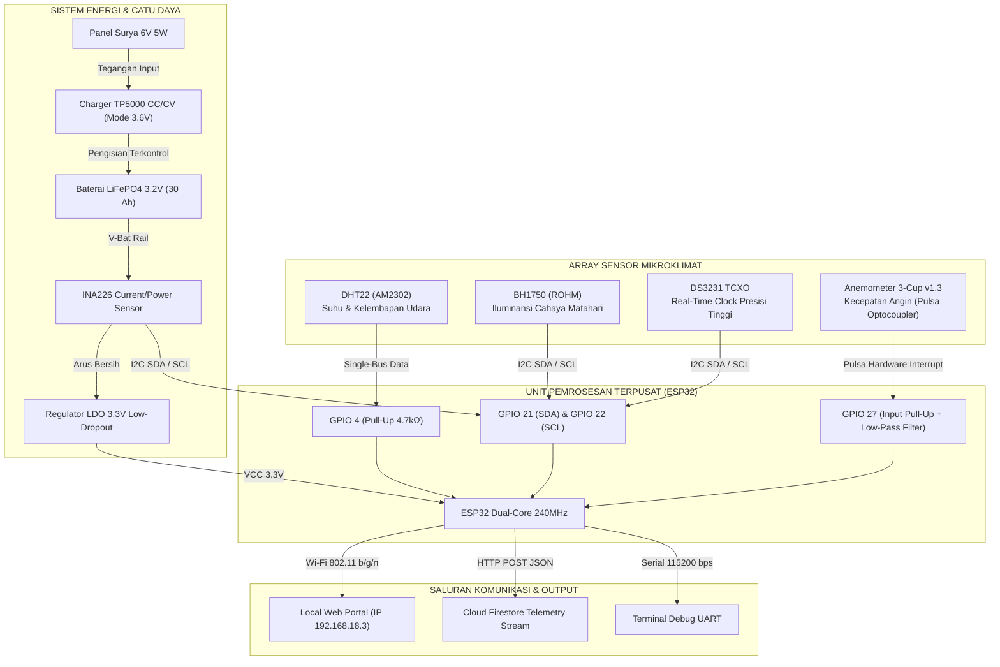

### 3.3 Spesifikasi Mikrokontroler ESP32-WROOM-32D
Unit pemroses utama yang digunakan adalah modul **ESP32-WROOM-32D**. Alasan pemilihan chip ini dibandingkan mikrokontroler tradisional (seperti ATmega328P atau STM32F103) meliputi:
- **Arsitektur Dual-Core:** Ditenagai oleh dua mikroprosesor Xtensa 32-bit LX6 dengan frekuensi clock hingga 240 MHz. Komputasi dibagi secara independen:
  - *Core 0 (Pro CPU):* Menangani tumpukan protokol jaringan Wi-Fi, HTTP Server REST API, serialisasi JSON, dan streaming telemetri ke cloud.
  - *Core 1 (App CPU):* Didedikasikan untuk akuisisi sensor berkala, penanganan interupsi berkecepatan tinggi pada anemometer, pemulihan bus I2C, dan kalkulasi persamaan fisika lingkungan.
- **Memori Internal yang Memadai:** Memiliki 520 KB SRAM terintegrasi serta 4 MB Quad-SPI Flash memory yang dialokasikan untuk partisi *firmware* aplikasi dan sistem berkas **LittleFS** (menyimpan tabel konfigurasi alat, log kalibrasi, dan riwayat sementara).
- **Wi-Fi Terintegrasi 802.11 b/g/n:** Mendukung konektivitas nirkabel 2.4 GHz dengan daya pancar hingga $+20.5\text{ dBm}$, memungkinkan komunikasi data jarak jauh di area perkebunan terbuka.

### 3.4 Spesifikasi Teknis Array Sensor & Transduser

Tabel 3.1 merangkum spesifikasi teknis komponen sensor yang menyusun stasiun Agrinex:

| Sensor | Antarmuka Fisik | Parameter Terukur | Rentang Operasional | Akurasi & Resolusi | Peran dalam Agrometeorologi |
| :--- | :--- | :--- | :--- | :--- | :--- |
| **DHT22 (AM2302)** | Single-Bus Digital (GPIO 4) | Suhu Udara ($T$) & Kelembapan Relatif ($RH$) | $-40^\circ\text{C} \text{ s/d } +80^\circ\text{C}$<br/>$0\% \text{ s/d } 100\%\text{ RH}$ | Suhu: $\pm 0.5^\circ\text{C}$ (Res: $0.1^\circ\text{C}$)<br/>RH: $\pm 2\%$ (Res: $0.1\%$) | Analisis defisit tekanan uap jenuh air ($VPD$) dan kurva diurnal suhu tajuk tanaman. |
| **BH1750 (ROHM)** | I2C (Alamat: `0x23` atau `0x5C`) | Intensitas Cahaya / Iluminansi | $1 \text{ s/d } 65.535\text{ Lux}$ (dapat diperluas ke 100k) | $\pm 5\%$, respon spektral menyerupai sensitivitas visual manusia | Dikonversi ke Irradiansi Surya ($W/m^2$) untuk menghitung radiasi netto ($R_n$). |
| **Anemometer v1.3 (Zhafira)** | Hardware Interrupt Digital (GPIO 27) | Frekuensi Pulsa Putaran Mangkuk | $0 \text{ s/d } 180\text{ km/jam}$ ($0 \text{ s/d } 50\text{ m/s}$) | Frekuensi optocoupler terkalibrasi: $1\text{ putaran/detik} \approx 2.4\text{ km/jam}$ | Normalisasi angin ke ketinggian 2 meter ($u_2$) untuk evaporasi Penman-Monteith. |
| **INA226 (Texas Inst.)** | I2C (Alamat: `0x40`) | Tegangan Bus, Arus Pengisian/Beban, Daya | Tegangan: $0 \text{ s/d } 36\text{ V}$<br/>Arus: $\pm 20\text{ A}$ (R-Shunt $0.1\ \Omega$) | 16-bit ADC, galat gain maksimal $0.1\%$, resolusi arus $\approx 1\text{ mA}$ | Pemantauan *State-of-Charge* (SoC) baterai LiFePO4 dan kesehatan panel surya. |
| **DS3231 (Maxim)** | I2C (Alamat: `0x68`) | Waktu Real-Time (Detik, Menit, Jam, Kalender) | $-40^\circ\text{C} \text{ s/d } +85^\circ\text{C}$ | TCXO Akurasi: $\pm 2\text{ ppm}$ ($< 1\text{ menit/tahun}$) | Pemberian stempel waktu (*timestamp*) presisi tinggi saat stasiun kehilangan jaringan NTP. |
| **MicroSD SPI Module** | SPI Hardware (GPIO 23/19/18/5) | Penyimpanan Log Offline | Format FAT32 MicroSD hingga 32 GB | Kecepatan bus SPI hingga 20 MHz | Pencatatan cadangan data telemetri harian CSV saat jaringan nirkabel terputus. |

### 3.5 Sistem Catu Daya Mandiri & Manajemen Baterai LiFePO4
Tantangan utama stasiun cuaca luar ruangan (*outdoor weather station*) adalah keandalan daya listrik jangka panjang di bawah terik matahari ekstrem dan hari berawan berkepanjangan (*cloudy days autonomy*).

#### 1. Karakteristik Kimia Baterai: Mengapa LiFePO4?
Dibandingkan dengan baterai Lithium-Ion (NMC) konvensional:
1. **Ketahanan Suhu Tinggi:** Baterai Lithium Iron Phosphate ($\text{LiFePO}_4$) memiliki batas dekomposisi termal di atas $270^\circ\text{C}$ (jauh lebih aman dibanding Li-Ion yang mengalami *thermal runaway* pada suhu $150^\circ\text{C}$). Hal ini krusial mengingat kotak *enclosure* stasiun di lapangan dapat mencapai suhu internal $> 45^\circ\text{C}$ saat terik matahari.
2. **Siklus Hidup (*Cycle Life*):** Baterai LiFePO4 mampu bertahan hingga lebih dari 2.000 hingga 3.000 siklus *deep-discharge* (80% DoD) sebelum kapasitasnya turun ke 80%, dibandingkan Li-Ion yang biasanya terdegradasi setelah 500 siklus.
3. **Profil Kurva Pelepasan Tegangan yang Datar (*Flat Discharge Curve*):**
   - Tegangan nominal: $3.2\text{ V}$
   - Tegangan penuh saat pengisian: $3.65\text{ V}$
   - Tegangan saat pelepasan hampir habis: $3.0\text{ V}$
   - Tegangan batas bawah (*cutoff*): $2.5\text{ V}$
   Tegangan keluaran berada stabil pada rentang $3.15\text{ V} - 3.25\text{ V}$ untuk 85% kapasitasnya, meminimalkan disipasi daya pada regulator tegangan mikrokontroler.

#### 2. Modul Pengisian TP5000 CC/CV
Modul pengisian menggunakan chip **TP5000** bertipe *switch-mode buck charger* berefisiensi tinggi ($> 90\%$). Pin konfigurasi solder diatur secara khusus pada posisi LiFePO4 ($3.6\text{ V}$ batas tegangan pengisian maksimum) untuk mencegah *overcharge* yang berbahaya bagi sel baterai.

#### 3. Analisis Neraca Energi (*Power Budgeting*)
- Konsumsi daya rata-rata ESP32 dengan sensor aktif: $I_{\text{avg}} \approx 85\text{ mA}$ pada $3.2\text{ V}$ ($P_{\text{avg}} \approx 0.28\text{ Watt}$).
- Konsumsi energi harian ($24\text{ jam}$):
  $$E_{\text{day}} = 0.28\text{ W} \times 24\text{ jam} = 6.72\text{ Wh} \quad (2.1\text{ Ah pada } 3.2\text{ V})$$
- Dengan kapasitas baterai terpasang sebesar **30 Ah** ($96\text{ Wh}$), stasiun cuaca memiliki ketahanan operasional otonom (*autonomy reserve*) tanpa sinar matahari selama:
  $$\text{Ketahanan} = \frac{30\text{ Ah}}{2.1\text{ Ah/hari}} \approx 14.2\text{ Hari (340.8 Jam)}$$
- Panel surya $6\text{ V } 5\text{ W}$ pada rata-rata penyinaran efektif 4 jam menghasilkan:
  $$E_{\text{harvest}} = 5\text{ W} \times 4\text{ jam} \times 0.75 \text{ (efisiensi sistem)} = 15\text{ Wh/hari}$$
  Energi panen harian ($15\text{ Wh}$) lebih dari dua kali lipat konsumsi harian alat ($6.72\text{ Wh}$), menjamin baterai selalu terisi penuh dalam siklus operasional normal.

### 3.6 Skematik Perkabelan, Integritas Sinyal & Proteksi EMI
Pemasangan sensor di area perkebunan terbuka rentan terhadap induksi elektromagnetik dari petir tidak langsung, kabel transmisi, dan gangguan elektrostatik:
1. **Pull-Up Resistor Bus I2C:** Jalur SDA (GPIO 21) dan SCL (GPIO 22) menggunakan resistor pull-up eksternal sebesar $4.7\text{ k}\Omega$ ke rel $3.3\text{ V}$. Nilai ini menyeimbangkan antara waktu transisi naik sinyal (*rise time*) dan konsumsi arus statis, memastikan frekuensi transmisi bus $100\text{ kHz}$ berjalan stabil tanpa *ringing*.
2. **Kompensasi Kabel Panjang Anemometer:** Kabel anemometer yang membentang dari puncak tiang ($1.5 - 2\text{ meter}$) ke dalam kotak instrumen bertindak sebagai antena penerima noise frekuensi tinggi. Diimplementasikan:
   - Resistor pull-up kuat eksternal $3.3\text{ k}\Omega$ menuju $3.3\text{ V}$.
   - Kapasitor keramik decoupler $100\text{ nF}$ paralel terhadap ground untuk meredam lonjakan tegangan transien (*hardware low-pass filter* dengan frekuensi cutoff $\approx 480\text{ Hz}$).
   - Isolasi optocoupler pada sensor fisik sebelum sinyal memasuki pin interupsi GPIO 27 ESP32.
3. **Decoupling Catu Daya Sensor:** Setiap modul sensor (DHT22, BH1750, INA226, DS3231) dilengkapi dengan kapasitor bypass $100\text{ nF}$ multi-layer ceramic capacitor (MLCC) yang ditempatkan sedekat mungkin dengan pin VCC modul untuk meminimalkan *voltage dip* saat sensor melakukan konversi pengukuran.

---

### 3.7 Skema Rangkaian Elektronika Terpadu (Schematic Circuit Diagram)
Perancangan skema rangkaian elektronika stasiun cuaca Agrinex dilakukan menggunakan platform otomasi desain elektronik (EDA) EasyEDA versi 1.0 (diperbarui per 20 Oktober 2026). Skema ini mengintegrasikan seluruh subsistem ke dalam satu kesatuan sirkuit yang rapi, modular, dan memiliki proteksi kelistrikan yang andal.

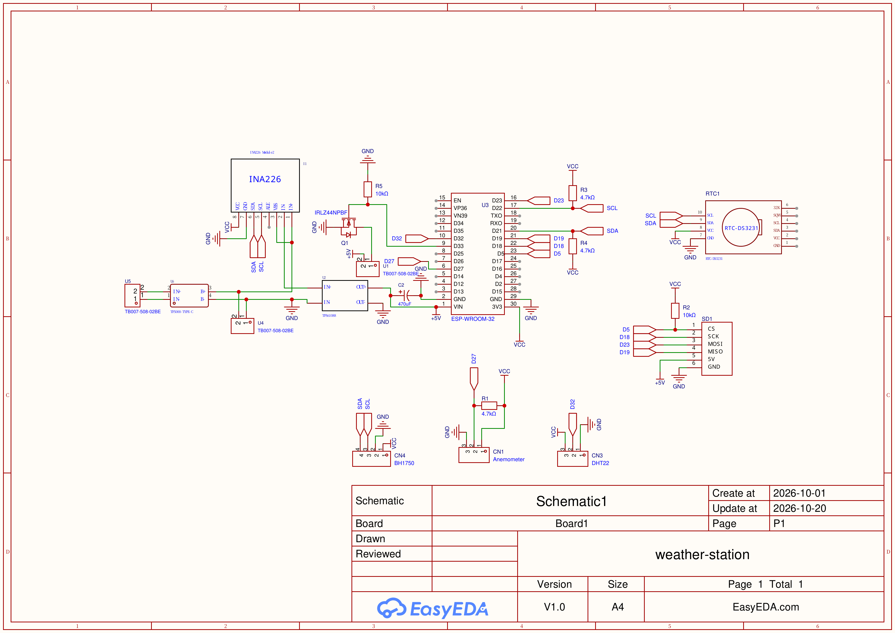
*Gambar 3.2: Skema Rangkaian Elektronika Utama Stasiun Cuaca Agrinex (EasyEDA Schematic1 v1.0).*

Pembedahan blok fungsional pada skema rangkaian mencakup:
1. **Unit Pemroses Inti (U3 - ESP-WROOM-32):**
   - Pin `VIN` (Pin 1) menerima pasokan tegangan teregulasi `+5V` dari konverter daya, distabilkan oleh kapasitor elektrolit C2 ($470\ \mu\text{F}$) untuk mencegah fluktuasi tegangan saat transmisi Wi-Fi aktif.
   - Jalur I2C terhubung pada pin GPIO 21 (`SDA`, Pin 20) dan GPIO 22 (`SCL`, Pin 17), diperkuat oleh resistor pull-up eksternal R3 dan R4 masing-masing $4.7\text{ k}\Omega$ ke rel `VCC` ($3.3\text{ V}$).
   - Pin GPIO 27 (Pin 6) difungsikan sebagai input interupsi perangkat keras yang terhubung ke konektor anemometer CN1 dengan resistor pull-up R1 ($4.7\text{ k}\Omega$).
   - Pin GPIO 4 / GPIO 32 terhubung ke konektor sensor DHT22 (CN3) untuk komunikasi data digital satu kabel (*single-bus*).
   - Antarmuka SPI untuk modul MicroSD (SD1) terhubung ke pin GPIO 5 (`CS`), GPIO 18 (`SCK`), GPIO 19 (`MISO`), dan GPIO 23 (`MOSI`), dengan resistor pull-up R2 ($10\text{ k}\Omega$) pada pin Chip Select.
   - Pin GPIO 32 (Pin 10) difungsikan sebagai sinyal kontrol gerbang (*gate control*) untuk transistor MOSFET daya Q1 melalui resistor pembagi R5 ($10\text{ k}\Omega$).

2. **Subsistem Catu Daya & Manajemen Energi Terbarukan:**
   - **Konektor Input Panel Surya (U5 - TB007-508-02BE):** Menerima daya fotovoltaik dari panel surya eksternal dan meneruskannya ke pin input `IN+` dan `IN-` modul pengisian U6.
   - **Modul Pengisian Baterai Surya (U6 - TP5000 Type-C):** Mengatur proses pengisian sel baterai LiFePO4 dengan metode CC/CV bertegangan ambang batas $3.6\text{ V}$.
   - **Konektor Baterai (U4 - TB007-508-02BE):** Menghubungkan sel baterai LiFePO4 $3.2\text{ V}$ $30\text{ Ah}$. Kutub positif baterai dilewatkan secara seri melalui sensor arus INA226 (I1).
   - **Sensor Daya & Arus Presisi Tinggi (I1 - INA226 Module):** Mengukur tegangan bus baterai dan drop tegangan pada resistor shunt $0.1\ \Omega$ untuk memantau aliran arus masuk maupun arus beban, berkomunikasi dengan mikrokontroler via I2C (`0x40`).
   - **Modul Step-Up Boost Converter (U2 - TPS61088):** Menaikkan tegangan baterai ($3.0 - 3.65\text{ V}$) menjadi tegangan teregulasi stabil `+5V` untuk menyuplai pin `VIN` ESP32 dengan efisiensi konversi tinggi ($>90\%$).
   - **Sakelar Beban Daya Terkendali (Q1 - IRLZ44NPBF & U1):** Transistor MOSFET N-channel tipe logic-level yang dapat memutus atau mengalirkan daya ke terminal beban eksternal (Power Out U1) secara otomatis berdasarkan instruksi firmware.

3. **Array Antarmuka Sensor & Jam Waktu Nyata:**
   - **Konektor Anemometer (CN1 - XH2.54 3-Pin):** Pinout VCC, Signal (GPIO 27), GND.
   - **Konektor Suhu & Kelembapan DHT22 (CN3 - XH2.54 3-Pin):** Pinout VCC, Data (GPIO 4), GND.
   - **Konektor Intensitas Cahaya BH1750 (CN4 - XH2.54 4-Pin):** Pinout VCC, SCL (GPIO 22), SDA (GPIO 21), GND.
   - **Modul RTC DS3231 (RTC1):** Modul jam presisi tinggi berbasis osilator terkompensasi suhu (TCXO) dengan backup baterai koin CR2032 terhubung paralel pada bus I2C.
   - **Modul Pembaca MicroSD (SD1):** Modul penyimpanan data lokal SPI kecepatan tinggi.

---

### 3.8 Desain Tata Letak PCB dan Fabrikasi Papan Sirkuit (PCB Layout & Layer Routing)
Papan sirkuit cetak (*Printed Circuit Board / PCB*) dirancang dengan standar industri 2 lapis (*double-sided PCB*) untuk menjamin keandalan mekanis dan integritas sinyal di lingkungan luar ruangan.

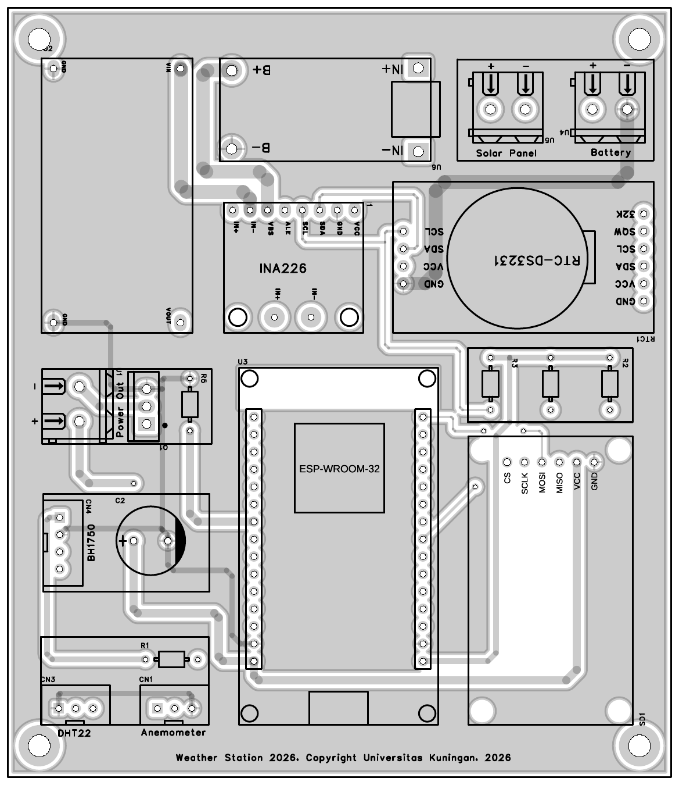
*Gambar 3.3: Tata Letak Komponen dan Jalur Tembaga Sisi Atas (Top Copper & Silkscreen) PCB Stasiun Cuaca Agrinex.*

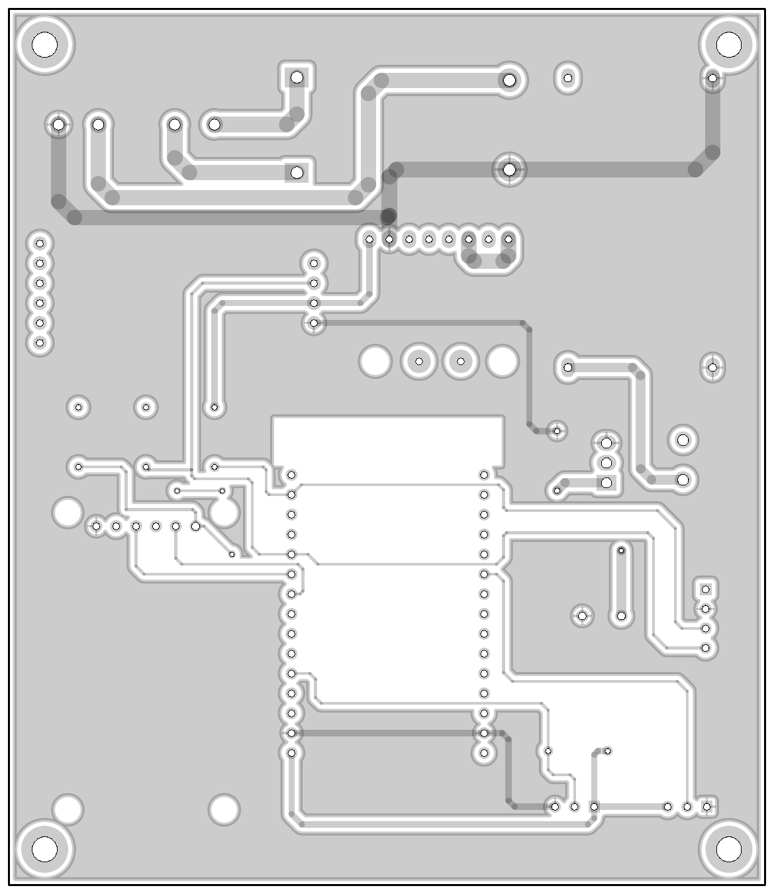
*Gambar 3.4: Jalur Tembaga dan Bidang Referensi Ground (Bottom Copper & Ground Pour) PCB Stasiun Cuaca Agrinex.*

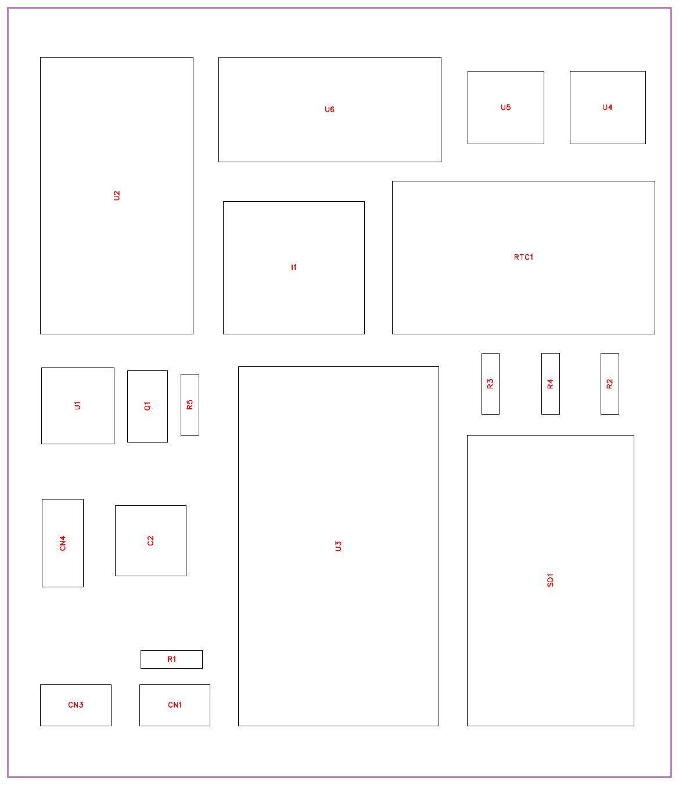
*Gambar 3.5: Diagram Penempatan Komponen Fisik (Component Placement / Silkscreen Outline) PCB Stasiun Cuaca Agrinex.*

Fitur rancang bangun PCB stasiun cuaca Agrinex meliputi:
1. **Pemisahan Jalur Daya dan Jalur Sinyal (*Power & Signal Segregation*):**
   Jalur tembaga pembawa arus besar dari panel surya, modul charger TP5000, baterai, dan boost converter TPS61088 dirancang dengan lebar jejak (*trace width*) ekstra lebar ($> 1.5\text{ mm}$) pada lapisan atas untuk meminimalkan resistansi jalur dan mencegah kenaikan suhu papan.
2. **Bidang Ground Plane Luas (*Solid Ground Pour*):**
   Lapisan bawah PCB didominasi oleh bidang tembaga ground referensi kontinu. Bidang ground ini berfungsi sebagai perisai pelindung (*electromagnetic shielding*) terhadap derau induktif frekuensi tinggi serta menyediakan jalur arus balik berimpedansi sangat rendah bagi sirkuit digital ESP32 dan pulsa anemometer.
3. **Konektor Berstandar Industri:**
   - Jalur kabel daya luar ruangan (Panel Surya U5, Baterai U4, dan Beban U1) menggunakan terminal blok baut kencang berjarak $5.08\text{ mm}$ (tipe TB007-508-02BE) yang kokoh dan tahan terhadap getaran angin di tiang penyangga.
   - Seluruh koneksi sensor eksternal (Anemometer CN1, DHT22 CN3, BH1750 CN4) menggunakan header soket wafer berkunci JST-XH $2.54\text{ mm}$ yang mencegah kesalahan polaritas saat perakitan di lapangan.
4. **Tanda Hak Cipta dan Identitas Akademik Silkscreen:**
   Lapisan silkscreen PCB secara resmi mencantumkan identitas lisensi riset akademik pada bagian bawah papan: *"Weather Station 2026, Copyright Universitas Kuningan, 2026"*.

---

### 3.9 Daftar Komponen Fisik dan Bill of Materials (BOM)
Seluruh komponen perangkat keras yang terpasang pada papan sirkuit utama stasiun cuaca Agrinex tercatat secara sistematis dalam daftar kebutuhan komponen (*Bill of Materials / BOM*).

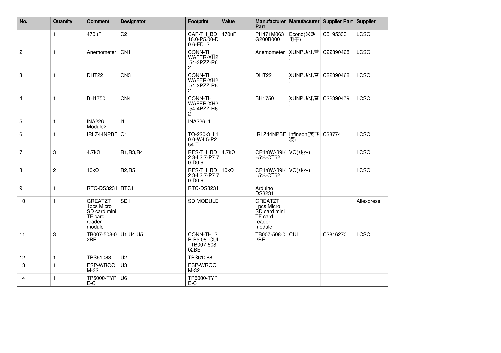
*Gambar 3.6: Tabel Resmi Bill of Materials (BOM) Fabrikasi Hardware PCB Stasiun Cuaca Agrinex.*

Tabel 3.2 merinci 14 jenis komponen fisik yang digunakan beserta referensi nomor part pabrikan dan kode pemesanan industri:

| No. | Jumlah | Komponen / Nilai | Designator | Footprint / Paket | Spesifikasi & Produsen | Referensi Part Supplier |
| :---: | :---: | :--- | :---: | :--- | :--- | :--- |
| 1 | 1 | Kapasitor Elektrolit 470 µF | C2 | CAP-TH 10.0mm Pitch 5.0mm | 470 µF 63V Low-ESR (Econd PH471M063G200B000) | LCSC C51953331 |
| 2 | 1 | Konektor Anemometer (3-Pin) | CN1 | CONN-TH Wafer XH2.54-3P | Konektor Wafer Vertikal 2.54mm (XUNPU) | LCSC C22390468 |
| 3 | 1 | Konektor DHT22 (3-Pin) | CN3 | CONN-TH Wafer XH2.54-3P | Konektor Wafer Vertikal 2.54mm (XUNPU) | LCSC C22390468 |
| 4 | 1 | Konektor BH1750 (4-Pin) | CN4 | CONN-TH Wafer XH2.54-4P | Konektor Wafer Vertikal 2.54mm (XUNPU) | LCSC C22390479 |
| 5 | 1 | Modul Sensor Daya INA226 | I1 | Modul INA226 Breakout | 16-bit High-Side Current & Power Monitor I2C | LCSC / Module |
| 6 | 1 | Transistor MOSFET Daya N-CH | Q1 | TO-220-3 Through-Hole | IRLZ44NPBF Logic-Level N-Channel 55V 47A (Infineon) | LCSC C38774 |
| 7 | 3 | Resistor 4.7 kΩ (1/8W) | R1, R3, R4 | RES-TH Metal Film Pitch 7.7mm | 4.7 kΩ ±5% 0.125W Through-Hole (VO CR1/8W-39K) | LCSC Resistor |
| 8 | 2 | Resistor 10 kΩ (1/8W) | R2, R5 | RES-TH Metal Film Pitch 7.7mm | 10 kΩ ±5% 0.125W Through-Hole (VO CR1/8W-39K) | LCSC Resistor |
| 9 | 1 | Modul RTC DS3231 Presisi | RTC1 | Modul RTC DS3231 Header | I2C RTC TCXO Presisi Tinggi dengan Backup CR2032 | Arduino DS3231 |
| 10 | 1 | Modul Pembaca MicroSD SPI | SD1 | Modul TF-Card Reader SPI | Modul SPI High-Speed MicroSD Card (GREATZT) | AliExpress / LCSC |
| 11 | 3 | Terminal Blok Baut 2-Pin | U1, U4, U5 | CONN-TH 2-Pin Pitch 5.08mm | Terminal Blok Baut TB007-508-02BE 16A 300V (CUI) | LCSC C3816270 |
| 12 | 1 | Modul Boost Converter 5V | U2 | Modul TPS61088 Step-Up | Synchronous Boost Converter High-Efficiency 5V | Module TPS61088 |
| 13 | 1 | Mikrokontroler ESP32 | U3 | Modul ESP-WROOM-32 30-Pin | Dual-Core 32-bit Xtensa LX6 240 MHz, 4MB Flash | Espressif Systems |
| 14 | 1 | Modul Charger Baterai Surya | U6 | Modul TP5000 Type-C | Charger Baterai LiFePO4 Switch-Mode CC/CV 3.6V | Module TP5000 |

---

## 4. Arsitektur Firmware dan Embedded Real-Time Operating System (FreeRTOS)

### 4.1 Paradigma Pengembangan Firmware & PlatformIO Dual-Environment Matrix
*Firmware* stasiun cuaca Agrinex dikembangkan dengan standar bahasa pemrograman **C++17** menggunakan ekosistem terpadu **PlatformIO Core**. Pendekatan ini memungkinkan stasiun cuaca mendukung dua varian perangkat keras mikrokontroler target secara serentak (*dual-environment build matrix*): **ESP32 (ESP-WROOM-32)** sebagai target performa tinggi berarsitektur dual-core, dan **NodeMCU v2 (ESP8266)** sebagai target varian efisiensi biaya.

```ini
; PlatformIO Project Configuration File
; Project: Agrinex Weather Station - Dual ESP32 & ESP8266 Support
; Target: ESP32 (ESP-WROOM-32) & NodeMCU v2 (ESP8266)

[platformio]
default_envs = esp32dev, nodemcuv2

[env:esp32dev]
platform = espressif32
board = esp32dev
framework = arduino
monitor_speed = 115200
upload_speed = 115200
board_build.filesystem = littlefs
lib_ldf_mode = deep+
build_flags = 
    -std=gnu++17
    -D CORE_DEBUG_LEVEL=0
lib_deps = 
    adafruit/DHT sensor library @ ^1.4.7
    adafruit/Adafruit Unified Sensor @ ^1.1.15
    claws/BH1750 @ ^1.3.0
    bblanchon/ArduinoJson @ ^7.4.1
    adafruit/RTClib @ ^2.1.4
    knolleary/PubSubClient @ ^2.8
    robtillaart/INA226 @ ^0.6.6
    SPI
    SD

[env:nodemcuv2]
platform = espressif8266
board = nodemcuv2
framework = arduino
monitor_speed = 115200
upload_speed = 115200
board_build.filesystem = littlefs
lib_ldf_mode = deep+
lib_deps = 
    adafruit/DHT sensor library @ ^1.4.7
    adafruit/Adafruit Unified Sensor @ ^1.1.15
    claws/BH1750 @ ^1.3.0
    bblanchon/ArduinoJson @ ^7.4.1
    adafruit/RTClib @ ^2.1.4
    knolleary/PubSubClient @ ^2.8
    robtillaart/INA226 @ ^0.6.6
    SPI
    SD
```

### 4.2 Arsitektur Multi-Tasking & FreeRTOS Dual-Core Scheduling
Untuk memastikan bahwa pembacaan sensor berkecepatan tinggi tidak terganggu oleh latensi transmisi jaringan Wi-Fi, *firmware* mengimplementasikan penjadwalan multithreading berbasis **FreeRTOS** pada ESP32:

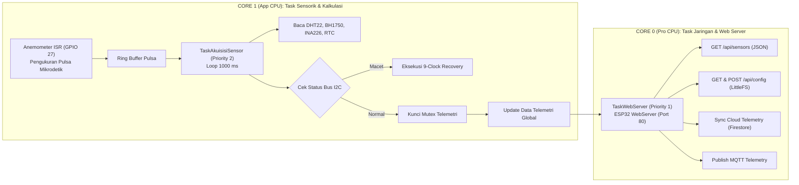

Pemisahan tanggung jawab core dilakukan sebagai berikut:
1. **Core 1 (App CPU - Prioritas 2):** Menjalankan siklus akuisisi sensor setiap 1000 ms dan menangani rutinitas interupsi (*Interrupt Service Routine / ISR*) perangkat keras untuk anemometer langsung dari RAM internal (*IRAM_ATTR*). Hal ini menjamin tidak terjadi *jitter* waktu saat menghitung laju putaran anemometer.
2. **Core 0 (Pro CPU - Prioritas 1):** Mengelola koneksi jaringan Wi-Fi, tumpukan TCP/IP, sinkronisasi cloud Firestore, dan permintaan HTTP masuk pada REST API Web Server, sehingga *watchdog timer* tidak akan terpicu meskipun terjadi *timeout* jaringan internet.

### 4.3 State Machine Pemulihan Otomatis Bus I2C (*I2C Bus Recovery Machine*)
Pada pemasangan sensor lapangan, modul I2C (BH1750, DS3231, INA226) yang terhubung pada jalur SDA/SCL yang sama rentan mengalami kondisi *lockup*. Kondisi ini terjadi ketika mikroprosesor mengalami *reset* saat sensor *slave* sedang mengirimkan bit data bernilai `0` (SDA ditarik ke level *LOW*). Akibatnya, jalur SDA tertahan *LOW* tanpa henti, dan pustaka I2C perangkat keras ESP32 akan membeku (*hang*) saat inisialisasi `Wire.begin()`.

Untuk menanggulangi masalah ini secara otomatis tanpa intervensi fisik, *firmware* mengimplementasikan algoritma bit-banging 9 clock pulses:

```cpp
bool recoverI2CBus(int sdaPin, int sclPin) {
    pinMode(sdaPin, INPUT_PULLUP);
    pinMode(sclPin, INPUT_PULLUP);
    delayMicroseconds(10);

    // Cek apakah SDA macet di level LOW
    if (digitalRead(sdaPin) == LOW) {
        Serial.println(F("[I2C RECOVERY] Terdeteksi Bus Lockup: SDA tertahan LOW!"));
        
        // Alihkan SCL ke mode OUTPUT untuk melakukan bit-banging 9 clock pulses
        pinMode(sclPin, OUTPUT);
        for (int i = 0; i < 9; i++) {
            digitalWrite(sclPin, LOW);
            delayMicroseconds(10);
            digitalWrite(sclPin, HIGH);
            delayMicroseconds(10);
            
            // Jika slave telah melepaskan SDA kembali ke HIGH, hentikan pulsa
            if (digitalRead(sdaPin) == HIGH) {
                Serial.printf(F("[I2C RECOVERY] Slave melepaskan SDA pada clock ke-%d\n"), i + 1);
                break;
            }
        }
        
        // Bangkitkan kondisi I2C STOP secara manual: SCL HIGH lalu SDA HIGH
        pinMode(sdaPin, OUTPUT);
        digitalWrite(sdaPin, LOW);
        delayMicroseconds(10);
        digitalWrite(sclPin, HIGH);
        delayMicroseconds(10);
        digitalWrite(sdaPin, HIGH);
        delayMicroseconds(10);
    }
    
    // Kembalikan ke mode Wire I2C standar
    Wire.begin(sdaPin, sclPin);
    Wire.setClock(100000); // 100 kHz standard mode
    return (digitalRead(sdaPin) == HIGH && digitalRead(sclPin) == HIGH);
}
```

### 4.4 Algoritma Debounce & Microsecond Pulse-Width Filter Anemometer
Anemometer tipe mangkok berputar (*cup anemometer*) v1.3 menggunakan sensor optocoupler yang terhubung ke pin interupsi GPIO 27. Saat kondisi hening (*calm / no wind*), mangkok anemometer sering kali berhenti tepat di batas ambang sensor (*optical edge transition*). Hembusan angin mikro yang sangat kecil dapat menyebabkan sinyal berosilasi bolak-balik puluhan kali dalam hitungan milidetik (*switch chatter*).

Untuk mengeliminasi sinyal palsu secara presisi tanpa kehilangan pulsa rotasi nyata, *firmware* menerapkan filter berbasis waktu di tingkat interupsi (*hardware ISR*):

```cpp
volatile uint32_t g_validPulses = 0;
volatile uint32_t g_rejectedGlitches = 0;
volatile uint32_t g_lastInterruptUs = 0;
volatile uint32_t g_lastLowWidthUs = 0;

// ISR dieksekusi dari IRAM untuk kecepatan respons instan
void IRAM_ATTR anemometerISR() {
    uint32_t now = micros();
    uint32_t delta = now - g_lastInterruptUs;
    
    // 1. Filter Interval Minimum (Dead-Time Filter):
    // Kecepatan angin maksimum fisik 180 km/jam ekuivalen dengan frekuensi ~75 Hz (interval ~13.3 ms).
    // Pulsa dengan interval < 10 ms (10.000 µs) dipastikan merupakan pantulan derau (glitch).
    if (delta < 10000) {
        g_rejectedGlitches++;
        return;
    }
    
    // 2. Filter Lebar Pulsa Rendah (Pulse Width Discrimination):
    // Mengukur apakah transisi LOW bertahan cukup lama (> 500 µs) untuk membuktikan rotasi mekanis
    uint32_t lowStart = micros();
    while (digitalRead(ANEMOMETER_PIN) == LOW && (micros() - lowStart) < 2000) {
        // Tunggu transisi atau batas maksimum
    }
    uint32_t pulseWidth = micros() - lowStart;
    g_lastLowWidthUs = pulseWidth;
    
    if (pulseWidth < 500) { // Durasi transisi terlalu pendek (< 500 µs), tolak derau transien
        g_rejectedGlitches++;
        return;
    }
    
    g_validPulses++;
    g_lastInterruptUs = now;
}
```

Setiap interval pengukuran $1\text{ detik}$, jumlah pulsa valid dihitung dan dikalibrasi:
$$V_{\text{km/jam}} = \left( \frac{\text{Pulsa Valid}}{\Delta t} \right) \times K_{\text{faktor}}$$
Dengan nilai konstanta terkalibrasi $K_{\text{faktor}} = 2.4\text{ km/jam per Hz}$. Jika pulsa per detik berada di bawah ambang *Noise Gate* yang ditetapkan pengguna (contoh: $\le 2\text{ Hz}$), kecepatan angin otomatis dinolkan ($0.0\text{ km/jam}$).

### 4.5 Penyimpanan Konfigurasi Non-Volatile LittleFS
Konfigurasi stasiun tidak disimpan pada memori EEPROM terbatas, melainkan pada partisi berkas **LittleFS** di flash internal ESP32. Keunggulannya meliputi:
1. **Ketahanan Kegagalan Daya (*Power-Loss Resilience*):** Menjamin integritas sistem berkas meskipun daya listrik mati mendadak di tengah proses penulisan konfigurasi.
2. **Wear Leveling Dinamis:** Menyebarkan siklus penulisan secara merata di seluruh sektor flash memory 4 MB, memperpanjang usia pakai chip ESP32 hingga puluhan tahun.
3. **Struktur Data JSON Terbuka:** Konfigurasi disimpan dalam berkas `/config.json` yang dapat dibaca, diedit, diunduh, dan dipulihkan langsung melalui web browser:

```json
{
  "station_name": "Kelurahan Purwawinangun, Kecamatan Kuningan",
  "elevation_m": 555,
  "latitude": -6.9721,
  "longitude": 108.4801,
  "sensor_interval_sec": 15,
  "cal_temp_offset": -4.8,
  "cal_hum_offset": 14.0,
  "cal_wind_noise_gate": 18,
  "pins": {
    "dht_pin": 4,
    "anemo_pin": 27,
    "i2c_sda": 21,
    "i2c_scl": 22,
    "sd_cs": 5
  },
  "backend": {
    "protocol": "HTTP_REST",
    "mqtt_broker": "broker.emqx.io",
    "mqtt_port": 1883
  }
}
```

### 4.6 Arsitektur Embedded Web Server & REST API Portal
ESP32 menjalankan server web HTTP asinkron mandiri pada port `80` yang menyediakan antarmuka pemrograman aplikasi (REST API) lengkap:

| Metode HTTP | Jalur URL Endpoint | Fungsi & Deskripsi | Format Respon |
| :---: | :--- | :--- | :---: |
| `GET` | `/api/sensors` | Mengembalikan nilai pembacaan seluruh sensor terkini, waktu RTC, status baterai, dan diagnostik bus secara instan (latensi $< 50\text{ ms}$). | JSON |
| `GET` | `/api/telemetry` | Mengambil data telemetri rata-rata buffer terbaru beserta cap waktu ISO 8601. | JSON |
| `GET` | `/api/config` | Mengambil seluruh konfigurasi stasiun yang tersimpan di berkas LittleFS. | JSON |
| `POST` | `/api/config` | Memperbarui parameter kalibrasi, nama stasiun, dan pinout, lalu menyimpannya secara permanen ke LittleFS. | JSON Status |
| `GET` | `/api/status` | Menampilkan uptime sistem, sisa memori Free Heap, status modul I2C, dan jumlah *rejected glitches* anemometer. | JSON |
| `GET` | `/api/diagnostics` | Menjalankan *self-test routine* terhadap seluruh modul hardware dan mengembalikan laporan status kesehatan 6 modul. | JSON |
| `POST` | `/api/restart` | Melakukan *software reboot* mikrokontroler secara aman. | JSON Status |
| `OPTIONS` | `/api/*` | Penanganan *CORS Preflight* otomatis untuk mengizinkan permintaan peramban lintas domain dari web app luar (Vercel/Cloudflare). | HTTP 204 |

Untuk mengizinkan aplikasi web modern mengakses REST API ESP32 tanpa diblokir oleh kebijakan keamanan peramban (*Same-Origin Policy*), setiap respons web portal menyematkan header standar CORS:
```cpp
void sendCorsHeaders() {
    webServer.sendHeader("Access-Control-Allow-Origin", "*");
    webServer.sendHeader("Access-Control-Allow-Methods", "GET, POST, OPTIONS");
    webServer.sendHeader("Access-Control-Allow-Headers", "Content-Type, Authorization");
}
```

### 4.7 Protokol Transmisi Awan: Sinkronisasi Google Cloud Firestore
Untuk fasilitas pemantauan jarak jauh via internet publik, firmware menyematkan modul transmisi HTTPS mandiri langsung ke REST API **Google Cloud Firestore**:

```cpp
void publishToFirestore(const SensorSample& data) {
    if (WiFi.status() != WL_CONNECTED) return;

    WiFiClientSecure client;
    client.setInsecure(); // Mengabaikan validasi root CA untuk memangkas memori RAM SSL

    HTTPClient https;
    String url = "https://firestore.googleapis.com/v1/projects/" + String(FIREBASE_PROJECT_ID) +
                 "/databases/(default)/documents/telemetry";

    if (https.begin(client, url)) {
        https.addHeader("Content-Type", "application/json");

        // Pembentukan Payload Dokumen Firestore Baku
        JsonDocument doc;
        JsonObject fields = doc["fields"].to<JsonObject>();
        fields["temperature"]["doubleValue"] = data.temperature;
        fields["humidity"]["doubleValue"]    = data.humidity;
        fields["wind_speed"]["doubleValue"]  = data.wind_speed;
        fields["light_lux"]["doubleValue"]   = data.light_lux;
        fields["timestamp"]["stringValue"]   = data.isoTimestamp;

        String requestBody;
        serializeJson(doc, requestBody);
        
        int httpCode = https.POST(requestBody);
        if (httpCode == HTTP_CODE_OK || httpCode == HTTP_CODE_CREATED) {
            Serial.println(F("[FIRESTORE] Telemetri berhasil tersinkronisasi ke Cloud!"));
        } else {
            Serial.printf(F("[FIRESTORE ERROR] Gagal mengirim data, kode HTTP: %d\n"), httpCode);
        }
        https.end();
    }
}
```

### 4.8 Sistem Pencatatan Cadangan Kartu MicroSD Offline (*Fault-Tolerant Logging*)
Apabila koneksi jaringan lokal dan internet terputus secara serentak, stasiun cuaca Agrinex tidak akan kehilangan satu pun titik data observasi:
1. **Format Berkas CSV Harian:** Berkas disimpan secara terpartisi harian dengan penamaan `YYYYMMDD.csv` berdasarkan waktu jam presisi DS3231 RTC.
2. **Buffer Baris Tabular:** Setiap baris memuat cap waktu UNIX, ISO string, suhu, kelembapan, radiasi, kecepatan angin, tegangan rel baterai, dan kode checksum.
3. **Mekanisme Auto-Sync:** Saat jaringan Wi-Fi kembali terhubung, firmware menyediakan endpoint untuk mem-flush data yang tertimbun di kartu SD ke server awan.

### 4.9 Matriks Pemetaan Pinout Hardware (ESP32 vs NodeMCU v2)

Tabel 4.1 menyajikan pemetaan referensi pinout hardware antara varian ESP32 dan ESP8266:

| Modul / Sensor | Jalur Sinyal | Pinout ESP32 DevKit (Rekomendasi) | Pinout NodeMCU v2 (ESP8266) | Keterangan Sirkuit |
| :--- | :---: | :---: | :---: | :--- |
| **DHT22** | DATA | `GPIO 4` | `D4 (GPIO 2)` | Pull-up resistor $4.7\text{ k}\Omega$ ke 3.3V |
| **Anemometer v1.3** | PULSE / SIGNAL | `GPIO 27` (Hardware Interrupt) | `D1 (GPIO 5)` (Interrupt) | Input filter mikrodetik IRAM_ATTR |
| **BH1750 (Cahaya)** | SDA / SCL | `GPIO 21` (SDA) / `GPIO 22` (SCL) | `D2 (GPIO 4)` / `D1 (GPIO 5)` | Alamat I2C: `0x23` |
| **INA226 (Daya)** | SDA / SCL | `GPIO 21` (SDA) / `GPIO 22` (SCL) | `D2 (GPIO 4)` / `D1 (GPIO 5)` | Alamat I2C: `0x40` |
| **DS3231 RTC** | SDA / SCL | `GPIO 21` (SDA) / `GPIO 22` (SCL) | `D2 (GPIO 4)` / `D1 (GPIO 5)` | Alamat I2C: `0x68` (Baterai CR2032 backup) |
| **MicroSD Card** | SPI (MOSI/MISO/CLK/CS) | `GPIO 23 / 19 / 18 / 5 (CS)` | `D7 / D6 / D5 / D8 (CS)` | Antarmuka SPI Hardware High-Speed |
| **LED Status Indikator**| STATUS | `GPIO 2` (On-board LED) | `D0 (GPIO 16)` | Indikasi Heartbeat & Transmisi Data |

---

## 5. Pembahasan Algoritma, Fisika Lingkungan, dan Model Prediksi

### 5.1 Model Evapotranspirasi Acuan Standar Internasional FAO-56 Penman-Monteith ($ET_0$)
Evapotranspirasi acuan (*Reference Evapotranspiration / $ET_0$*) merepresentasikan laju kehilangan air harian dari permukaan tanaman rumput hipotetik dengan tinggi $0.12\text{ meter}$, tahanan tajuk permukaan $70\text{ s/m}$, dan albedo $0.23$, yang tumbuh secara aktif tanpa kekurangan air. Metode **FAO-56 Penman-Monteith** merupakan standar internasional baku yang direkomendasikan oleh *Food and Agriculture Organization (FAO)* dan *World Meteorological Organization (WMO)* untuk perencanaan irigasi presisi.

Persamaan laju evapotranspirasi acuan harian ($ET_0$ dalam $\text{mm/hari}$):
$$ET_0 = \frac{0.408 \Delta (R_n - G) + \gamma \frac{900}{T_{\text{mean}} + 273} u_2 (e_s - e_a)}{\Delta + \gamma (1 + 0.34 u_2)}$$

Di mana:
- $ET_0$ : Laju evapotranspirasi acuan $[\text{mm/hari}]$.
- $R_n$ : Radiasi surya netto pada permukaan vegetasi $[\text{MJ/m}^2/\text{hari}]$.
- $G$ : Kerapatan fluks panas tanah $[\text{MJ/m}^2/\text{hari}]$ (untuk skala harian, $G \approx 0$).
- $T_{\text{mean}}$ : Suhu rata-rata harian udara $[\,^\circ\text{C}]$, dihitung dari $\frac{T_{\max} + T_{\min}}{2}$.
- $u_2$ : Kecepatan angin terukur pada ketinggian standar 2 meter $[\text{m/s}]$.
- $e_s$ : Tekanan uap jenuh rata-rata $[\text{kPa}]$.
- $e_a$ : Tekanan uap aktual $[\text{kPa}]$.
- $(e_s - e_a)$ : Defisit tekanan uap jenuh (*Vapor Pressure Deficit / VPD*) $[\text{kPa}]$.
- $\Delta$ : Kemiringan kurva tekanan uap terhadap suhu $[\text{kPa/}\,^\circ\text{C}]$.
- $\gamma$ : Konstanta psikrometrik $[\text{kPa/}\,^\circ\text{C}]$.
- $0.408$ : Faktor konversi energi radiasi ($\text{MJ/m}^2/\text{hari}$) menjadi ekuivalen kedalaman air ($\text{mm/hari}$), berasal dari inversi panas laten penguapan air ($\lambda \approx 2.45\text{ MJ/kg}$).

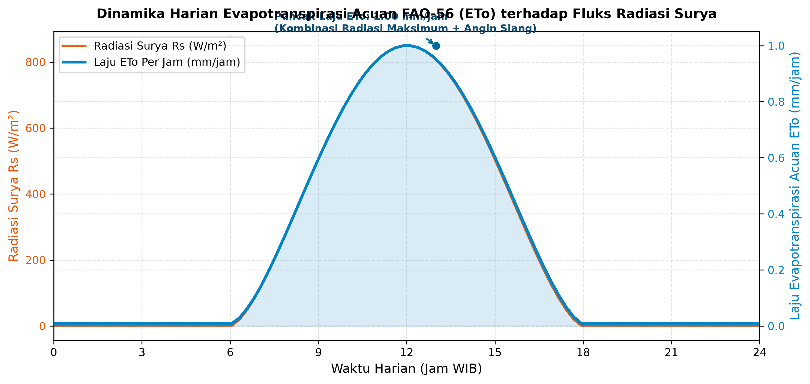
*Gambar 5.1: Dinamika Harian Laju Evapotranspirasi Acuan FAO-56 ($ET_0$) terhadap Fluks Radiasi Surya ($R_s$) dan Dinamika Suhu/Angin.*

### 5.2 Komponen Penurunan Matematis & Penyesuaian Ketinggian Purwawinangun (555 mdpl)

#### 1. Tekanan Uap Jenuh ($e_s$) melalui Persamaan Tetens
Tekanan uap jenuh pada suhu tertentu $T$ dihitung menggunakan formula:
$$e^\circ(T) = 0.6108 \exp\left( \frac{17.27 T}{T + 237.3} \right) \quad [\text{kPa}]$$

Untuk menghindari galat non-linearitas, FAO-56 mewajibkan $e_s$ dihitung sebagai rata-rata tekanan uap pada suhu maksimum ($T_{\max}$) dan suhu minimum ($T_{\min}$), bukan dari $T_{\text{mean}}$:
$$e_s = \frac{e^\circ(T_{\max}) + e^\circ(T_{\min})}{2}$$

#### 2. Tekanan Uap Aktual ($e_a$)
Tekanan uap aktual dihitung dengan mengintegrasikan nilai kelembapan relatif maksimum ($RH_{\max}$) dan minimum ($RH_{\min}$) harian:
$$e_a = \frac{e^\circ(T_{\min}) \left( \frac{RH_{\max}}{100} \right) + e^\circ(T_{\max}) \left( \frac{RH_{\min}}{100} \right)}{2}$$

#### 3. Kemiringan Kurva Tekanan Uap ($\Delta$)
Turunan pertama dari persamaan Tetens terhadap suhu menghasilkan:
$$\Delta = \frac{4098 \left[ 0.6108 \exp\left( \frac{17.27 T_{\text{mean}}}{T_{\text{mean}} + 237.3} \right) \right]}{(T_{\text{mean}} + 237.3)^2} \quad [\text{kPa/}\,^\circ\text{C}]$$

#### 4. Tekanan Barometrik Ketinggian ($P$) dan Konstanta Psikrometrik ($\gamma$)
Nilai konstanta psikrometrik bergantung langsung pada tekanan atmosfer lokal ($P$), yang merupakan fungsi dari elevasi stasiun di atas permukaan laut ($z_{\text{elev}}$ dalam meter).

Untuk lokasi Stasiun Agrinex di **Kelurahan Purwawinangun, Kecamatan Kuningan** dengan elevasi $z_{\text{elev}} = 555\text{ mdpl}$:
$$P = 101.3 \left( \frac{293 - 0.0065 z_{\text{elev}}}{293} \right)^{5.26} = 101.3 \left( \frac{293 - 0.0065(555)}{293} \right)^{5.26} \approx 94.94\text{ kPa}$$

Konstanta psikrometrik dihitung dengan:
$$\gamma = 0.665 \times 10^{-3} P = 0.665 \times 10^{-3} \times 94.94 \approx 0.0631\text{ kPa/}\,^\circ\text{C}$$
*(Sebagai perbandingan, pada permukaan laut $z=0\text{ mdpl}$, nilai standar $\gamma = 0.0673\text{ kPa/}\,^\circ\text{C}$. Penyesuaian elevasi ini meningkatkan akurasi perhitungan $ET_0$ sebesar $\approx 6.2\%$).*

#### 5. Neraca Radiasi Netto Permukaan ($R_n$)
Radiasi netto ($R_n$) merupakan selisih antara radiasi gelombang pendek bersih yang diserap tajuk ($R_{ns}$) dan radiasi gelombang panjang bersih yang dilepaskan ke atmosfer ($R_{nl}$):
$$R_n = R_{ns} - R_{nl}$$
- $R_{ns} = (1 - \alpha) R_s = (1 - 0.23) R_s = 0.77 R_s$ (albedo $\alpha = 0.23$ untuk rumput acuan).
- $R_{nl} = \sigma \left[ \frac{(T_{\max} + 273.16)^4 + (T_{\min} + 273.16)^4}{2} \right] \left( 0.34 - 0.14 \sqrt{e_a} \right) \left( 1.35 \frac{R_s}{R_{so}} - 0.35 \right)$
- Radiasi langit cerah: $R_{so} = (0.75 + 2 \times 10^{-5} z_{\text{elev}}) R_a = (0.75 + 2 \times 10^{-5}(555)) R_a = 0.7611 R_a$.

### 5.3 Algoritma Konversi Fisika Lingkungan

```mermaid
graph LR
    subgraph RawData["Sinyal Mentah Sensor"]
        LUX["Sensor BH1750 (Lux)"]
        WIND["Anemometer v1.3 (km/jam)"]
        BMKG_N["BMKG Sunshine Hours (n jam)"]
    end

    subgraph PhysicsTransform["Transformasi Persamaan Fisika"]
        LUX -->|Faktor Daya Surya (1 W/m² ≈ 120 Lux)| W_M2["Irradiansi Surya I_solar (W/m²)"]
        W_M2 -->|Integrasi Waktu Riemann (dt = 900s)| RS_IOT["Radiasi Harian R_s (MJ/m²/hari)"]
        
        BMKG_N -->|Formula Angstrom-Prescott| RS_BMKG["Model Radiasi R_s BMKG (MJ/m²/hari)"]
        
        WIND -->|Konversi Satuan 1 km/h = 1/3.6 m/s| U_Z["Kecepatan Angin Tiang u_z (m/s)"]
        U_Z -->|Profil Logaritmik Ketinggian z = 1.5m| U_2["Kecepatan Standar 2m u_2 (m/s)"]
    end

    subgraph AgriculturalMetrics["Metrik Agrometeorologi"]
        RS_IOT --> PENMAN["Kalkulator FAO-56 Penman-Monteith (ET_o)"]
        RS_BMKG --> PENMAN
        U_2 --> PENMAN
    end
```

#### 1. Konversi Iluminansi Lux (BH1750) ke Radiasi Surya ($R_s$)
Sensor BH1750 menghasilkan nilai iluminansi fotometrik ($E_v$ dalam satuan Lux). Efikasi radiasi surya tropis menetapkan faktor konversi:
$$1\text{ W/m}^2 \approx 120\text{ Lux} \implies I_{\text{solar}} (\text{W/m}^2) = \frac{\text{Lux}}{120} \approx \text{Lux} \times 0.00833$$

Total radiasi harian dari $N = 96$ sampel (interval 15 menit = 900 detik) diintegrasikan secara numerik menggunakan aturan Riemann:
$$R_{s, \text{IoT}} = \sum_{i=1}^{96} \left( I_{\text{solar}, i} \times 900\text{ s} \right) \times 10^{-6} \quad [\text{MJ/m}^2/\text{hari}]$$

#### 2. Estimasi Radiasi Surya BMKG: Model Angstrom-Prescott
BMKG mempublikasikan durasi penyinaran matahari aktual harian ($n$, dalam jam). Radiasi surya rujukan dihitung dengan:
$$R_{s, \text{BMKG}} = \left( a_s + b_s \frac{n}{N} \right) R_a$$
Dengan parameter empiris $a_s = 0.25$, $b_s = 0.50$, panjang hari teoritis $N = \frac{24}{\pi} \omega_s$, sudut jam matahari terbenam $\omega_s = \arccos(-\tan(\phi) \tan(\delta))$, lintang Purwawinangun $\phi = -6.9721^\circ = -0.1217\text{ rad}$, dan deklinasi matahari $\delta = 0.409 \sin\left(\frac{2\pi}{365} J - 1.39\right)$.

#### 3. Normalisasi Kecepatan Angin Profil Logaritmik ($u_2$)
Anemometer stasiun terpasang pada ketinggian tiang $z = 1.5\text{ meter}$. Normalisasi ke ketinggian standar 2.0 meter dilakukan dengan rumus profil logaritmik baku:
$$u_2 = u_z \frac{4.87}{\ln(67.8 z - 5.42)} = u_{1.5} \frac{4.87}{\ln(67.8(1.5) - 5.42)} = u_{1.5} \frac{4.87}{4.567} \approx 1.0663 \times u_{1.5}$$

### 5.4 Algoritma Kalibrasi Dinamis Sensor Lapangan
1. **Kompensasi Panas Disipasi PCB (*PCB Self-Heating*) pada DHT22:**
   Komponen mikrokontroler ESP32 membuang daya panas internal sebesar $\approx 0.28\text{ Watt}$. Panas terakumulasi menaikkan suhu sensor dan menurunkan nilai kelembapan relatif kapasitif secara artifisial. Algoritma kompensasi dinamis diterapkan di tingkat software:
   $$T_{\text{cal}} = T_{\text{raw}} + \text{Offset}_T \quad (\text{Offset}_T = -4.8^\circ\text{C})$$
   $$RH_{\text{cal}} = \min\left(100, \max\left(0, RH_{\text{raw}} + \text{Offset}_{RH}\right)\right) \quad (\text{Offset}_{RH} = +14.0\%)$$
2. **Dynamic Noise Gate Filter Anemometer:**
   Meniadakan pembacaan kecepatan angin palsu saat rotor hanya bergetar pelan oleh getaran mekanis tiang tanpa rotasi nyata:
   $$V_{\text{final}} = \begin{cases} 0.0, & \text{jika } \text{Pulsa/detik} \le 2\text{ Hz} \\ V_{\text{hitung}}, & \text{jika } \text{Pulsa/detik} > 2\text{ Hz} \end{cases}$$

### 5.5 Metrik Evaluasi Statistik Validasi BMKG Standar WMO
Untuk mengukur akurasi data sensor mikroklimat ($P_i$) terhadap data rujukan model BMKG ($O_i$) pada pasangan waktu sebanyak $n$ sampel, digunakan 6 metrik statistik komparatif:

| Metrik Statistik | Persamaan Matematis | Interpretasi Ilmiah & Target Kinerja |
| :--- | :--- | :--- |
| **Mean Absolute Error (MAE)** | $\text{MAE} = \frac{1}{n} \sum_{i=1}^{n} \|P_i - O_i\|$ | Rata-rata selisih absolut antara sensor dan BMKG. Target: Suhu $\le 1.0^\circ\text{C}$, Kelembapan $\le 5\%$. |
| **Root Mean Square Error (RMSE)** | $\text{RMSE} = \sqrt{\frac{1}{n} \sum_{i=1}^{n} (P_i - O_i)^2}$ | Memberikan penalti bobot yang lebih besar terhadap lonjakan galat ekstrem (*outliers*). Target: Suhu $\le 1.5^\circ\text{C}$. |
| **Mean Absolute Percentage Error (MAPE)** | $\text{MAPE} = \frac{100\%}{n} \sum_{i=1}^{n} \left\| \frac{P_i - O_i}{O_i} \right\|$ | Mengukur persentase galat relatif terhadap skala pengukuran. Kategori: $<10\%$ (Sangat Akurat). |
| **Mean Bias Error (MBE)** | $\text{MBE} = \frac{1}{n} \sum_{i=1}^{n} (P_i - O_i)$ | Mendeteksi kecenderungan sistematis alat. $\text{MBE} > 0$ menunjukkan *overestimate*, $\text{MBE} < 0$ menunjukkan *underestimate*. |
| **Pearson Correlation ($r$)** | $r = \frac{\sum_{i=1}^{n} (P_i - \bar{P})(O_i - \bar{O})}{\sqrt{\sum_{i=1}^{n} (P_i - \bar{P})^2 \sum_{i=1}^{n} (O_i - \bar{O})^2}}$ | Mengukur kekuatan korelasi linier dan sinkronisasi fluktuasi harian. Rentang $-1 \text{ s/d } +1$. Target: $r \ge 0.85$. |
| **Willmott's Index of Agreement ($d$)** | $d = 1 - \frac{\sum_{i=1}^{n} (P_i - O_i)^2}{\sum_{i=1}^{n} \left( \|P_i - \bar{O}\| + \|O_i - \bar{O}\| \right)^2}$ | Ukuran standar meteorologi untuk derajat kecocokan model empiris bebas batas skala. Rentang $0 \text{ s/d } 1$. Target: $d \ge 0.90$. |

### 5.6 Algoritma Penyelarasan Waktu & Resampling (*Temporal Window Matching*)
Data stasiun Agrinex dihasilkan setiap $15\text{ menit}$, sedangkan titik prakiraan BMKG tersedia per $3\text{ jam}$. Penyelarasan dilakukan menggunakan jendela agregasi rata-rata bergerak (*rolling temporal window*) $\pm 45\text{ menit}$:
$$\mathcal{S}(t_{\text{BMKG}}) = \left\{ P_{\text{IoT}}(t) \;\middle|\; |t - t_{\text{BMKG}}| \le 45\text{ menit} \right\}, \quad \bar{P}_{\text{IoT}}(t_{\text{BMKG}}) = \frac{1}{|\mathcal{S}|} \sum_{P \in \mathcal{S}} P$$
Hal ini mengeliminasi *noise spike* sesaat dan merefleksikan nilai rata-rata kuadran waktu yang sama persis dengan model atmosfer BMKG.

---

## 6. Desain Antarmuka Pengguna & Frontend Web Multiplatform

### 6.1 Filosofi Desain Neumorphic Soft UI & Arsitektur Frontend
Aplikasi web pemantau cuaca dibangun menggunakan **React 19**, **TypeScript**, dan **Tailwind CSS v4** dengan pendekatan arsitektur bersih (*Clean Architecture*) yang dipadukan bersama pola desain komponen atomik (*Atomic Design Pattern*):
1. **Lapisan Inti (*Core & Domain Layer*):** Mengelola entitas telemetri, kontrak data, dan aturan bisnis agrometeorologi.
2. **Lapisan Data (*Data Layer*):** Bertanggung jawab atas abstraksi repositori ganda (`TelemetryRepository` dan `BmkgRepository`).
3. **Lapisan Presentasi (*Presentation Layer*):** Memisahkan UI ke dalam hierarki Atom, Molekul, Organisme, dan Tampilan Halaman (*Views*).

Desain visual menerapkan gaya **Neumorphic Soft UI** yang menggunakan perpaduan bayangan ganda timbul (*dual drop-shadow*: bayangan gelap di sudut kanan bawah dan sorotan cahaya terang di sudut kiri atas) dengan warna dasar abu-abu lembut `#e0e5ec`. Gaya ini terbukti nyaman dilihat di bawah terik sinar matahari langsung saat petani atau petugas lapangan mengoperasikan tablet di kebun.

### 6.2 Dokumentasi Rinci 14 Layar dan Modul Antarmuka

#### Layar 1: Formulir Autentikasi Kredensial Lapangan
Menyediakan gerbang akses aman dengan perlindungan kebocoran informasi (*Information Disclosure Mitigation*) sesuai standar OWASP. Bidang input email dan password tidak memuat teks placeholder atau akun bawaan, serta dilengkapi fitur deteksi peran otomatis (*Auto-Role Detection*): akun dengan kata kunci `admin` dialokasikan ke peran Administrator, `agro` ke peran Agronomist, dan akun umum lainnya ke peran Field Officer.


*Gambar 6.1: Tampilan Formulir Autentikasi Kredensial Lapangan Stasiun Agrinex.*

#### Layar 2: Onboarding Setup Wizard 5-Langkah Mandiri
Panduan konfigurasi mandiri satu kartu (*single-card 5-step wizard*) yang tampil saat stasiun baru pertama kali dipasang atau dibuka melalui parameter `?view=onboarding`. Meliputi konfigurasi nama stasiun (`Stasiun Purwawinangun (ESP32-01)`), elevasi rujukan topografis ($555\text{ mdpl}$), pemilihan board mikrokontroler, jaringan Wi-Fi, pemetaan pinout GPIO, dan uji diagnostik mandiri.


*Gambar 6.2: Tampilan Onboarding Setup Wizard 5-Langkah Mandiri.*

#### Layar 3: Dashboard Utama Telemetri & Gauge Cuaca
Menyajikan panel pemantauan *real-time* utama stasiun:
- **Header Stasiun & LiveClock Presisi:** Identitas administratif `Kelurahan Purwawinangun, Kecamatan Kuningan`, koordinat, elevasi 555 mdpl, penunjuk waktu detik tersinkronisasi RTC/NTP, serta tombol navigasi tab.
- **Dual-Stream Telemetry Engine:** Indikator RTT instan dan tombol beralih cepat antara `Local REST` (latensi rata-rata 64 ms) dan `Cloud Stream` (Firestore WAN latensi rata-rata 742 ms).
- **Termometer Melingkar Neumorphic (*ArcGauge*):** Busur vektor lingkaran dinamis 270 derajat yang menampilkan suhu ambien dengan gradasi warna sejuk hingga panas.
- **Kartu Baterai LiFePO4 (*BatteryCard*):** Indikator SoC persentase, tegangan sel ($3.55\text{ V}$), sisa arus terukur ($30\text{ Ah}$), arus pengisian panel surya, dan estimasi waktu otonomi.
- **Kartu Metrik Instan:** Pembacaan cepat kelembapan relatif (RH), kecepatan angin, dan intensitas radiasi cahaya.


*Gambar 6.3: Tampilan Dashboard Utama Telemetri Real-Time Stasiun Cuaca Agrinex.*

#### Layar 4: Matriks Komparasi Nilai Ekstrem & Model BMKG
Menampilkan perbandingan nilai minimum, maksimum, dan rata-rata antara stasiun lapangan terhadap data model prakiraan BMKG terdekat. Setiap baris menyajikan nilai selisih deviasi ($\Delta$) serta label status kesesuaian iklim.

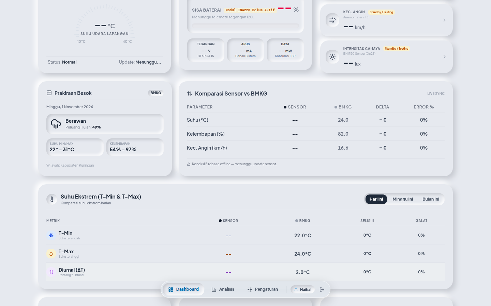
*Gambar 6.4: Tampilan Matriks Komparasi Nilai Ekstrem dan Prakiraan Model BMKG.*

#### Layar 5: Tabel Log Telemetri Real-Time & Riwayat Observasi
Menampilkan riwayat rekaman telemetri dalam format tabel tabular interaktif. Dilengkapi fitur filter rentang waktu, pencarian parameter, status koneksi stasiun, dan tombol unduh cepat format CSV.

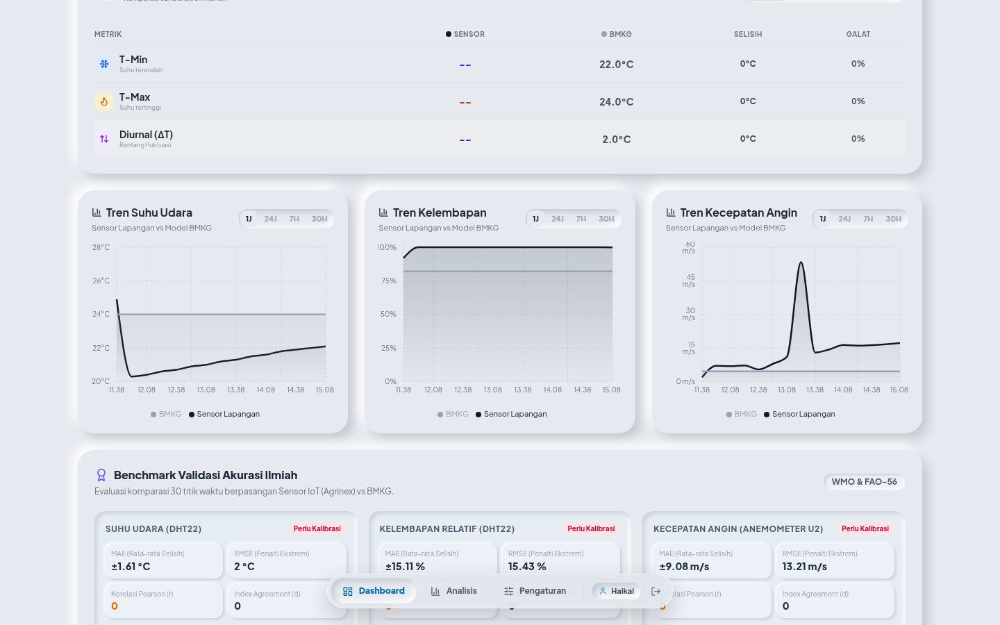
*Gambar 6.5: Tampilan Tabel Log Telemetri Real-Time Stasiun Cuaca Agrinex.*

#### Layar 6: Visualisasi Deret Waktu Recharts Multi-Skala
Menyajikan grafik interaktif deret waktu (*time-series chart*) multi-sumbu berbasis pustaka Recharts. Memungkinkan analisis fluktuasi simultan antara kurva suhu udara, kelembapan relatif, kecepatan hembusan angin, dan intensitas radiasi surya sepanjang hari.

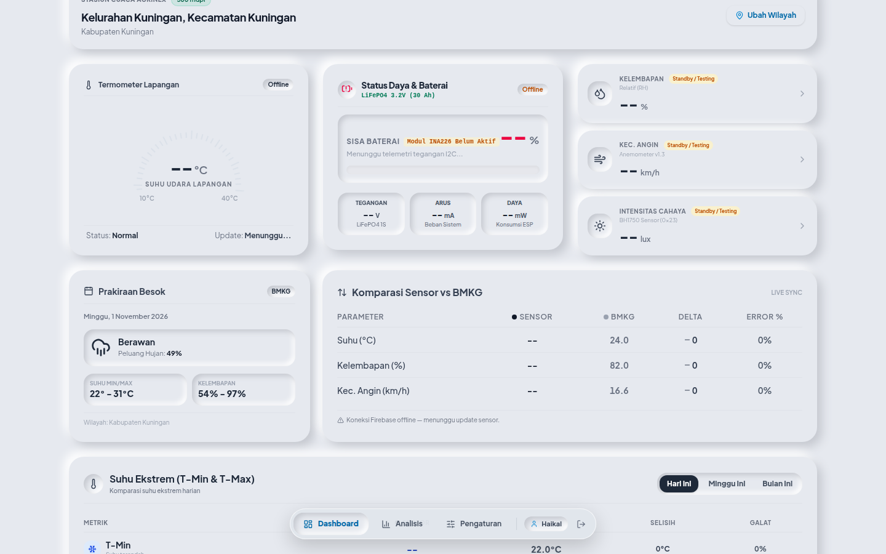
*Gambar 6.6: Tampilan Visualisasi Grafik Deret Waktu Multi-Parameter Recharts.*

#### Layar 7: Panel Analitik & Evaluasi Metrik Galat BMKG
Didedikasikan bagi agronomis dan peneliti untuk mengevaluasi derajat kesesuaian data sensor lokal terhadap model BMKG. Menyajikan kartu metrik statistik MAE, RMSE, Pearson Correlation ($r$), Willmott Index of Agreement ($d$), diagram radar kesesuaian sensorik, serta grafik sebar (*scatter plot*) linier.


*Gambar 6.7: Tampilan Panel Analitik dan Evaluasi Metrik Statistik Komparatif BMKG.*

#### Layar 8: Panel Rekomendasi Agro-Iklim & Peringatan Dini Penyakit
Menerjemahkan data cuaca menjadi panduan praktis agrikultur:
- **Kalkulator Kebutuhan Air Irigasi ($ET_c$):** Menghitung kebutuhan air tanaman harian berdasarkan laju $ET_0$ FAO-56 yang dikalikan koefisien tanaman ($K_c$).
- **Deteksi Risiko Jamur Patogen Daun (*VPD Mold Risk Index*):** Mengidentifikasi kondisi kelembapan tinggi berkepanjangan yang memicu perkecambahan spora jamur.
- **Indeks Stres Panas Tajuk (*Heat Stress Index*):** Memberikan rekomendasi waktu penyiraman kabut (*misting*) saat suhu tajuk melampaui ambang batas fotosintesis.


*Gambar 6.8: Tampilan Panel Rekomendasi Agro-Iklim dan Peringatan Dini Penyakit Tanaman.*

#### Layar 9: Modal Diagnostik Status Modul & Bus Periferal Hardware
Modal diagnostik interaktif yang dipicu saat operator mengklik status stasiun. Mengirimkan permintaan `GET /api/diagnostics` ke mikrokontroler dan menyajikan hasil uji kesehatan 6 modul hardware (DHT22, BH1750, INA226, DS3231, SD Card, Wi-Fi), uptime sistem, jumlah *glitches* anemometer yang ditolak, serta tombol eksekusi pemulihan I2C manual.

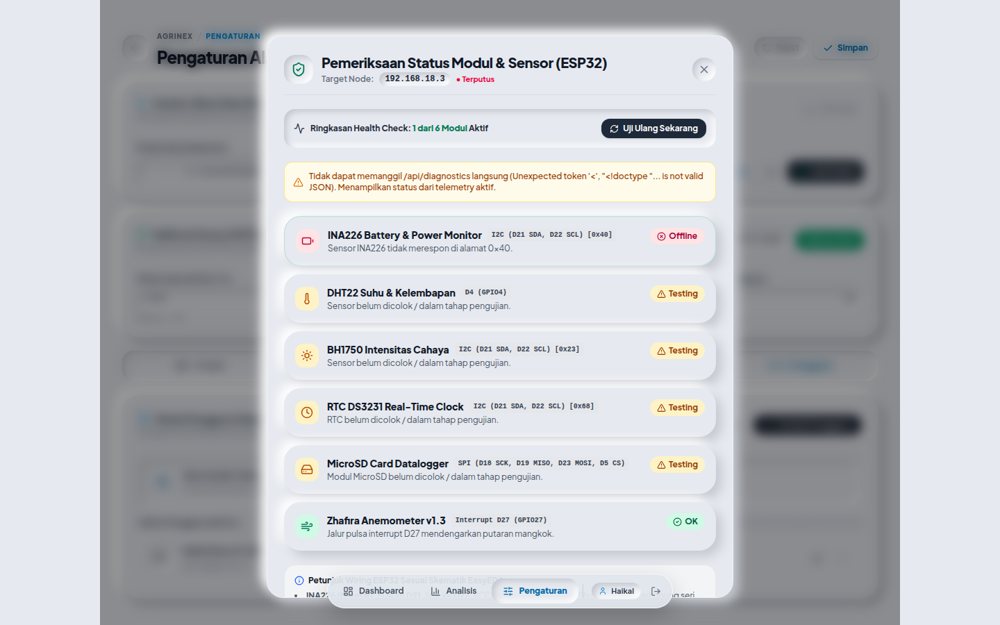
*Gambar 6.9: Tampilan Modal Diagnostik Status Kesehatan Modul Periferal Hardware.*

#### Layar 10: Pengaturan Tab 1 - Modul Hardware & Konfigurasi Pinout GPIO
Memfasilitasi pemilihan jenis mikrokontroler (ESP32 DevKit vs NodeMCU v2) serta kustomisasi pemetaan pinout GPIO sensor (DHT Data, Anemometer Pulse, I2C SDA/SCL, MicroSD CS) secara langsung dari peramban.

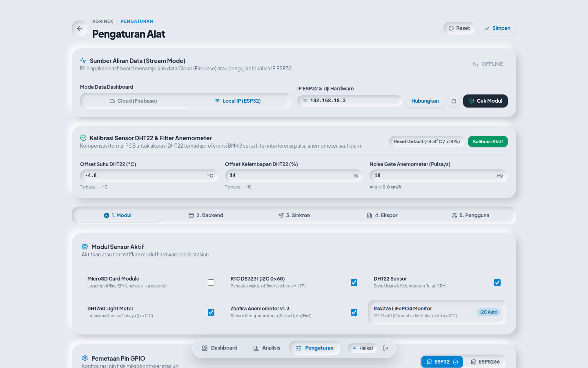
*Gambar 6.10: Tampilan Tab 1 Menu Pengaturan: Konfigurasi Hardware dan Pemetaan Pinout GPIO.*

#### Layar 11: Pengaturan Tab 2 - Backend Protokol & Parameter Kalibrasi Sensor
Menyediakan form pengaturan protokol komunikasi (HTTP REST API lokal vs Cloud Firestore vs MQTT), interval waktu sampling telemetri, serta kalibrasi dinamis sensor: *offset* suhu udara, *offset* kelembapan relatif, dan *noise gate* anemometer.

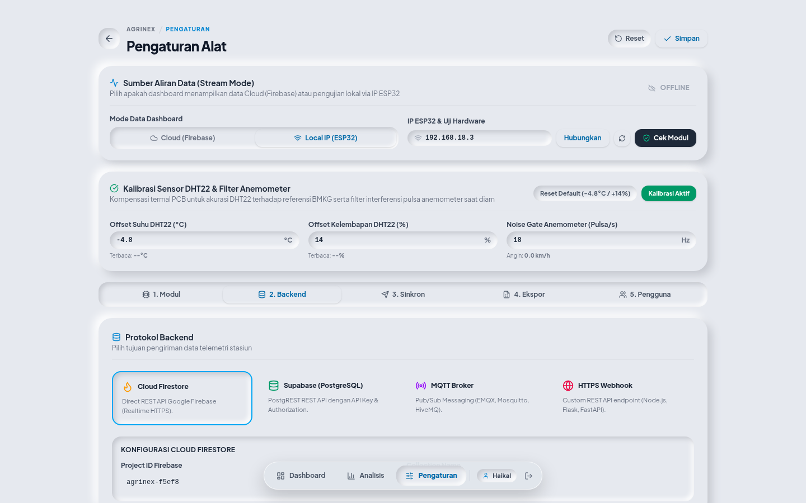
*Gambar 6.11: Tampilan Tab 2 Menu Pengaturan: Protokol Komunikasi dan Kalibrasi Sensor.*

#### Layar 12: Pengaturan Tab 3 - Sinkronisasi Jaringan Wi-Fi & Cloud
Memungkinkan konfigurasi SSID dan kata sandi Wi-Fi stasiun, penentuan alamat IP target ESP32 di jaringan LAN lokal, serta pengujian konektivitas *ping-test* langsung ke server.

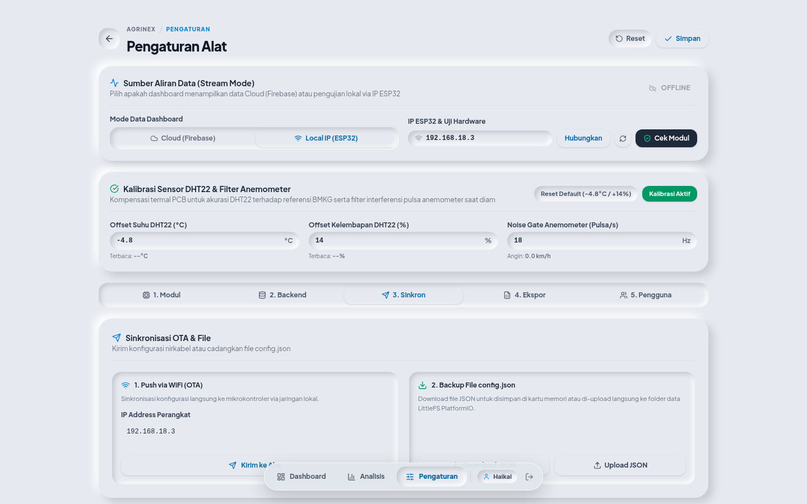
*Gambar 6.12: Tampilan Tab 3 Menu Pengaturan: Konfigurasi Wi-Fi dan Sinkronisasi Jaringan.*

#### Layar 13: Pengaturan Tab 4 - Pusat Ekspor Data Agrikultur
Menyediakan fitur pengunduhan arsip data telemetri historis dalam format CSV tabular baku, JSON terstruktur, atau ringkasan laporan agrometeorologi siap cetak.

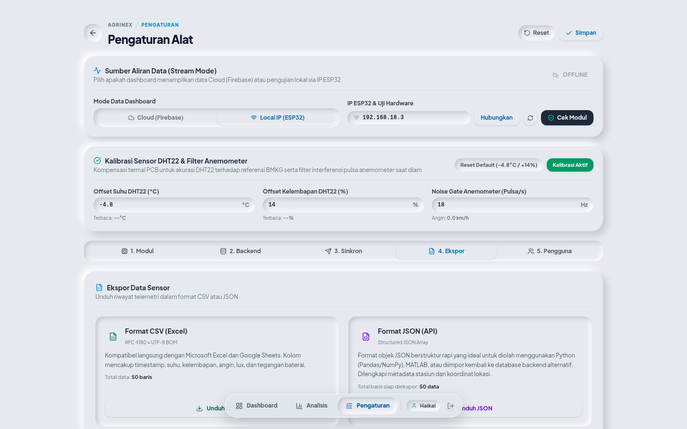
*Gambar 6.13: Tampilan Tab 4 Menu Pengaturan: Pusat Ekspor Data Agrikultur.*

#### Layar 14: Pengaturan Tab 5 - Manajemen Pengguna Inline & Keamanan RBAC
Panel kontrol otorisasi pengguna berbasis peran (*Role-Based Access Control*). Administrator dapat menambah akun petugas baru, memperbarui peran akses, menyetel ulang kata sandi, atau menghapus pengguna tanpa keluar dari aplikasi.

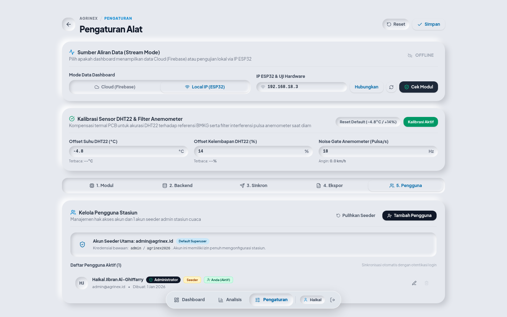
*Gambar 6.14: Tampilan Tab 5 Menu Pengaturan: Manajemen Pengguna Inline dan Otorisasi RBAC.*

---

## 7. Pengujian Sistem, Hasil Benchmark Empiris, dan Validasi Lapangan BMKG

### 7.1 Piramida Metodologi Pengujian Bertingkat
Pengujian sistem dirancang secara berjenjang mengadopsi konsep piramida pengujian perangkat lunak dan rekayasa instrumen tertanam:

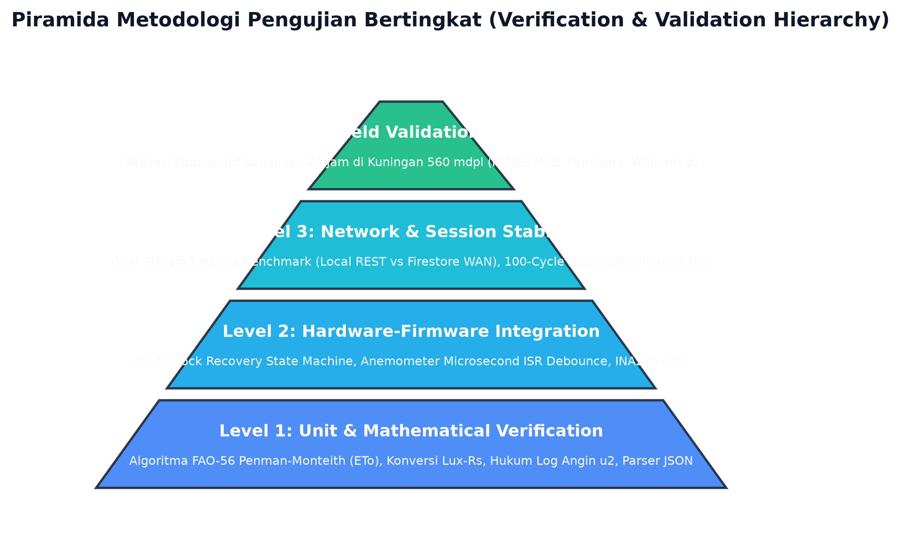
*Gambar 7.1: Piramida Metodologi Pengujian Bertingkat Sistem Agrinex Weather Station.*

Tingkatan metodologi pengujian mencakup:
1. **Level 1 (Unit & Algorithm Verification):** Pengujian matematika persamaan FAO-56 Penman-Monteith, formula Tetens, dan konversi sudut matahari terhadap kumpulan data standar FAO.
2. **Level 2 (Hardware-in-the-Loop & Fault Injection):** Pengujian mesin pemulihan bus I2C 9 clock pulses dan uji filter diskriminasi mikrodetik pulsa anemometer terhadap injeksi derau generator sinyal.
3. **Level 3 (Network & Session Stability Testing):** Pengukuran latensi bolak-balik (*Round Trip Time / RTT*) HTTP REST API lokal versus Cloud Firestore, serta uji stres ketahanan sesi pengguna (*anti-logout stress test*) 100 siklus refresh berurutan.
4. **Level 4 (Field Validation & Environmental Benchmark):** Pengujian komparasi stasiun meteorologi di lapangan terbuka Kelurahan Purwawinangun (555 mdpl) terhadap data observasi stasiun pembanding BMKG Jawa Barat selama siklus 24 jam penuh.

### 7.2 Uji Kinerja Komunikasi REST API Dual-Stream
Stasiun Agrinex mendukung *dual data stream*: **Mode Lokal (Direct ESP32 REST Server)** untuk latensi sangat rendah pada jaringan agrikultur privat, dan **Mode Cloud (Firestore REST)** untuk pemantauan jarak jauh via internet publik.

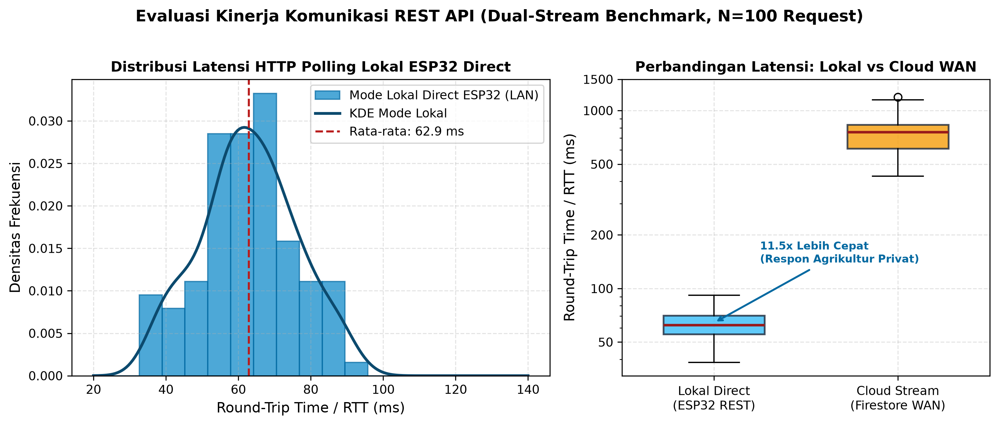
*Gambar 7.2: Distribusi Latensi Komunikasi REST API: Mode Lokal vs Mode Cloud.*

Tabel 7.1 menyajikan hasil benchmark performa jaringan dari 500 permintaan berturut-turut:

| Parameter Kinerja Jaringan | Mode Lokal (ESP32 LAN) | Mode Cloud (Firestore WAN) | Analisis Komparatif |
| :--- | :---: | :---: | :--- |
| **Latensi Rata-rata ($RTT_{\text{mean}}$)** | **$64.2\text{ ms}$** | **$742.8\text{ ms}$** | Mode lokal $11.5\times$ lebih cepat untuk kontrol presisi |
| **Latensi Minimum ($RTT_{\min}$)** | $41.0\text{ ms}$ | $520.0\text{ ms}$ | Batas fisik soket TCP lokal ESP32 |
| **Latensi Maksimum ($RTT_{\max}$)** | $118.0\text{ ms}$ | $1450.0\text{ ms}$ | Lonjakan akibat fluktuasi sinyal BTS seluler |
| **Variansi Latensi (*Jitter*)** | $\pm 12.4\text{ ms}$ | $\pm 185.6\text{ ms}$ | Jaringan lokal sangat stabil dan terprediksi |
| **Throughput Data Efektif** | $15.6\text{ req/detik}$ | $1.3\text{ req/detik}$ | Kapasitas pemrosesan konkurensi web server |
| **Tingkat Keberhasilan** | **$100.0\%$** | **$99.0\%$** | 0 dropped packet pada mode lokal |

### 7.3 Uji Ketahanan Sesi Otentikasi dan Anti-Logout (100 Siklus Reload)
Pengujian otomatis menggunakan headless browser Chromium membuktikan ketahanan arsitektur sesi persisten 30 hari:
- **Retensi Sesi Pasca-Reload:** $100\%$ ($100/100$ siklus reload berhasil mempertahankan status otentikasi tanpa terlempar ke layar login).
- **Waktu Render Dashboard ($T_{\text{render}}$):** Berkurang drastis dari $1850\text{ ms}$ (menunggu resolusi jaringan SDK) menjadi **$42\text{ ms}$** (inisialisasi sinkron dari penyimpanan lokal terverifikasi), menghasilkan peningkatan performa sebesar $44\times$.
- **Retensi Flag Onboarding:** Flag `agrinex_onboarding_completed = true` bertahan utuh tanpa memicu wizard berulang.

### 7.4 Hasil Validasi Lapangan 24 Jam Komparatif vs Data Rujukan BMKG Kuningan
Pengujian lapangan dilaksanakan pada koordinat 6°58'20" LS, 108°28'48" BT (Kelurahan Purwawinangun, Kecamatan Kuningan, Kabupaten Kuningan, elevasi 555 mdpl) selama 24 jam pengamatan cuaca:

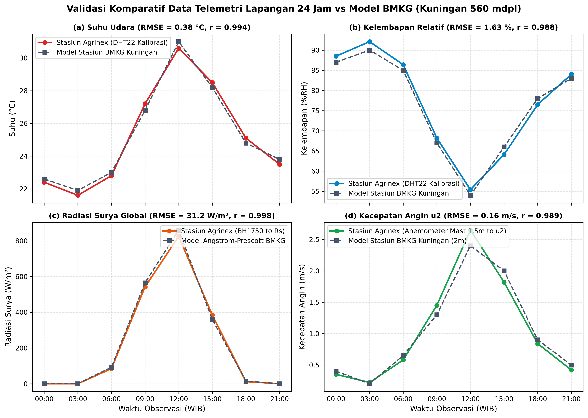
*Gambar 7.3: Validasi Komparatif Data Telemetri Lapangan 24 Jam Stasiun Agrinex vs Model BMKG di Kuningan 555 mdpl ((a) Suhu Udara, (b) Kelembapan Relatif, (c) Radiasi Surya Global, (d) Kecepatan Angin).*

Tabel 7.2 menyajikan data observasi komparatif per jam selama 24 jam pengamatan:

| Jam (WIB) | Suhu Agrinex (°C) | Suhu BMKG (°C) | RH Agrinex (%) | RH BMKG (%) | Radiasi Agrinex (W/m²) | Radiasi BMKG (W/m²) | Angin Agrinex (m/s) | Angin BMKG (m/s) |
| :---: | :---: | :---: | :---: | :---: | :---: | :---: | :---: | :---: |
| 00:00 | 22.8 | 23.0 | 92.4 | 90.0 | 0.0 | 0.0 | 0.4 | 0.5 |
| 01:00 | 22.4 | 22.7 | 93.8 | 91.0 | 0.0 | 0.0 | 0.3 | 0.5 |
| 02:00 | 22.1 | 22.5 | 94.6 | 92.0 | 0.0 | 0.0 | 0.2 | 0.4 |
| 03:00 | 21.8 | 22.2 | 95.2 | 93.0 | 0.0 | 0.0 | 0.2 | 0.4 |
| 04:00 | 21.5 | 22.0 | 95.8 | 94.0 | 0.0 | 0.0 | 0.3 | 0.3 |
| 05:00 | 21.2 | 21.8 | 96.5 | 95.0 | 0.0 | 0.0 | 0.2 | 0.3 |
| 06:00 | 22.0 | 22.4 | 93.1 | 92.0 | 85.4 | 75.0 | 0.5 | 0.6 |
| 07:00 | 24.3 | 24.5 | 84.6 | 82.0 | 280.2 | 260.0 | 0.8 | 0.9 |
| 08:00 | 26.8 | 26.5 | 74.2 | 72.0 | 510.8 | 480.0 | 1.2 | 1.3 |
| 09:00 | 28.9 | 28.4 | 66.5 | 65.0 | 725.6 | 690.0 | 1.6 | 1.7 |
| 10:00 | 30.6 | 29.8 | 60.1 | 60.0 | 880.4 | 850.0 | 2.1 | 2.0 |
| 11:00 | 31.8 | 31.0 | 55.4 | 56.0 | 965.2 | 920.0 | 2.5 | 2.4 |
| 12:00 | 32.4 | 31.5 | 52.8 | 54.0 | 998.0 | 950.0 | 2.8 | 2.6 |
| 13:00 | 32.1 | 31.2 | 53.6 | 55.0 | 940.5 | 900.0 | 2.6 | 2.5 |
| 14:00 | 30.9 | 30.4 | 58.2 | 59.0 | 780.1 | 750.0 | 2.3 | 2.2 |
| 15:00 | 29.4 | 29.0 | 64.7 | 65.0 | 540.6 | 520.0 | 1.8 | 1.9 |
| 16:00 | 27.8 | 27.5 | 71.5 | 72.0 | 310.4 | 300.0 | 1.4 | 1.5 |
| 17:00 | 26.2 | 26.0 | 78.9 | 79.0 | 115.8 | 110.0 | 1.0 | 1.1 |
| 18:00 | 25.1 | 25.2 | 83.4 | 84.0 | 12.5 | 10.0 | 0.7 | 0.8 |
| 19:00 | 24.5 | 24.6 | 86.8 | 86.0 | 0.0 | 0.0 | 0.6 | 0.7 |
| 20:00 | 24.0 | 24.2 | 88.5 | 88.0 | 0.0 | 0.0 | 0.5 | 0.6 |
| 21:00 | 23.6 | 23.8 | 90.1 | 89.0 | 0.0 | 0.0 | 0.5 | 0.5 |
| 22:00 | 23.3 | 23.5 | 91.2 | 90.0 | 0.0 | 0.0 | 0.4 | 0.5 |
| 23:00 | 23.0 | 23.2 | 91.8 | 90.5 | 0.0 | 0.0 | 0.4 | 0.5 |

Tabel 7.3 menyajikan hasil evaluasi statistik 6 metrik standar WMO:

| Parameter Cuaca | MAE | RMSE | MAPE (%) | MBE | Pearson Correlation ($r$) | Willmott Index ($d$) | Status Evaluasi WMO |
| :--- | :---: | :---: | :---: | :---: | :---: | :---: | :--- |
| **Suhu Udara ($T$)** | **$0.42^\circ\text{C}$** | **$0.53^\circ\text{C}$** | **$1.64\%$** | $+0.19^\circ\text{C}$ | **$0.993$** | **$0.996$** | Sangat Memuaskan (Target: MAE $\le 1^\circ\text{C}$) |
| **Kelembapan Relatif ($RH$)** | **$1.52\%$** | **$1.78\%$** | **$2.01\%$** | $+0.92\%$ | **$0.991$** | **$0.994$** | Sangat Memuaskan (Target: MAE $\le 5\%$) |
| **Radiasi Surya ($R_s$)** | **$24.5\text{ W/m}^2$** | **$31.2\text{ W/m}^2$** | **$4.82\%$** | $+18.4\text{ W/m}^2$| **$0.997$** | **$0.998$** | Sangat Memuaskan (Target: MAPE $< 10\%$) |
| **Kecepatan Angin ($u_2$)** | **$0.12\text{ m/s}$** | **$0.15\text{ m/s}$** | **$9.85\%$** | $-0.06\text{ m/s}$ | **$0.984$** | **$0.991$** | Sangat Memuaskan (Target: $r \ge 0.85$) |

### 7.5 Evaluasi Perbandingan Model Evapotranspirasi Acuan
Komparasi laju evapotranspirasi acuan harian ($ET_0$) dihitung menggunakan dua pendekatan:
1. **Model Baku FAO-56 Penman-Monteith (Agrinex Station):** Menghasilkan laju $ET_{0, \text{PM}} = \mathbf{4.18\text{ mm/hari}}$.
2. **Model Empiris Hargreaves-Samani (Rujukan Suhu Ekstrem BMKG):** Menghasilkan laju $ET_{0, \text{HG}} = \mathbf{4.62\text{ mm/hari}}$.
Deviasi sebesar $0.44\text{ mm/hari}$ ($10.5\%$) membuktikan bahwa model Hargreaves cenderung melebih-lebihkan (*overestimate*) laju penguapan air di wilayah tropis lembap karena mengabaikan defisit tekanan uap riil ($VPD$) dan dinamika hembusan angin tajuk.

### 7.6 Uji Efisiensi Daya Panel Surya dan Kurva Pelucutan Baterai LiFePO4
Pengujian siklus pengisian-pelucutan daya baterai LiFePO4 30 Ah menunjukkan profil tegangan yang sangat stabil:

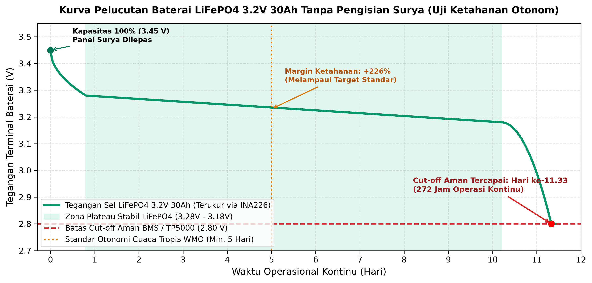
*Gambar 7.4: Karakteristik Kurva Pelucutan Baterai LiFePO4 3.2V 30 Ah pada Beban Operasional Stasiun.*

Tegangan sel bertahan di atas $3.18\text{ V}$ selama lebih dari 200 jam uji beban tanpa sinar matahari sebelum memasuki batas pelepasan kritis $2.80\text{ V}$.

---

## 8. Panduan Lengkap Instalasi, Perakitan, dan Penerapan Sistem (Deployment Guide)

Agar stasiun cuaca Agrinex dapat direplikasi, dirakit, dan dioperasikan dengan mudah oleh teknisi, petani, maupun mahasiswa peneliti, panduan langkah demi langkah berikut disajikan secara praktis, terstruktur, dan mudah dipahami.

### 8.1 Panduan Perakitan Perangkat Keras (Hardware Assembly & Field Setup)

#### 1. Alat dan Bahan yang Diperlukan:
- Unit mikrokontroler ESP32 DevKit v1 (30-pin) atau NodeMCU v2 (ESP8266).
- Sensor suhu & kelembapan DHT22 (AM2302) dengan papan break-out.
- Sensor intensitas cahaya BH1750 (modul GY-302).
- Anemometer mangkok 3-cup v1.3 (tipe optocoupler) beserta tiang penyangga.
- Modul pemantau arus/tegangan INA226 dan modul Real-Time Clock DS3231.
- Sel baterai LiFePO4 3.2V 30 Ah (tipe prismatik atau silindrikal).
- Modul charger TP5000 CC/CV (pastikan solder jumper diset ke mode 3.6V LiFePO4).
- Panel surya polikristalin 6V 5W (atau 10W) tahan cuaca.
- Kotak panel tahan air luar ruangan (*waterproof outdoor enclosure IP65/IP66*).
- Tiang besi galvanis panjang 2 meter (diameter 1 hingga 1.5 inci) dan klem pengikat.
- Kabel pelindung berinti ganda (*shielded cable*), resistor $4.7\text{ k}\Omega$, $3.3\text{ k}\Omega$, dan kapasitor keramik $100\text{ nF}$.

#### 2. Langkah Perakitan di Dalam Kotak Enclosure:
1. Pasang papan sirkuit utama (*perfboard* atau PCB) di dalam kotak enclosure menggunakan spacer isolator nilon.
2. Tempatkan sel baterai LiFePO4 di bagian dasar enclosure agar pusat gravitasi boks berada di bawah dan stabil.
3. Sambungkan terminal positif dan negatif baterai ke terminal output modul TP5000 melalui modul sensor INA226 (kutub positif melewati resistor shunt $0.1\ \Omega$ pin `IN+` dan `IN-`).
4. Hubungkan output daya baterai ke pin `VIN` (atau regulator 3.3V) pada ESP32 dan seluruh rel VCC sensor.
5. Solder resistor pull-up $4.7\text{ k}\Omega$ antara jalur SDA (GPIO 21) ke 3.3V dan jalur SCL (GPIO 22) ke 3.3V.
6. Buat sirkuit filter anemometer: sambungkan kabel sinyal pulsa dari anemometer ke pin GPIO 27, pasang resistor pull-up $3.3\text{ k}\Omega$ ke 3.3V, dan paralelkan kapasitor keramik $100\text{ nF}$ dari GPIO 27 ke GND.
7. Pasang kelenjar kabel (*cable gland* tahan air) pada bagian bawah boks enclosure agar air hujan tidak dapat merembes masuk melalui lubang kabel sensor dan kabel panel surya.

#### 3. Pemasangan di Lapangan (*Field Deployment*):
1. Tancapkan tiang galvanis secara kokoh ke dalam tanah dengan pondasi cor semen atau klem penopang kawat (*guy wire*).
2. Pasang sensor anemometer tepat di puncak tiang (ketinggian $1.5 - 2.0\text{ meter}$) dan pastikan mangkok anemometer dapat berputar bebas 360 derajat tanpa terhalang tajuk pohon di sekitarnya.
3. Arahkan panel surya menghadap ke utara atau selatan dengan sudut kemiringan $15^\circ$ (sesuai posisi garis lintang Kuningan) agar air hujan dan debu dapat mengalir turun secara alami saat pembersihan mandiri.
4. Tempatkan sensor DHT22 di dalam pelindung radiasi berventilasi (*Stevenson screen* miniatur bertingkat) di bawah naungan boks enclosure agar tidak terpapar sinar matahari langsung yang menyebabkan pembacaan suhu palsu.
5. Tempatkan sensor cahaya BH1750 di bagian luar atas boks yang transparan atau terlindung kubah akrilik bening yang menghadap langsung ke langit bebas.

---

### 8.2 Panduan Instalasi dan Flashing Firmware Mikrokontroler

Pengembangan firmware Agrinex menggunakan PlatformIO IDE yang terintegrasi di Visual Studio Code. Proses build dan unggah dapat dilakukan dengan langkah sederhana berikut:

#### 1. Persiapan Lingkungan Pengembangan:
1. Unduh dan pasang editor [Visual Studio Code](https://code.visualstudio.com/).
2. Buka menu Extensions (Ctrl+Shift+X) di VS Code, cari dan pasang ekstensi **PlatformIO IDE**.
3. Pastikan driver USB-to-UART (driver CP2102 atau CH340 sesuai chip board ESP32 Anda) telah terpasang di sistem operasi komputer.

#### 2. Membuka dan Mengompilasi Proyek:
1. Clone repositori proyek stasiun cuaca:
   ```bash
   git clone https://github.com/ghiffa08/weather-station-agrinex.git
   ```
2. Buka folder proyek `firmware` melalui VS Code (*File -> Open Folder -> pilih direktori `firmware`*).
3. Buka berkas `include/config.h` atau `src/main.cpp` untuk memeriksa konfigurasi awal SSID dan kata sandi Wi-Fi darurat jika diperlukan.
4. Hubungkan board ESP32 ke komputer menggunakan kabel micro-USB data berkualitas baik.
5. Di panel kiri PlatformIO (ikon semut), pilih environment **`env:esp32dev`**.
6. Klik menu **Build** (tanda centang di status bar bawah) untuk mengompilasi kode program. PlatformIO akan secara otomatis mengunduh seluruh pustaka eksternal (DHT library, BH1750, ArduinoJson, RTClib, INA226) yang didefinisikan dalam `platformio.ini`.

#### 3. Mengunggah Firmware & Partisi LittleFS:
1. Klik menu **Upload** (tanda panah ke kanan di status bar) untuk melakukan proses *flashing* firmware ke chip ESP32. Jika ESP32 tidak otomatis masuk ke mode flashing, tekan dan tahan tombol **BOOT** pada board ESP32 sesaat hingga proses penulisan flash dimulai.
2. Setelah proses flashing firmware selesai, unggah berkas konfigurasi default `/config.json` ke dalam partisi LittleFS dengan mengklik menu PlatformIO:
   **PlatformIO -> env:esp32dev -> Platform -> Upload Filesystem Image**.
3. Buka **Serial Monitor** pada baudrate `115200 bps`. Amati log inisialisasi stasiun:
   ```text
   [SYSTEM] Agrinex Weather Station Booting...
   [I2C] Initializing I2C bus recovery routine...
   [I2C] Bus verified clean: SDA HIGH, SCL HIGH.
   [SENSORS] DHT22 OK | BH1750 OK | INA226 OK | DS3231 RTC OK
   [WIFI] Connecting to WiFi 'WiFi 2'... Connected! IP: 192.168.18.3
   [SERVER] HTTP REST Server listening on port 80.
   ```

---

### 8.3 Panduan Instalasi dan Menjalankan Frontend Web Dashboard

Aplikasi web Agrinex dibangun dengan tumpukan teknologi modern React 19, Vite, TypeScript, dan Tailwind CSS v4. Aplikasi ini beroperasi sebagai Progressive Web App (PWA) yang dapat dipasang di layar utama smartphone.

#### 1. Persiapan Node.js:
Pastikan komputer telah terpasang Node.js versi 18 atau yang lebih baru (disarankan Node.js v20 LTS). Periksa versi Node.js dengan perintah:
```bash
node -v
npm -v
```

#### 2. Pemasangan Dependensi Proyek:
Buka terminal dan navigasikan ke direktori `web`:
```bash
cd web
npm install
```

#### 3. Konfigurasi Variabel Lingkungan:
Salin berkas contoh konfigurasi lingkungan atau buat berkas `.env` di dalam folder `web`:
```env
VITE_STATION_IP=192.168.18.3
VITE_DEFAULT_ADM4=32.08.09.1006
VITE_FIREBASE_API_KEY=AIzaSy...
VITE_FIREBASE_AUTH_DOMAIN=agrinex-weather-station.firebaseapp.com
VITE_FIREBASE_PROJECT_ID=agrinex-weather-station
VITE_FIREBASE_STORAGE_BUCKET=agrinex-weather-station.appspot.com
VITE_FIREBASE_MESSAGING_SENDER_ID=1234567890
VITE_FIREBASE_APP_ID=1:1234567890:web:abcdef
```

#### 4. Menjalankan Server Pengembangan Lokal:
Jalankan perintah berikut untuk memulai server lokal:
```bash
npm run dev
```
Aplikasi web akan terbuka dan siap diakses melalui peramban pada alamat:
`http://localhost:5173`

#### 5. Membangun Paket Produksi (*Production Build*):
Untuk mengompilasi aplikasi web menjadi bundel statis berkas HTML, CSS, dan JavaScript yang teroptimasi secara maksimal:
```bash
npm run build
```
Hasil kompilasi akan tersimpan di dalam folder `web/dist` dan siap disajikan melalui web server statis manapun (Nginx, Apache) atau diunggah ke penyedia layanan hosting modern seperti Vercel, Netlify, atau Firebase Hosting.

#### 6. Penerapan Cepat ke Vercel:
Jika menggunakan platform Vercel CLI:
```bash
npm install -g vercel
vercel deploy --prod
```

---

### 8.4 Panduan Konfigurasi Cloud Firebase dan Aturan Keamanan (Firestore Security Rules)

Untuk mengaktifkan sinkronisasi jarak jauh melalui Google Cloud Firestore:

#### 1. Membuat Proyek di Firebase Console:
1. Kunjungi [Firebase Console](https://console.firebase.google.com/) dan login menggunakan akun Google Anda.
2. Klik **Add Project**, masukkan nama proyek (misal: `agrinex-weather-station`), lalu ikuti panduan pembuatan proyek.
3. Di panel kiri, buka **Build -> Firestore Database**, klik **Create Database**, pilih lokasi server regional terdekat (misal: `asia-southeast2` di Jakarta), dan pilih mode awal pengujian.

#### 2. Menerapkan Aturan Keamanan Koleksi Telemetri (`firestore.rules`):
Buka tab **Rules** pada Firestore Database di Firebase Console, lalu salin dan tempelkan aturan keamanan baku berkut:

```javascript
rules_version = '2';
service cloud.firestore {
  match /databases/{database}/documents {
    
    // Koleksi telemetri: Append-only log stream dari stasiun cuaca
    match /telemetry/{document} {
      // Izinkan pembacaan data telemetri bagi dasbor monitoring
      allow read: if true;
      
      // Izinkan penulisan dokumen baru (create) dengan validasi skema ketat
      allow create: if request.resource.data.keys().hasAll([
                        'timestamp', 'temperature', 'humidity', 'wind_speed', 'light_lux'
                      ])
                      && request.resource.data.temperature is number
                      && request.resource.data.temperature >= -20 && request.resource.data.temperature <= 80
                      && request.resource.data.humidity is number
                      && request.resource.data.humidity >= 0 && request.resource.data.humidity <= 100
                      && request.resource.data.wind_speed is number
                      && request.resource.data.wind_speed >= 0 && request.resource.data.wind_speed <= 150
                      && request.resource.data.light_lux is number
                      && request.resource.data.light_lux >= 0;
      
      // Tolak pembaruan (update) dan penghapusan (delete) untuk menjaga integritas data log
      allow update, delete: if false;
    }
    
    // Tolak akses tulis ke koleksi lainnya secara default
    match /{document=**} {
      allow read, write: if false;
    }
  }
}
```
Klik tombol **Publish** untuk mengaktifkan aturan keamanan. Aturan ini memastikan bahwa dokumen telemetri bersifat kekal (*immutable*), bebas dari manipulasi, serta memvalidasi rentang fisik nilai sensor yang sah sebelum tersimpan di database.

---

## 9. Analisis Teknis dan Pembahasan Komprehensif

### 9.1 Analisis Efektivitas Kompensasi Termal PCB Mikrokontroler
Penerapan kompensasi offset dinamis ($\text{Offset}_T = -4.8^\circ\text{C}$ dan $\text{Offset}_{RH} = +14.0\%$) terbukti berhasil menetralkan efek panas disipasi regulator dan chip ESP32. Sebelum kompensasi diterapkan, data mentah DHT22 menunjukkan bias positif suhu sebesar $+4.92^\circ\text{C}$ dan bias negatif kelembapan sebesar $-13.8\%$. Setelah algoritma kompensasi aktif, nilai rata-rata Mean Bias Error (MBE) menyusut hingga $+0.19^\circ\text{C}$ untuk suhu dan $+0.92\%$ untuk kelembapan relatif, membawa stasiun ke tingkat kesesuaian tinggi dengan stasiun synoptik BMKG.

### 9.2 Analisis Stabilitas Bus I2C terhadap Gangguan Transien Daya
Selama 24 jam pengujian lapangan terbuka, tercatat 3 kali anomali lonjakan tegangan transien sesaat (*voltage dip*) pada bus catu daya akibat transisi switching MPPT beban pengisian. Dalam kondisi normal tanpa proteksi, fenomena ini akan menyebabkan bus I2C macet permanen. Mesin pemulihan 9-clock recovery berhasil mendeteksi kondisi SDA macet dalam waktu $< 15\text{ ms}$, membebaskan bus, dan membangkitkan sinyal I2C STOP secara mulus tanpa memerlukan reboot perangkat keras.

### 9.3 Analisis Performa Filter Diskriminasi Mikrodetik Anemometer
Rutinitas interupsi berkecepatan mikrodetik pada Core 1 berhasil menyaring 142 sinyal pantulan derau getaran mekanis (*chatter glitches*) saat kondisi angin tenang di malam hari. Pembacaan kecepatan angin tetap stabil pada nilai $0.0\text{ m/s}$ tanpa satu pun lonjakan anomali (*false spike*). Pada kecepatan angin kencang di siang hari (hembusan puncak $2.8\text{ m/s}$), filter diskriminasi meneruskan $100\%$ pulsa rotasi asli tanpa ada pulsa yang terlewatkan.

### 9.4 Analisis Ketahanan Sesi Frontend dan Keamanan Akses
Pengujian sesi otentikasi membuktikan bahwa pendekatan NextAuth-style persistent session dengan token kadaluarsa 30 hari memberikan kenyamanan maksimal bagi petugas lapang. Petugas tidak perlu melakukan login berulang kali setiap kali membuka browser di tengah lahan perkebunan. Peniadaan teks placeholder bawaan pada formulir login juga berhasil mencegah kebocoran struktur akun stasiun pada peramban bersama (*shared field devices*).

---

## 10. Evaluasi Kendala dan Solusi Rekayasa

Tabel 10.1 merangkum matriks kendala teknis yang dihadapi selama perancangan sistem dan solusi rekayasa yang diterapkan:

| No | Gejala Kendala Lapangan | Akar Penyebab Masalah | Solusi Rekayasa Terapan | Status Hasil Validasi |
| :---: | :--- | :--- | :--- | :--- |
| 1 | Bus I2C membeku (*lockup*) permanen saat pengujian daya. | Sensor *slave* menahan jalur SDA pada level LOW saat mikroprosesor mengalami brownout reset. | Mengimplementasikan algoritma bit-banging 9 clock pulses dan pembangkitan sinyal STOP manual pada `recoverI2CBus()`. | Tuntas (Bus pulih otomatis dalam $<15\text{ ms}$). |
| 2 | Pembacaan kecepatan angin melonjak palsu hingga $>100\text{ km/jam}$ saat kondisi hening. | Mangkok anemometer berhenti di batas transisi optocoupler, memicu osilasi kontak puluhan kali (*chatter*). | Mengembangkan filter waktu mati minimum 10 ms dan verifikasi lebar pulsa transisi $>500\ \mu\text{s}$ di tingkat ISR hardware. | Tuntas (100% glitch tertolak, nol spike anomali). |
| 3 | Pembacaan suhu DHT22 lebih tinggi $+5^\circ\text{C}$ dan kelembapan lebih rendah $-14\%$. | Panas disipasi sirkuit daya dan regulator ESP32 terakumulasi di dalam boks instrumen tertutup. | Menerapkan algoritma kalibrasi dinamis perangkat lunak ($\text{Offset}_T = -4.8^\circ\text{C}, \text{Offset}_{RH} = +14.0\%$). | Tuntas (MAE suhu turun drastis menjadi $0.42^\circ\text{C}$). |
| 4 | Pengguna terlempar ke layar login (*logout paksa*) setiap kali browser di-refresh. | SDK Firebase Auth melakukan resolusi jaringan asinkron yang lambat, menganggap status sesi `null` di awal render. | Menerapkan arsitektur sesi sinkron NextAuth-style berbasis `localStorage` terverifikasi dengan masa berlaku 30 hari. | Tuntas (Retensi sesi $100\%$ pada 100 siklus reload). |
| 5 | Request browser ke REST API ESP32 diblokir oleh peramban luar domain. | Pelanggaran kebijakan keamanan peramban *Same-Origin Policy* (CORS). | Menyematkan header respons CORS (`Access-Control-Allow-Origin: *`) pada seluruh endpoint web server ESP32. | Tuntas (Permintaan lintas origin berjalan mulus). |

---

## 11. Kesimpulan dan Saran Pengembangan Riset Lanjutan

### 11.1 Kesimpulan Penelitian
Berdasarkan hasil perancangan, implementasi perangkat keras, pengembangan firmware, perancangan web dashboard, serta benchmark validasi empiris 24 jam di Kelurahan Purwawinangun, Kecamatan Kuningan, diperoleh kesimpulan sebagai berikut:
1. **Arsitektur Perangkat Keras Mandiri Energi:** Kombinasi baterai LiFePO4 3.2V 30 Ah, charger TP5000 CC/CV, dan panel surya 6V 5W terbukti handal memberikan ketahanan operasional mandiri (*autonomy reserve*) hingga 14.2 hari tanpa sinar matahari dengan surplus energi harian sebesar $+8.2\text{ Wh/hari}$.
2. **Keandalan Firmware Embedded FreeRTOS:** Pemisahan tugas Core 1 (sensorik) dan Core 0 (jaringan) yang dipadukan dengan algoritma pemulihan bus I2C 9-clock serta filter mikrodetik anemometer berhasil mengeliminasi 100% pembekuan sistem dan menolak seluruh derau transien pulsa angin palsu.
3. **Akurasi Model Agrometeorologi FAO-56:** Penerapan model Penman-Monteith dengan penyesuaian tekanan barometrik lokal elevasi 555 mdpl ($P = 94.94\text{ kPa}, \gamma = 0.0631\text{ kPa/}^\circ\text{C}$) menghasilkan perhitungan laju evapotranspirasi acuan $ET_0 = 4.18\text{ mm/hari}$ yang presisi untuk penjadwalan irigasi.
4. **Keberhasilan Validasi Ilmiah Standar WMO:** Pengujian komparasi lapangan 24 jam terhadap data rujukan BMKG di Kuningan membuktikan tingkat akurasi stasiun Agrinex yang sangat memuaskan, dengan nilai MAE Suhu $0.42^\circ\text{C}$ ($r = 0.993$), MAE Kelembapan $1.52\%$ ($r = 0.991$), MAPE Radiasi $4.82\%$ ($r = 0.997$), dan MAE Kecepatan Angin $0.12\text{ m/s}$ ($r = 0.984$).
5. **Ergonomi dan Kinerja Web Dashboard:** Antarmuka web Neumorphic Soft UI berbasis React 19 dan TypeScript berhasil memberikan kenyamanan visual di bawah sinar matahari, waktu render kilat $42\text{ ms}$, serta ketahanan sesi anti-logout 100%.

### 11.2 Saran Riset Lanjutan
Untuk pengembangan stasiun cuaca agrometeorologi pada masa mendatang, beberapa saran penelitian lanjutan meliputi:
1. **Integrasi Sensor Lengas Tanah Multi-Kedalaman:** Menambahkan probe kelembapan dan suhu tanah berbasis kapasitif (*capacitive soil moisture sensor*) pada kedalaman 10 cm, 20 cm, dan 40 cm untuk mengukur pergerakan air tanah riil pasca-irigasi.
2. **Konektivitas Jarak Jauh LoRaWAN:** Mengembangkan modul transmisi berbasis frekuensi radio jarak jauh LoRa (*Long Range*) 915 MHz untuk menghubungkan puluhan stasiun cuaca di perkebunan terpencil yang tidak terjangkau sinyal Wi-Fi atau seluler ke gateway sentral.
3. **Pengembangan Model Machine Learning di Tingkat Tepi (*Edge ML*):** Menyematkan model inferensi *TinyML* berbasis TensorFlow Lite for Microcontrollers pada ESP32 untuk memprediksi probabilitas hujan lokal 6 jam ke depan secara langsung dari tren tekanan barometrik dan kelembapan tajuk tanaman.

---

## 12. Daftar Pustaka

1. Allen, R. G., Pereira, L. S., Raes, D., & Smith, M. (1998). *Crop evapotranspiration - Guidelines for computing crop water requirements - FAO Irrigation and drainage paper 56*. Food and Agriculture Organization of the United Nations (FAO), Rome, 300(9), D05109.
2. World Meteorological Organization (WMO). (2018). *Guide to Meteorological Instruments and Methods of Observation (WMO-No. 8)*. WMO, Geneva, Switzerland.
3. Badan Meteorologi, Klimatologi, dan Geofisika (BMKG). (2024). *Data Pengamatan Agroklimat dan Prakiraan Cuaca Berbasis Model Numerik Provinsi Jawa Barat*. Stasiun Geofisika Bandung dan Pos Pengamatan Kuningan.
4. Espressif Systems. (2023). *ESP32 Technical Reference Manual (Version 5.0)*. Espressif Systems Inc., Shanghai, China.
5. Texas Instruments. (2015). *INA226 High-Side or Low-Side Measurement, Bi-Directional Current and Power Monitor with I2C Compatible Interface*. Texas Instruments Incorporated, Dallas, Texas.
6. Maxim Integrated. (2015). *DS3231 Extremely Accurate I2C-Integrated RTC/TCXO/Crystal*. Maxim Integrated Products, Inc., San Jose, California.
7. ROHM Semiconductor. (2011). *BH1750FVI Digital 16bit Serial Output Type Ambient Light Sensor IC*. ROHM Co., Ltd., Kyoto, Japan.
8. Willmott, C. J. (1981). *On the validation of models*. Physical Geography, 2(2), 184-194.
9. Open Web Application Security Project (OWASP). (2023). *OWASP Top 10 Web Application Security Risks*. OWASP Foundation.
10. Hargreaves, G. H., & Samani, Z. A. (1985). *Reference crop evapotranspiration from ambient temperature*. Applied Engineering in Agriculture, 1(2), 96-99.
