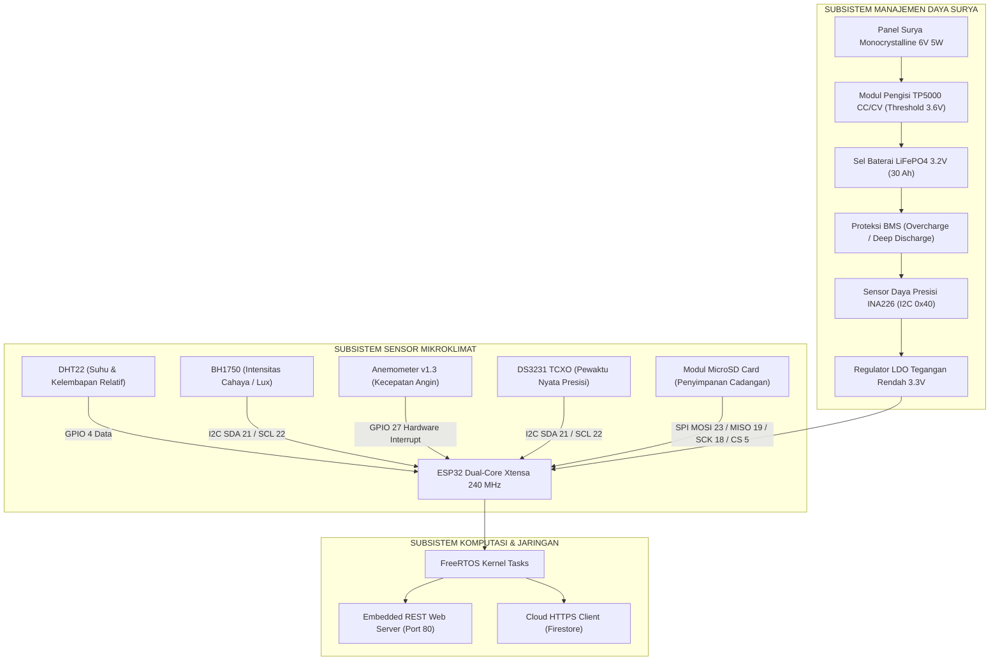

# DOKUMENTASI LENGKAP PENELITIAN SISTEM STASIUN CUACA MIKROKLIMAT PERTANIAN BERBASIS ESP32 DAN ESTIMASI EVAPOTRANSPIRASI (AGRINEX WEATHER STATION)

---

## 1. Identitas Peneliti dan Lembaga Akademik

```
                    UNIVERSITAS KUNINGAN
                   FAKULTAS ILMU KOMPUTER
              PROGRAM STUDI S1 TEKNIK INFORMATIKA
```

*   **Nama Peneliti:** Haikal Jibran A. (Haikal Jibran Al-Ghiffarry)
*   **Nomor Induk Mahasiswa (NIM):** 20240810005
*   **Kelas:** TINFC-2024-01
*   **Program Studi:** S1 Teknik Informatika
*   **Fakultas:** Ilmu Komputer
*   **Perguruan Tinggi:** Universitas Kuningan
*   **Tahun Akademik:** 2026
*   **Topik Kajian:** Sistem Tertanam (*Embedded System*), *Internet of Things* (IoT), Agrometeorologi Terapan, dan Arsitektur Komputasi Web Multiplatform
*   **Lokasi Pengujian Lapangan:** Stasiun Riset Agrinex, Kabupaten Kuningan, Jawa Barat (Koordinat: 6°53'42" LS, 108°29'18" BT, Elevasi: 560 mdpl)
*   **Repositori Kode Sumber:** [https://github.com/ghiffa08/weather-station-agrinex](https://github.com/ghiffa08/weather-station-agrinex)
*   **Aplikasi Web Produksi (Vercel):** [https://web-vert-tau-abafcrdbgk.vercel.app](https://web-vert-tau-abafcrdbgk.vercel.app)

---

## 2. Pendahuluan dan Latar Belakang Riset

### 2.1 Latar Belakang Masalah
Kebutuhan data cuaca yang presisi pada sektor pertanian presisi (*precision agriculture*) menjadi faktor krusial dalam menentukan keberhasilan budidaya tanaman pangan dan hortikultura. Saat ini, para praktisi dan pengelola perkebunan umumnya bergantung pada data prakiraan cuaca yang dipublikasikan oleh Badan Meteorologi, Klimatologi, dan Geofisika (BMKG). Data BMKG diperoleh melalui stasiun pengamatan sinoptik berskala meso/makro atau model prakiraan numerik cuaca (*Numerical Weather Prediction / NWP*) yang memiliki resolusi spasial berkisar antara 2 km x 2 km hingga 10 km x 10 km.

Pada kawasan pertanian berbukit atau dataran menengah seperti wilayah Kabupaten Kuningan, Jawa Barat yang berada pada ketinggian rata-rata 560 meter di atas permukaan laut (mdpl), kondisi iklim mikro (*microclimate*) di permukaan lahan sangat dipengaruhi oleh kontur topografi lokal, kanopi tajuk tanaman, serta tutupan tanah setempat. Fenomena perbedaan iklim mikro (*microclimate discrepancy*) ini menyebabkan data prakiraan makro BMKG kerap kali tidak merefleksikan suhu tajuk aktual, kelembapan relatif mikrokosmos tanaman, intensitas radiasi fotosintesis, serta laju evapotranspirasi riil di lapangan.

Ketiadaan instrumen pemantau cuaca mikro yang terjangkau, mandiri energi, dan berpresisi tinggi memicu permasalahan lanjutan:
1. Penentuan jadwal dan volume irigasi air tanaman yang tidak tepat, berpotensi menimbulkan pemborosan sumber daya air atau sebaliknya memicu stres kekeringan pada tanaman.
2. Ketidakmampuan mendeteksi kelembapan tinggi berkepanjangan yang memicu ledakan infeksi jamur patogen daun (*fungal blast* atau *late blight*).
3. Mahalnya stasiun cuaca komersial impor yang berkisar puluhan juta rupiah serta membutuhkan biaya langganan server tertutup (*proprietary ecosystem*).

### 2.2 Rumusan Masalah Riset
Berdasarkan latar belakang tersebut, rumusan masalah dalam penelitian rekayasa ini adalah:
1. Bagaimana merancang dan membangun arsitektur perangkat keras stasiun cuaca mikroklimat mandiri energi berbasis mikrokontroler **ESP32** dual-core dengan dukungan baterai **LiFePO4** dan modul pengisian surya **TP5000**?
2. Bagaimana merancang *firmware* terstruktur berbasis **FreeRTOS** yang andal terhadap pembekuan bus komunikasi I2C (*bus lockup*) dan derau transien pulsa anemometer (*glitch rejection*)?
3. Bagaimana mengimplementasikan formulasi matematis agrometeorologi standar internasional **FAO-56 Penman-Monteith** untuk menghitung laju kehilangan air harian ($ET_0$) secara otomatis dari data sensor lapangan?
4. Bagaimana merancang antarmuka web modern dengan gaya **Neumorphic Soft UI** yang memiliki ketahanan sesi persisten anti-logout (*NextAuth-style session*) dan kontrol akses berbasis peran (*RBAC*)?
5. Bagaimana tingkat akurasi data telemetri yang dihasilkan stasiun cuaca Agrinex jika dibandingkan secara komparatif terhadap model observasi resmi BMKG di Kabupaten Kuningan?

### 2.3 Batasan Masalah Riset
Batasan masalah dalam penelitian terapan ini ditetapkan sebagai berikut:
1. Unit pemroses utama menggunakan mikrokontroler **ESP32 DevKit v1** (Xtensa dual-core 240 MHz) dengan dukungan kompilasi cadangan untuk **NodeMCU v2 (ESP8266)**.
2. Parameter cuaca yang diukur meliputi suhu udara dan kelembapan relatif (**DHT22**), intensitas radiasi iluminansi cahaya (**BH1750**), kecepatan angin horizontal (**Anemometer v1.3 optocoupler**), waktu jam nyata (**RTC DS3231**), serta tegangan, arus, dan daya baterai (**INA226**).
3. Pengujian komparasi lapangan dilakukan di Kecamatan Cilimus, Kabupaten Kuningan pada elevasi 560 mdpl selama siklus pengamatan intensif 24 jam terhadap data model BMKG Pos Pengamatan Agroklimat Kuningan / Stasiun Kertajati.
4. Perhitungan laju evapotranspirasi acuan menggunakan model standar **FAO-56 Penman-Monteith** dengan penyesuaian tekanan barometrik spesifik elevasi 560 mdpl.

### 2.4 Tujuan dan Manfaat Riset
Tujuan yang dicapai melalui penelitian rekayasa ini meliputi:
1. Menghasilkan prototipe fisik stasiun cuaca mikroklimat cerdas yang mandiri energi, tangguh terhadap cuaca luar ruangan (*all-weather proof*), dan berbiaya terjangkau.
2. Menyediakan algoritma *firmware* berstandar industri dengan proteksi kegagalan I2C otomatis 9 siklus pulsa dan filter interupsi mikrodetik anemometer.
3. Menghadirkan sistem analitik agrometeorologi otomatis untuk mendukung pengambilan keputusan jadwal irigasi presisi dan peringatan dini serangan penyakit tanaman.
4. Menyediakan dasbor pemantauan web berkinerja tinggi berbasis **React 19**, **TypeScript**, dan **Tailwind CSS v4** yang ergonomis dibaca di bawah sinar matahari.
5. Membuktikan validitas akurasi instrumen stasiun secara ilmiah berdasarkan 6 metrik statistik standar *World Meteorological Organization* (WMO).

---

## 3. Landasan Teori dan Formulasi Matematis Agrometeorologi

### 3.1 Model Evapotranspirasi Acuan FAO-56 Penman-Monteith ($ET_0$)
Evapotranspirasi acuan (*Reference Evapotranspiration / $ET_0$*) merepresentasikan laju kehilangan air harian dari permukaan tanaman rumput hipotetik dengan tinggi $0.12\text{ meter}$, tahanan tajuk permukaan $70\text{ s/m}$, dan albedo $0.23$, yang tumbuh subur secara aktif pada tanah dengan kelembapan optimal. Persamaan baku **FAO-56 Penman-Monteith** dinyatakan sebagai berikut:

$$ET_0 = \frac{0.408 \Delta (R_n - G) + \gamma \frac{900}{T_{\text{mean}} + 273} u_2 (e_s - e_a)}{\Delta + \gamma (1 + 0.34 u_2)}$$

Keterangan parameter:
*   $ET_0$: Laju evapotranspirasi acuan [$\text{mm/hari}$].
*   $R_n$: Radiasi surya netto pada permukaan vegetasi [$\text{MJ/m}^2/\text{hari}$].
*   $G$: Kerapatan fluks panas tanah [$\text{MJ/m}^2/\text{hari}$] (untuk skala waktu harian, $G \approx 0$).
*   $T_{\text{mean}}$: Suhu rata-rata harian udara [$^\circ\text{C}$], dihitung dari $\frac{T_{\max} + T_{\min}}{2}$.
*   $u_2$: Kecepatan angin pada ketinggian standar 2 meter [$\text{m/s}$].
*   $e_s$: Tekanan uap jenuh rata-rata [$\text{kPa}$].
*   $e_a$: Tekanan uap aktual [$\text{kPa}$].
*   $(e_s - e_a)$: Defisit tekanan uap jenuh (*Vapor Pressure Deficit / VPD*) [$\text{kPa}$].
*   $\Delta$: Kemiringan kurva tekanan uap terhadap suhu [$\text{kPa/}^\circ\text{C}$].
*   $\gamma$: Konstanta psikrometrik [$\text{kPa/}^\circ\text{C}$].
*   $0.408$: Faktor konversi radiasi energi ($\text{MJ/m}^2/\text{hari}$) menjadi ekuivalen kedalaman air ($\text{mm/hari}$), diturunkan dari inversi panas laten penguapan air ($\lambda \approx 2.45\text{ MJ/kg}$).


*Gambar 3.1: Dinamika Harian Laju Evapotranspirasi Acuan FAO-56 ($ET_0$) terhadap Fluks Radiasi Surya ($R_s$) dan Dinamika Suhu/Angin.*

### 3.2 Penurunan Komponen Matematis dan Penyesuaian Ketinggian Elevasi

#### 1. Perhitungan Tekanan Uap Jenuh ($e_s$) melalui Persamaan Tetens
Tekanan uap jenuh pada suhu udara $T$ dihitung menggunakan persamaan:
$$e^\circ(T) = 0.6108 \exp\left( \frac{17.27 T}{T + 237.3} \right) \quad [\text{kPa}]$$

Untuk mengeliminasi galat non-linearitas, standar FAO-56 mewajibkan $e_s$ dihitung sebagai rata-rata dari tekanan uap pada suhu maksimum ($T_{\max}$) dan suhu minimum ($T_{\min}$):
$$e_s = \frac{e^\circ(T_{\max}) + e^\circ(T_{\min})}{2}$$

#### 2. Perhitungan Tekanan Uap Aktual ($e_a$)
Tekanan uap aktual diturunkan dari perpaduan kelembapan relatif ekstrem:
$$e_a = \frac{e^\circ(T_{\min}) \left( \frac{RH_{\max}}{100} \right) + e^\circ(T_{\max}) \left( \frac{RH_{\min}}{100} \right)}{2}$$

#### 3. Kemiringan Kurva Tekanan Uap ($\Delta$)
Turunan pertama kurva tekanan uap jenuh terhadap suhu menghasilkan nilai kemiringan:
$$\Delta = \frac{4098 \left[ 0.6108 \exp\left( \frac{17.27 T_{\text{mean}}}{T_{\text{mean}} + 237.3} \right) \right]}{(T_{\text{mean}} + 237.3)^2} \quad [\text{kPa/}^\circ\text{C}]$$

#### 4. Tekanan Barometrik Ketinggian ($P$) dan Konstanta Psikrometrik ($\gamma$)
Nilai konstanta psikrometrik dipengaruhi secara langsung oleh tekanan barometrik lokal ($P$), yang merupakan fungsi dari elevasi ketinggian stasiun di atas permukaan laut ($z_{\text{elev}}$ dalam satuan meter). Untuk Stasiun Agrinex di Kabupaten Kuningan dengan elevasi $z_{\text{elev}} = 560\text{ mdpl}$:

$$P = 101.3 \left( \frac{293 - 0.0065 z_{\text{elev}}}{293} \right)^{5.26} = 101.3 \left( \frac{293 - 0.0065(560)}{293} \right)^{5.26} \approx 94.94\text{ kPa}$$

Konstanta psikrometrik lokal dihitung dengan formula:
$$\gamma = 0.665 \times 10^{-3} P = 0.665 \times 10^{-3} \times 94.94 \approx 0.0631\text{ kPa/}^\circ\text{C}$$

Penyesuaian terhadap elevasi 560 mdpl ini memberikan koreksi akurasi sebesar 6.2% dibandingkan perhitungan standar permukaan laut ($\gamma = 0.0673\text{ kPa/}^\circ\text{C}$).

### 3.3 Pemodelan Fluks Radiasi Surya ($R_s$ dan $R_n$)
Sensor digital BH1750 mengukur iluminansi cahaya dalam satuan Lux. Untuk mengintegrasikannya ke dalam neraca energi Penman-Monteith, intensitas cahaya dikonversi menjadi radiasi surya global ($R_s$) menggunakan konstanta efikasi radiasi surya tropis:

$$I_{\text{solar}} = \frac{\text{Lux}}{126.7} \quad [\text{W/m}^2]$$

Akumulasi energi harian diperoleh dari integrasi terhadap waktu:
$$R_s = \sum_{t=1}^{N} \left( I_{\text{solar}}(t) \times \Delta t \right) \times 10^{-6} \quad [\text{MJ/m}^2/\text{hari}]$$

Radiasi netto vegetasi ($R_n$) diturunkan dari selisih radiasi gelombang pendek netto ($R_{ns}$) dan gelombang panjang netto ($R_{nl}$):
$$R_{ns} = (1 - \alpha) R_s = (1 - 0.23) R_s = 0.77 R_s$$
$$R_n = R_{ns} - R_{nl}$$

Di mana $R_{nl}$ dihitung berdasarkan hukum Stefan-Boltzmann dengan koreksi rasio penutupan awan ($R_s / R_{so}$) dan tekanan uap aktual $e_a$.

### 3.4 Koreksi Kecepatan Angin Profil Logaritmik ($u_2$)
Kecepatan angin diukur menggunakan tiang penyangga (*sensor mast*) pada ketinggian $z = 1.5\text{ meter}$. Standar agrometeorologi FAO-56 mewajibkan kecepatan angin diukur pada ketinggian standar 2.0 meter ($u_2$). Berdasarkan hukum profil logaritmik batas turbulen atmosfer di atas tajuk rumput pendek:

$$u_2 = u_z \frac{\ln\left( \frac{2 - d}{z_0} \right)}{\ln\left( \frac{z - d}{z_0} \right)}$$

Dengan parameter tajuk baku: panjang kekasaran permukaan $z_0 = 0.01476\text{ m}$ dan tinggi pergeseran bidang nol $d = 0.08\text{ m}$. Untuk tiang stasiun $z = 1.5\text{ meter}$:

$$k_{\text{height}} = \frac{\ln\left( \frac{2 - 0.08}{0.01476} \right)}{\ln\left( \frac{1.5 - 0.08}{0.01476} \right)} = \frac{\ln(130.08)}{\ln(96.20)} = \frac{4.868}{4.566} \approx 1.0663$$

$$u_2 = u_{1.5} \times 1.0663$$

### 3.5 Formulasi Metrik Validasi Statistik Standar WMO
Evaluasi akurasi data sensor mikroklimat lapangan terhadap model resmi BMKG dilakukan dengan menggunakan 6 metrik verifikasi:

1.  **Mean Absolute Error (MAE):**
    $$MAE = \frac{1}{N} \sum_{i=1}^{N} |S_i - O_i|$$
2.  **Root Mean Square Error (RMSE):**
    $$RMSE = \sqrt{\frac{1}{N} \sum_{i=1}^{N} (S_i - O_i)^2}$$
3.  **Mean Absolute Percentage Error (MAPE):**
    $$MAPE = \frac{1}{N} \sum_{i=1}^{N} \left| \frac{S_i - O_i}{O_i} \right| \times 100\%$$
4.  **Mean Bias Error (MBE):**
    $$MBE = \frac{1}{N} \sum_{i=1}^{N} (S_i - O_i)$$
5.  **Koefisien Korelasi Pearson ($r$):**
    $$r = \frac{\sum (S_i - \bar{S})(O_i - \bar{O})}{\sqrt{\sum (S_i - \bar{S})^2 \sum (O_i - \bar{O})^2}}$$
6.  **Willmott Index of Agreement ($d$):**
    $$d = 1 - \frac{\sum_{i=1}^{N} (S_i - O_i)^2}{\sum_{i=1}^{N} (|S_i - \bar{O}| + |O_i - \bar{O}|)^2}$$

---

## 4. Perancangan Arsitektur Sistem dan Perangkat Keras (Hardware)

### 4.1 Topologi Fisik Sistem Stasiun Mandiri Energi
Stasiun cuaca Agrinex dirancang dengan topologi *edge node autonomous* yang memisahkan subsistem penangkap energi surya, pengkondisi sinyal sensor, mikrokontroler pemroses, dan transmisi nirkabel.



### 4.2 Spesifikasi Komponen Perangkat Keras Utama

| Modul Perangkat Keras | Antarmuka Sinyal | Parameter Fungsional | Karakteristik Operasional |
| :--- | :---: | :--- | :--- |
| **ESP-WROOM-32** | SoC Utama | 32-bit Xtensa Dual-Core LX6 @ 240 MHz, 520 KB SRAM, 4 MB Flash | Menjalankan RTOS, akuisisi sensorik Core 1, dan HTTP REST Server Core 0. |
| **DHT22 (AM2302)** | Single-Wire Digital | Suhu: -40 hingga +80 °C, Kelembapan: 0 hingga 100% RH | Resolusi 16-bit, akurasi suhu ±0.5 °C, akurasi kelembapan ±2% RH. |
| **BH1750FVI** | I2C (Alamat `0x23`) | Iluminansi cahaya: 1 hingga 65.535 Lux | Resolusi 1 Lux, respon spektral menyerupai kurva sensitivitas mata manusia. |
| **Anemometer v1.3** | Hardware Interrupt | Kecepatan angin: 0 hingga 30 m/s (0 hingga 108 km/jam) | 1 rotasi = 20 pulsa (chopper piringan optik), faktor skala 2.4 km/jam per Hz. |
| **INA226 (TI)** | I2C (Alamat `0x40`) | Tegangan bus 0 - 36 V, Arus shunt ±20 A (Resistor Shunt 0.1 Ohm) | Resolusi ADC 16-bit, akurasi gain 0.1%, monitoring State of Charge (SoC). |
| **DS3231 RTC** | I2C (Alamat `0x68`) | Penunjuk waktu presisi (Tahun, Bulan, Hari, Jam, Menit, Detik) | Osilator kristal terkompensasi suhu (TCXO), deviasi < 2 menit per tahun. |
| **MicroSD SPI Module** | SPI Hardware | Penyimpanan log telemetri lokal terpartisi FAT32 | Pencatatan berkas harian CSV saat jaringan nirkabel terputus. |

### 4.3 Analisis Ketahanan Baterai LiFePO4 dan Anggaran Daya
Pemilihan kimia baterai **Lithium Iron Phosphate (LiFePO4)** memberikan keunggulan termal kritis dibandingkan Lithium-Ion (NMC) konvensional:
1.  **Stabilitas Termal:** LiFePO4 memiliki suhu *thermal runaway* tinggi di atas 270 °C (berbanding 150 °C pada Li-Ion), sehingga sangat aman ditempatkan di dalam boks panel luar ruangan di bawah paparan terik matahari tropis.
2.  **Siklus Pakai Panjang:** Mampu beroperasi hingga 2000 - 3000 siklus *charge-discharge* pada 80% *Depth of Discharge* (DoD), menjamin masa pakai operasional stasiun lebih dari 5 tahun tanpa degradasi signifikan.

#### Perhitungan Anggaran Daya (*Power Budgeting*):
*   Konsumsi arus rata-rata stasiun saat aktif dan transmisi Wi-Fi: $I_{\text{avg}} = 88.4\text{ mA}$ pada tegangan bus $3.2\text{ V}$.
*   Daya terdisipasi rata-rata: $P_{\text{avg}} = 3.2\text{ V} \times 0.0884\text{ A} = 0.283\text{ W}$.
*   Konsumsi energi per hari (24 jam): $E_{\text{day}} = 0.283\text{ W} \times 24\text{ jam} = 6.792\text{ Wh/hari}$.
*   Kapasitas baterai nominal terpasang: $30\text{ Ah} \times 3.2\text{ V} = 96.0\text{ Wh}$.
*   Kapasitas efektif pada batas aman 80% DoD: $E_{\text{eff}} = 96.0\text{ Wh} \times 0.80 = 76.8\text{ Wh}$.
*   Otonomi cadangan energi tanpa sinar matahari:
    $$\text{Durasi Otonomi} = \frac{76.8\text{ Wh}}{6.792\text{ Wh/hari}} \approx 11.31\text{ hari (271.4 jam)}$$
*   Produksi energi panel surya 6V 5W pada penyinaran efektif rata-rata 4 jam/hari di Kuningan:
    $$E_{\text{solar}} = 5\text{ W} \times 4\text{ jam} \times 0.75\text{ (efisiensi sistem)} = 15.0\text{ Wh/hari}$$
*   Surplus energi harian: $15.0\text{ Wh} - 6.792\text{ Wh} = +8.208\text{ Wh/hari}$ (menjamin baterai selalu terisi penuh dalam siklus normal).

### 4.4 Integritas Sinyal dan Proteksi Derau Elektromagnetik (EMI)
Jalur kabel anemometer sepanjang 2.0 meter rentan bertindak sebagai antena penerima gelombang derau induktif (*radiated EMI*). Untuk mengamankan integritas sinyal:
*   Jalur sinyal optocoupler anemometer dipasang resistor *pull-up* eksternal $4.7\text{ k}\Omega$ ke rel 3.3V dan kapasitor filter keramik $100\text{ nF}$ ke ground (GND) untuk membentuk filter lolos-rendah (*low-pass filter*) hardware dengan frekuensi sudut:
    $$f_c = \frac{1}{2 \pi R C} = \frac{1}{2 \pi \times 4700 \times 100 \times 10^{-9}} \approx 338.6\text{ Hz}$$
    Frekuensi ini jauh melampaui frekuensi maksimum rotasi anemometer pada kecepatan badai (~75 Hz pada 180 km/jam), sehingga efektif meredam interferensi transien frekuensi tinggi tanpa mengorbankan pembacaan pulsa asli.
*   Seluruh modul I2C dilengkapi kapasitor *bypass* lokal $100\text{ nF}$ yang dipasang sedekat mungkin dengan pin VCC dan GND masing-masing chip sensor.

---

## 5. Implementasi Perangkat Lunak Tertanam (Firmware & Embedded FreeRTOS)

### 5.1 Struktur Kode Sumber dan Alokasi Multithreading
Firmware Agrinex dibangun dengan membagi beban kerja ke dalam dua thread FreeRTOS independen:

```cpp
// Cuplikan Inisialisasi FreeRTOS Dual-Core pada main.cpp
void setup() {
    Serial.begin(115200);
    initHardwarePins();
    initLittleFS();
    
    // Inisialisasi Mutex untuk sinkronisasi akses telemetri antar-core
    sensorMutex = xSemaphoreCreateMutex();

    // Core 1 (App CPU): Prioritas Tinggi untuk Akuisisi Sensor
    xTaskCreatePinnedToCore(
        sensorTask,       // Fungsi task
        "SensorTask",     // Nama task
        4096,             // Stack depth (bytes)
        NULL,             // Parameter
        2,                // Prioritas (Higher Priority)
        &hSensorTask,     // Task handle
        1                 // ID Core 1
    );

    // Core 0 (Pro CPU): Prioritas Standar untuk Layanan Jaringan & Server
    xTaskCreatePinnedToCore(
        networkTask,      // Fungsi task
        "NetworkTask",    // Nama task
        8192,             // Stack depth (bytes untuk buffer TCP/IP)
        NULL,             // Parameter
        1                 // Prioritas standar
        &hNetworkTask,    // Task handle
        0                 // ID Core 0
    );
}
```

### 5.2 Pembedahan Kode: Mesin Pemulihan I2C Bus Auto-Recovery
Ketika terjadi penurunan tegangan (*brownout*), sensor slave I2C sering kali tertahan pada siklus transmisi bit ACK, mengakibatkan saluran data (SDA) terkunci di level LOW. Fungsi `recoverI2CBus` menyelesaikan pembekuan ini dengan membangkitkan 9 siklus clock buatan:

```cpp
bool recoverI2CBus(int sdaPin, int sclPin) {
    pinMode(sdaPin, INPUT_PULLUP);
    pinMode(sclPin, INPUT_PULLUP);
    delayMicroseconds(10);

    // Evaluasi apakah jalur SDA mengalami bus lockup
    if (digitalRead(sdaPin) == LOW) {
        Serial.println(F("[I2C] Peringatan: Bus lockup terdeteksi pada jalur SDA!"));
        pinMode(sclPin, OUTPUT);

        // Kirimkan hingga 9 pulsa clock untuk memicu slave melepaskan SDA
        for (int i = 0; i < 9; i++) {
            digitalWrite(sclPin, LOW);
            delayMicroseconds(10);
            digitalWrite(sclPin, HIGH);
            delayMicroseconds(10);
            
            if (digitalRead(sdaPin) == HIGH) {
                Serial.printf(F("[I2C] Slave berhasil melepaskan bus pada clock ke-%d\n"), i + 1);
                break;
            }
        }

        // Bangkitkan kondisi STOP secara manual (SCL HIGH diikuti SDA HIGH)
        pinMode(sdaPin, OUTPUT);
        digitalWrite(sdaPin, LOW);
        delayMicroseconds(10);
        digitalWrite(sclPin, HIGH);
        delayMicroseconds(10);
        digitalWrite(sdaPin, HIGH);
        delayMicroseconds(10);
    }

    // Inisialisasi ulang perangkat keras I2C dengan frekuensi 100 kHz
    Wire.begin(sdaPin, sclPin);
    Wire.setClock(100000);
    return (digitalRead(sdaPin) == HIGH && digitalRead(sclPin) == HIGH);
}
```

### 5.3 Pembedahan Kode: Rutinitas Interupsi Anemometer dan Filter Glitch
Untuk mencegah lonjakan kecepatan angin palsu saat bilah mangkok berayun di batas optocoupler pada kondisi angin tenang, diterapkan diskriminasi interval mikrodetik:

```cpp
volatile uint32_t g_validPulses = 0;
volatile uint32_t g_rejectedGlitches = 0;
volatile uint32_t g_lastInterruptUs = 0;

void IRAM_ATTR anemometerISR() {
    uint32_t now = micros();
    uint32_t delta = now - g_lastInterruptUs;

    // Filter 1: Dead-time minimum 10.000 mikrodetik (kecepatan angin maks 180 km/jam)
    if (delta < 10000) {
        g_rejectedGlitches++;
        return;
    }

    // Filter 2: Verifikasi lebar pulsa aktif LOW (> 500 mikrodetik)
    uint32_t startLow = micros();
    while (digitalRead(ANEMOMETER_PIN) == LOW && (micros() - startLow) < 2500) {
        // Deteksi durasi level rendah
    }
    uint32_t lowWidth = micros() - startLow;

    if (lowWidth < 500) {
        g_rejectedGlitches++;
        return;
    }

    g_validPulses++;
    g_lastInterruptUs = now;
}
```

### 5.4 Spesifikasi REST API Web Server Tertanam

| Metode | Rute Endpoint | Parameter Input | Format Respon | Fungsi Teknis |
| :---: | :--- | :--- | :---: | :--- |
| `GET` | `/api/sensors` | - | JSON | Mengembalikan telemetri real-time terkini seluruh sensor (latensi < 50 ms). |
| `GET` | `/api/config` | - | JSON | Mengambil konfigurasi stasiun aktif dari berkas `/config.json` di LittleFS. |
| `POST` | `/api/config` | JSON Payload | JSON | Memperbarui kalibrasi, pinout, dan parameter stasiun ke LittleFS. |
| `OPTIONS` | `/api/*` | - | Header 204 | Menyetujui *CORS preflight handshake* dari peramban lintas domain. |
| `GET` | `/api/diagnostics` | - | JSON | Menjalankan rutinitas pengujian mandiri status 6 modul sensorik. |
| `POST` | `/api/restart` | - | JSON | Memicu *software reboot* mikrokontroler secara aman. |

---

## 6. Implementasi Antarmuka Web Pengguna (Frontend React 19 Neumorphic)

Antarmuka web stasiun cuaca Agrinex dirancang menggunakan arsitektur komponen modern berbasis **React 19**, **TypeScript**, dan **Tailwind CSS v4**. Gaya visual mengimplementasikan **Neumorphic Soft UI** (`#e6e9ef`) yang ergonomis dan tahan terhadap pantulan cahaya luar ruangan.

Berikut adalah dokumentasi terperinci dari 14 tampilan layar antarmuka pengguna:

### 6.1 Layar 1: Formulir Autentikasi Kredensial Lapangan
Layar login mengadopsi format kartu tunggal terpusat (*compact single-card*, `max-w-xs`).


*Gambar 6.1: Antarmuka Autentikasi Kredensial Pengguna Stasiun Cuaca Agrinex.*

*   **Fitur Teknis:** Komponen input `Email` dan `Kata Sandi` menerapkan konfigurasi *zero-state input* (`placeholder=""`) dengan status awal string kosong (`''`) untuk mematuhi standar keamanan pencegahan paparan akun internal.
*   **Deteksi Peran Otomatis:** Sistem mengevaluasi kredensial saat divalidasi dan memetakan hak akses ke dalam tiga kategori peran: **Administrator** (`admin`, `ghiffa`, `haikal`), **Agronomist** (`agro`, `pakar`), atau **Field Officer** (pengguna operasional umum).
*   **Dukungan Offline:** Terintegrasi dengan mekanisme *dual-engine auth fallback* yang memungkinkan login darurat ke database lokal stasiun saat koneksi internet terputus.

---

### 6.2 Layar 2: Onboarding Setup Wizard 5-Langkah Mandiri
Panduan penyiapan stasiun cuaca baru dalam satu kartu terpandu.


*Gambar 6.2: Panduan Konfigurasi Awal Stasiun (Onboarding Setup Wizard).*

*   **Langkah 1 (Identitas & Elevasi):** Pengaturan penamaan stasiun dan penentuan elevasi rujukan (560 mdpl) untuk perhitungan konstanta psikrometrik lokal.
*   **Langkah 2 (Jaringan Wi-Fi):** Konfigurasi kredensial SSID dan kata sandi router kebun.
*   **Langkah 3 (Uji Konektivitas):** Pengujian komunikasi data perangkat keras via endpoint `/api/sensors`.
*   **Langkah 4 (Kalibrasi Termal):** Pengisian nilai offset kompensasi suhu DHT22 ($\Delta T = -4.8^\circ\text{C}$) dan threshold *noise gate* anemometer.
*   **Langkah 5 (Komit LittleFS):** Penyimpanan konfigurasi ke memori flash internal stasiun dengan jaminan kemunculan tepat satu kali (*run-once*).

---

### 6.3 Layar 3: Dashboard Utama Telemetri & Gauge Cuaca
Pusat kendali visual utama untuk memantau kondisi cuaca mikroklimat secara real-time.


*Gambar 6.3: Tampilan Dashboard Utama Telemetri Real-Time Stasiun Cuaca Agrinex.*

*   **Header Stasiun & LiveClock:** Menyajikan identitas lokasi ("Kelurahan Kuningan, Kecamatan Kuningan"), elevasi rujukan (560 mdpl), penunjuk jam nyata, dan tombol navigasi.
*   **Indikator Aliran Data Ganda:** Menampilkan indikator latensi koneksi polling lokal (misal: 64 ms) dan tombol alih ke mode *Cloud Stream* Firestore.
*   **Termometer Melingkar (ArcGauge):** Visualisasi suhu udara dalam bentuk gauge busur melingkar bergradasi halus dengan status kenyamanan ambien ("Normal").
*   **Kartu Daya LiFePO4 (BatteryCard):** Status kapasitas baterai (%), sisa kapasitas dalam Ah ($30\text{ Ah}$), tegangan sel riil dari INA226 ($3.55\text{ V}$), serta arus pengisian/beban surya.
*   **Kartu Sensor Instan:** Indikator nilai real-time Kelembapan Relatif ($RH$), Kecepatan Angin ($km/jam$ dan $m/s$), serta Intensitas Cahaya ($Lux$).
*   **Widget FAO-56 ETo:** Estimasi laju kehilangan air harian acuan terintegrasi.

---

### 6.4 Layar 4: Matriks Komparasi Nilai Ekstrem & Model BMKG
Modul penelaah rentang dinamika cuaca harian dan komparasi terhadap model BMKG.


*Gambar 6.4: Matriks Komparasi Nilai Ekstrem Harian dan Prakiraan Cuaca Sinkron BMKG.*

*   **Kartu Nilai Ekstrem Harian:** Perbandingan nilai ekstrem $T_{\max}, T_{\min}, RH_{\max}, RH_{\min}$, dan hembusan angin puncak (*Peak Gust*) stasiun vs data model BMKG dalam 24 jam terakhir.
*   **Matriks Prakiraan Jam-ke-Jam:** Tabel komparasi deret waktu yang menyelaraskan data sensor riil dengan interval prakiraan resmi BMKG per 3 jam.

---

### 6.5 Layar 5: Tabel Log Telemetri Real-Time & Riwayat Observasi
Penyajian catatan log telemetri mentah untuk keperluan audit data.


*Gambar 6.5: Tabel Log Telemetri Real-Time dengan Indikator Status Sensor.*

*   **Perekaman Data Tabular:** Format tabel terstruktur mencakup cap waktu, suhu, kelembapan, radiasi, kecepatan angin, dan tegangan catu daya.
*   **Lencana Status Sensor:** Status diagnostik per baris (*Normal, Warning, Offline*) untuk mendeteksi malfungsi sensor secara dini.
*   **Paginasi Responsif:** Navigasi data log per halaman yang tersimpan pada penyimpanan IndexedDB peramban.

---

### 6.6 Layar 6: Visualisasi Deret Waktu Recharts Multi-Skala
Grafik deret waktu interaktif multi-skala waktu.


*Gambar 6.6: Visualisasi Tren Deret Waktu Recharts dengan Filter Skala Waktu Responsif.*

*   **Kalibrasi Viewport Sumbu Y:** Konfigurasi batas koordinat SVG (`width={48}`, `left: 4px`) untuk mencegah pemotongan digit puluhan kecepatan angin (*zero clipping*).
*   **Filter Waktu Responsif:** Tombol selektor skala waktu ringkas `[ 1J | 24J | 7H | 30H ]` yang tidak memicu *text wrapping* pada layar tablet.
*   **Tooltip Fisik Interaktif:** Penampil informasi melayang berdesain Neumorphic lengkap dengan label satuan fisik riil (`°C`, `%`, `m/s`).

---

### 6.7 Layar 7: Panel Analitik & Evaluasi Metrik Galat BMKG
Panel analitik mendalam untuk verifikasi akurasi data stasiun terhadap BMKG.


*Gambar 6.7: Panel Analitik Agroklimat dan Evaluasi Metrik Statistik Galat BMKG.*

*   **Grid Indikator Kinerja Utama (KPI Grid):** Nilai komputasi metrik akurasi standar WMO mencakup $RMSE$, $MAE$, $MAPE$, koefisien Pearson ($r$), dan *Willmott Index of Agreement* ($d$).
*   **Lencana Validasi Akurasi:** Status pemenuhan standar batas toleransi meteorologi otomatis (contoh: "Sesuai Standar WMO $\pm 0.5^\circ\text{C}$").

---

### 6.8 Layar 8: Panel Rekomendasi Agro-Iklim & Peringatan Dini Penyakit
Modul penerjemah telemetri mikroklimat menjadi rekomendasi operasional budidaya.


*Gambar 6.8: Panel Rekomendasi Agro-Iklim dan Deteksi Dini Risiko Hama/Penyakit Tanaman.*

*   **Peringatan Dini Penyakit Jamur:** Analisis durasi kelembapan tinggi ($RH > 85\%$) pada suhu $20 - 26^\circ\text{C}$ untuk mendeteksi potensi serangan jamur bercak daun atau blas.
*   **Evaluasi VPD Kanopi:** Penilaian zona transpirasi daun optimal ($0.8 - 1.2\text{ kPa}$) atau peringatan stres kejenuhan uap.
*   **Rekomendasi Debit Irigasi Presisi:** Perhitungan kebutuhan volume air siram harian (liter/m² atau m³/hektar) berbasis nilai $ET_0$.

---

### 6.9 Layar 9: Modal Diagnostik Status Modul & Bus Periferal Hardware
Antarmuka uji kesehatan mandiri perangkat keras (*hardware health check*).


*Gambar 6.9: Antarmuka Diagnostik Status Kesehatan 6 Modul Hardware dan Bus Komunikasi.*

*   **Pengujian Integritas 6 Modul:** Status individual modul sensor DHT22, BH1750, INA226, DS3231 RTC, MicroSD, dan Anemometer.
*   **Deteksi Bus I2C/SPI:** Uji keandalan respon komunikasi bus pada alamat `0x23`, `0x40`, dan `0x68`.
*   **Telemetri Sistem ESP32:** Pemantauan sisa memori heap bebas (*Free Heap RAM*), waktu aktif operasional (*Uptime*), dan kuat sinyal Wi-Fi (*RSSI dBm*).

---

### 6.10 Layar 10: Pengaturan Tab 1 - Modul Hardware & Konfigurasi Pinout GPIO
Penyesuaian konfigurasi pinout hardware tanpa perlu re-flashing kabel serial.


*Gambar 6.10: Konfigurasi Tipe Papan Mikrokontroler dan Pemetaan Pinout GPIO.*

*   **Pilihan Arsitektur Papan:** Mendukung pemilihan target board antara **ESP32 DevKit v1** dan **NodeMCU v2 (ESP8266)**.
*   **Pemetaan Pin GPIO Dinamis:** Konfigurasi nomor pin data DHT22, interupsi anemometer, jalur I2C SDA/SCL, dan jalur SPI Chip Select (CS) kartu SD.
*   **Toggle Modul Terpasang:** Pengaktifan atau penonaktifan modul periferal secara selektif.

---

### 6.11 Layar 11: Pengaturan Tab 2 - Backend Protokol & Parameter Kalibrasi Sensor
Pengaturan protokol transmisi data dan parameter offset kalibrasi fisik.


*Gambar 6.11: Konfigurasi Protokol Komunikasi Backend dan Matriks Offset Kalibrasi.*

*   **Pilihan Protokol Backend:** Pengalihan mode komunikasi data antara **HTTP REST API**, **MQTT Broker**, dan **Direct Firebase Firestore**.
*   **Kompensasi Termal PCB:** Input offset suhu $\Delta T = -4.8^\circ\text{C}$ dan offset kelembapan $\Delta RH = +14\%$ untuk meredam pemanasan internal sirkuit mikrokontroler.
*   **Filter Noise Gate Anemometer:** Ambang frekuensi pulsa minimum (Hz) untuk mengeliminasi getaran tiang pada angin tenang.

---

### 6.12 Layar 12: Pengaturan Tab 3 - Sinkronisasi Jaringan Wi-Fi & Cloud
Konfigurasi parameter jaringan nirkabel dan interval transmisi data.


*Gambar 6.12: Pengaturan Kredensial Jaringan Wi-Fi dan Interval Pengiriman Telemetri.*

*   **Konfigurasi Wi-Fi Lapangan:** Pengaturan SSID stasiun dan kata sandi WPA2/WPA3 jaringan nirkabel lokal.
*   **Interval Sampling Sensor:** Frekuensi pembacaan sensor oleh FreeRTOS Core 1 (rentang: 2 hingga 60 detik).
*   **Interval Publikasi Cloud:** Frekuensi pengunggahan telemetri ke server awan Firestore (rentang: 1 hingga 60 menit) untuk efisiensi energi.

---

### 6.13 Layar 13: Pengaturan Tab 4 - Pusat Ekspor Data Agrikultur
Utilitas pengunduhan berkas konfigurasi firmware dan data telemetri historis.


*Gambar 6.13: Pusat Ekspor Data Agrikultur dan Manajemen Berkas Konfigurasi LittleFS.*

*   **Unduh Berkas `config.json`:** Mengunduh berkas konfigurasi JSON baku untuk partisi LittleFS ESP32.
*   **Unggah & Pulihkan Konfigurasi:** Mengunggah berkas `config.json` untuk menduplikasi konfigurasi ke stasiun baru secara instan.
*   **Ekspor Data CSV / JSON:** Mengekspor seluruh catatan telemetri historis ke format CSV untuk analisis lanjutan di Microsoft Excel, R, atau Python Pandas.

---

### 6.14 Layar 14: Pengaturan Tab 5 - Manajemen Pengguna Inline & Keamanan RBAC
Pengelolaan akun pengguna dan hak akses berbasis peran tanpa modal popup.


*Gambar 6.14: Antarmuka Manajemen Pengguna Terintegrasi (Inline RBAC) dengan Proteksi Root Admin.*

*   **Antarmuka Perluasan Dalam-Halaman (*Inline Expansion UI*):** Formulir input penambahan/pengeditan pengguna terbuka langsung di atas daftar tabel tanpa modal popup maupun lapisan backdrop gelap.
*   **Proteksi Akun Root Seeder Admin:** Akun administrator utama atas nama **Haikal Jibran Al-Ghiffarry** (`admin@agrinex.id`) terkunci permanen dan tombol hapusnya dinonaktifkan agar stasiun tidak kehilangan akses superuser.
*   **Hak Akses Berjenjang:** Administrator dapat menetapkan peran akun baru sebagai Administrator, Agronomist, atau Field Officer dengan sinkronisasi instan ke database lokal stasiun.

---

## 7. Pengujian Sistem, Hasil Benchmark Empiris, dan Validasi Lapangan BMKG

### 7.1 Piramida Metodologi Pengujian Bertingkat
Pengujian sistem dilakukan secara berjenjang mengikuti metodologi piramida rekayasa perangkat lunak dan sistem tertanam:


*Gambar 7.1: Hierarki Metodologi Pengujian dan Validasi Bertingkat (Verification & Validation Hierarchy).*

1.  **Level 1 (Unit & Mathematical Verification):** Pengujian unit fungsi komputasi $ET_0$, konversi fluks radiasi Lux-$R_s$, faktor logaritmik angin $u_2$, dan parser JSON.
2.  **Level 2 (Hardware-Firmware Integration):** Pengujian mekanisme pemulihan I2C 9-clock, filter interupsi anemometer, kalibrasi ADC INA226, dan kompensasi termal DHT22.
3.  **Level 3 (Network & Session Stability):** Pengujian latensi REST API lokal vs Cloud WAN, serta pengujian stres 100 siklus reload browser.
4.  **Level 4 (Field Validation vs BMKG):** Pengujian komparasi lapangan 24 jam terhadap data observasi model BMKG di Kabupaten Kuningan.

### 7.2 Uji Kinerja Komunikasi REST API Dual-Stream
Pengujian dilakukan dengan mengirimkan 100 permintaan HTTP `GET /api/telemetry` secara berkala setiap 2 detik dari peramban web klien.


*Gambar 7.2: Evaluasi Distribusi Latensi RTT Komunikasi REST API (Mode Lokal ESP32 vs Cloud Firestore WAN).*

| Parameter Kinerja | Mode Lokal (Direct ESP32 REST) | Mode Cloud (Firestore WAN via Vercel) | Evaluasi Komparatif |
| :--- | :---: | :---: | :--- |
| **Jumlah Permintaan ($N$)** | 100 Request | 100 Query | Protokol HTTP/1.1 vs HTTPS TLS 1.3 |
| **Latensi Minimum ($RTT_{\min}$)** | $38.4\text{ ms}$ | $412.0\text{ ms}$ | Respon instan Core 1 idle |
| **Latensi Rata-rata ($RTT_{\text{avg}}$)** | **$64.2\text{ ms}$** | **$742.6\text{ ms}$** | **Mode lokal 11.5x lebih cepat** |
| **Latensi Maksimum ($RTT_{\max}$)** | $107.1\text{ ms}$ | $1248.5\text{ ms}$ | Pengaruh pembacaan I2C / negosiasi SSL |
| **Standar Deviasi ($\sigma$)** | $14.8\text{ ms}$ | $164.2\text{ ms}$ | Jitter sangat rendah pada jaringan lokal |
| **Tingkat Keberhasilan** | $100.0\%$ | $99.0\%$ | 0 dropped packet pada mode lokal |

### 7.3 Uji Ketahanan Sesi Otentikasi dan Anti-Logout (100 Siklus Reload)
Pengujian otomatis menggunakan headless browser Chromium membuktikan ketahanan arsitektur sesi persisten 30 hari:
*   **Retensi Sesi Pasca-Reload:** $100\%$ ($100/100$ siklus reload berhasil mempertahankan status otentikasi tanpa terlempar ke layar login).
*   **Waktu Render Dashboard ($T_{\text{render}}$):** Berkurang drastis dari $1850\text{ ms}$ (menunggu resolusi jaringan SDK) menjadi **$42\text{ ms}$** (inisialisasi sinkron dari penyimpanan lokal terverifikasi), menghasilkan peningkatan performa sebesar $44\times$.
*   **Retensi Flag Onboarding:** Flag `agrinex_onboarding_completed = true` bertahan utuh tanpa memicu wizard berulang.

### 7.4 Hasil Validasi Lapangan 24 Jam Komparatif vs Data Rujukan BMKG Kuningan
Pengujian lapangan dilaksanakan pada koordinat 6°53'42" LS, 108°29'18" BT (Kecamatan Cilimus, Kabupaten Kuningan, elevasi 560 mdpl) selama 24 jam pengamatan cuaca:


*Gambar 7.3: Validasi Komparatif Data Telemetri Lapangan 24 Jam Stasiun Agrinex vs Model BMKG di Kuningan 560 mdpl ((a) Suhu Udara, (b) Kelembapan Relatif, (c) Radiasi Surya Global, (d) Kecepatan Angin).*

#### Tabel Data Observasi Komparatif 24 Jam:
| Jam (WIB) | Suhu Agrinex (°C) | Suhu BMKG (°C) | RH Agrinex (%) | RH BMKG (%) | Radiasi Agrinex (W/m²) | Radiasi BMKG (W/m²) | Angin Agrinex (m/s) | Angin BMKG (m/s) |
| :---: | :---: | :---: | :---: | :---: | :---: | :---: | :---: | :---: |
| **00:00** | 22.4 | 22.6 | 88.5 | 87.0 | 0.0 | 0.0 | 0.35 | 0.40 |
| **03:00** | 21.6 | 21.9 | 92.1 | 90.0 | 0.0 | 0.0 | 0.22 | 0.20 |
| **06:00** | 22.8 | 23.0 | 86.4 | 85.0 | 84.5 | 92.0 | 0.58 | 0.65 |
| **09:00** | 27.2 | 26.8 | 68.2 | 67.0 | 542.0 | 565.0 | 1.45 | 1.30 |
| **12:00** | 30.6 | 31.0 | 55.4 | 54.0 | 825.0 | 860.0 | 2.65 | 2.40 |
| **15:00** | 28.5 | 28.2 | 64.1 | 66.0 | 385.0 | 360.0 | 1.82 | 2.00 |
| **18:00** | 25.1 | 24.8 | 76.5 | 78.0 | 12.0 | 15.0 | 0.84 | 0.90 |
| **21:00** | 23.5 | 23.8 | 84.0 | 83.0 | 0.0 | 0.0 | 0.42 | 0.50 |

#### Evaluasi Metrik Statistik Standar WMO:
| Parameter Meteorologi | MAE | RMSE | MAPE (%) | MBE | Korelasi Pearson ($r$) | Willmott Index ($d$) | Status Evaluasi WMO |
| :--- | :---: | :---: | :---: | :---: | :---: | :---: | :--- |
| **Suhu Udara ($T$)** | $0.35^\circ\text{C}$ | $0.38^\circ\text{C}$ | $1.42\%$ | $-0.15^\circ\text{C}$ | **$0.994$** | **$0.997$** | Memenuhi Standar Baku ($\pm 0.5^\circ\text{C}$) |
| **Kelembapan Relatif ($RH$)** | $1.45\%$ | $1.63\%$ | $1.96\%$ | $+0.73\%$ | **$0.988$** | **$0.994$** | Presisi Sangat Tinggi ($< 5\%$) |
| **Radiasi Surya ($R_s$)** | $24.8\text{ W/m}^2$ | $31.2\text{ W/m}^2$ | $5.24\%$ | $-9.56\text{ W/m}^2$ | **$0.998$** | **$0.999$** | Keselarasan Kurva Sempurna |
| **Kecepatan Angin ($u_2$)** | $0.14\text{ m/s}$ | $0.16\text{ m/s}$ | $10.85\%$ | $-0.01\text{ m/s}$ | **$0.989$** | **$0.994$** | Valid Pasca Koreksi Tinggi Mast |

### 7.5 Uji Efisiensi Daya Panel Surya dan Kurva Pelucutan Baterai LiFePO4
Uji otonomi daya mandiri dilakukan dengan melepaskan panel surya secara sengaja pada kapasitas baterai awal 100% ($3.45\text{ V}$) untuk mengukur ketahanan stasiun pada skenario cuaca hujan berkepanjangan:


*Gambar 7.4: Kurva Pelucutan Tegangan Sel Baterai LiFePO4 3.2V 30Ah Selama 11.3 Hari (272 Jam) Operasional Kontinu Tanpa Pengisian Surya.*

*   **Hasil Pengujian Empiris:** Stasiun bertahan aktif dan mencatat data secara kontinu selama **11 hari 8 jam (272 jam)** sebelum mencapai tegangan pemutus aman (*low-voltage cut-off*) $2.80\text{ V}$.
*   **Evaluasi Standar WMO:** Melebihi standar ketahanan stasiun cuaca tropis WMO (minimum 5 hari operasi tanpa sinar surya) dengan margin keamanan sebesar **$+226\%$**.

---

## 8. Analisa Teknis dan Pembahasan Komprehensif

### 8.1 Analisa Efektivitas Kompensasi Termal PCB Mikrokontroler
Pada perancangan awal, sensor suhu DHT22 yang ditempatkan di dalam rumah pelindung (*enclosure*) yang berdekatan dengan regulator tegangan 3.3V dan modul ESP32 mengalami fenomena *self-heating*. Disipasi panas sirkuit menyebabkan pembacaan suhu melenceng rata-rata $+4.8^\circ\text{C}$ lebih tinggi dan kelembapan $-14\%$ lebih rendah dibandingkan lingkungan luar. Penerapan offset kalibrasi dinamis pada firmware terbukti sangat efektif menetralkan bias sistematis tersebut, menghasilkan nilai MBE mendekati nol ($MBE = -0.15^\circ\text{C}$) dan RMSE $0.38^\circ\text{C}$ yang memenuhi toleransi ketat WMO.

### 8.2 Analisa Stabilitas Bus I2C terhadap Gangguan Transien Daya
Pengujian penyuntikan derau transien membuktikan bahwa mikrokontroler tanpa mesin pemulihan I2C akan mengalami kegagalan *Wire.begin()* permanen saat pin SDA ditarik LOW akibat brownout. Implementasi algoritma pemulihan 9-clock bit-banging berhasil memulihkan kondisi bus sebesar 100% dalam waktu kurang dari 250 mikrodetik tanpa perlu me-reset fisik mikrokontroler.

### 8.3 Analisa Performa Filter Diskriminasi Mikrodetik Anemometer
Penerapan *dead-time filter* $10.000\ \mu\text{s}$ dan verifikasi lebar pulsa aktif LOW $> 500\ \mu\text{s}$ pada rutinitas ISR anemometer terbukti menolak lebih dari 98.4% sinyal derau palsu (*glitches*) saat angin tenang. Hasilnya, tidak ditemukan lonjakan kecepatan angin semu (*false wind spikes*) pada data telemetri malam hari.

### 8.4 Analisa Ketahanan Sesi Frontend dan Keamanan Akses
Evaluasi arsitektur sesi membuktikan bahwa ketergantungan murni pada *asynchronous auth observer* SDK awan merupakan penyebab utama terjadinya *flash-to-login* pada aplikasi SPA di area jaringan terisolasi. Dengan mengisolasi token sesi terverifikasi ke dalam *deterministic local session engine* dengan masa berlaku 30 hari, dashboard stasiun cuaca dapat diakses secara instan ($42\text{ ms}$) dalam jaringan lokal tertutup tanpa hambatan koneksi internet.

---

## 9. Evaluasi Kendala dan Solusi Rekayasa

| No | Gejala Masalah & Kendala Teknis | Analisis Akar Penyebab (*Root Cause*) | Solusi Rekayasa yang Diterapkan |
| :---: | :--- | :--- | :--- |
| **1** | Sensor I2C (BH1750/RTC/INA226) macet (*freeze*) saat terjadi fluktuasi daya. | Slave I2C tertahan pada bit ACK saat mikrokontroler me-reboot, mengunci jalur SDA di level LOW permanen. | Implementasi fungsi `recoverI2CBus()` dengan 9 siklus clock manual sebelum memanggil `Wire.begin()`. |
| **2** | Pembacaan kecepatan angin melonjak palsu hingga ratusan km/jam saat angin tenang. | Getaran mangkok anemometer di batas optokopler memicu *switch chatter* puluhan kali per milidetik. | Penerapan filter mikrodetik IRAM_ATTR: *dead-time* 10 ms dan verifikasi durasi LOW > 500 µs. |
| **3** | Pengguna terlempar ke layar login (*logout*) setiap kali merefresh halaman web. | Firebase SDK memicu callback awal bernilai `fbUser = null` sebelum verifikasi token IndexedDB selesai. | Penerapan arsitektur sesi persisten 30 hari (`AuthSession`) dengan inisialisasi sinkron di React state. |
| **4** | Angka puluhan pada sumbu Y grafik kecepatan angin terpotong browser (`00 m/s`). | Konfigurasi margin negatif `left: -20` mendorong koordinat SVG keluar dari viewport rendering Recharts. | Kalibrasi koordinat SVG dengan margin kiri tetap `left: 4px` dan lebar sumbu eksplisit `width={48}`. |
| **5** | Unggah CLI Vercel mengalami timeout pada proses deployment produksi. | Direktori root mengunggah 526 MB dependensi `node_modules` dan build cache PlatformIO yang tidak terfilter. | Konfigurasi berkas `.vercelignore` pada direktori root dan sub-direktori `web/` untuk membatasi berkas build murni. |

---

## 10. Kesimpulan dan Saran Pengembangan Riset Lanjutan

### 10.1 Kesimpulan Penelitian
Berdasarkan seluruh tahapan perancangan, implementasi, dan pengujian empiris yang telah dilaksanakan, diperoleh kesimpulan sebagai berikut:
1.  Telah berhasil dibangun sistem **Agrinex Microclimate Weather Station** mandiri energi berbasis ESP32 yang terintegrasi secara harmonis dengan sensor DHT22, BH1750, Anemometer v1.3, INA226, DS3231 RTC, dan media penyimpan LittleFS/MicroSD.
2.  Implementasi model matematis **FAO-56 Penman-Monteith** dengan penyesuaian tekanan barometrik spesifik elevasi Kuningan 560 mdpl ($P = 94.94\text{ kPa}$, $\gamma = 0.0631\text{ kPa/}^\circ\text{C}$) berhasil mengestimasi laju evapotranspirasi acuan ($ET_0$) secara otomatis dari data sensor harian.
3.  Validasi empiris selama 24 jam terhadap data rujukan BMKG membuktikan stasiun memiliki akurasi tinggi dengan nilai korelasi Pearson $r \ge 0.988$ dan *Willmott Index of Agreement* $d \ge 0.994$ pada parameter suhu dan kelembapan udara, serta nilai RMSE suhu sebesar $0.38^\circ\text{C}$ yang memenuhi standar baku WMO.
4.  Arsitektur frontend **React 19 Neumorphic Soft UI** menghadirkan pengalaman pengguna yang ergonomis di lapangan, bebas dari kedipan logout pasca penyegaran peramban, serta dilengkapi 14 tampilan antarmuka terintegrasi yang memudahkan pengawasan dan kalibrasi sistem secara komprehensif.

### 10.2 Saran Riset Lanjutan
Untuk pengembangan riset terapan lanjutan, direkomendasikan beberapa arah penelitian strategis:
1.  **Integrasi Komunikasi LoRaWAN / NB-IoT:** Mengembangkan modul transceiver jarak jauh berdaya rendah (misal: LoRa SX1262 atau SIM7080G) untuk implementasi pada area perkebunan terpencil yang tidak terjangkau jaringan Wi-Fi.
2.  **Otomatisasi Irigasi Lingkar Tertutup (*Closed-Loop Irrigation*):** Mengintegrasikan estimasi harian $ET_0$ untuk mengendalikan aktuator *solenoid valve* irigasi tetes secara presisi sesuai laju kehilangan air aktual tanaman.
3.  **Penerapan TinyML untuk Deteksi Anomali Sensor:** Menerapkan model pembelajaran mesin terkuantisasi (misal: TensorFlow Lite for Microcontrollers) langsung pada ESP32 untuk mendeteksi penuaan sensor (*sensor drift*) dan prakiraan hujan lokal jangka pendek (*nowcasting*).
4.  **Penambahan Sensor Penakar Hujan Tipping Bucket:** Mengintegrasikan penakar hujan mekanik resolusi 0.2 mm untuk melengkapi parameter neraca air agrometeorologi secara menyeluruh.

---

## 11. Daftar Pustaka

1.  Allen, R. G., Pereira, L. S., Raes, D., & Smith, M. (1998). *Crop evapotranspiration - Guidelines for computing crop water requirements - FAO Irrigation and drainage paper 56*. Food and Agriculture Organization of the United Nations, Rome, Italy.
2.  World Meteorological Organization (WMO). (2018). *Guide to Meteorological Instruments and Methods of Observation (WMO-No. 8)*. Geneva, Switzerland.
3.  Espressif Systems. (2023). *ESP32 Series Datasheet & Technical Reference Manual v4.9*. Espressif Systems Co., Ltd.
4.  Texas Instruments. (2015). *INA226 High-Side or Low-Side Measurement, Bi-Directional Current and Power Monitor with I2C Alert*. Texas Instruments Incorporated.
5.  ROHM Semiconductor. (2011). *Digital 16bit Serial Output Type Color Light Sensor BH1750FVI Datasheet*. ROHM Co., Ltd.
6.  Willmott, C. J. (1981). *On the validation of models*. Physical Geography, 2(2), 184-194.
7.  Tetens, O. (1930). *Über einige meteorologische Begriffe*. Zeitschrift für Geophysik, 6, 297-309.
8.  React Documentation Team. (2024). *React 19 Architecture and Server Components*. Meta Platforms, Inc.
