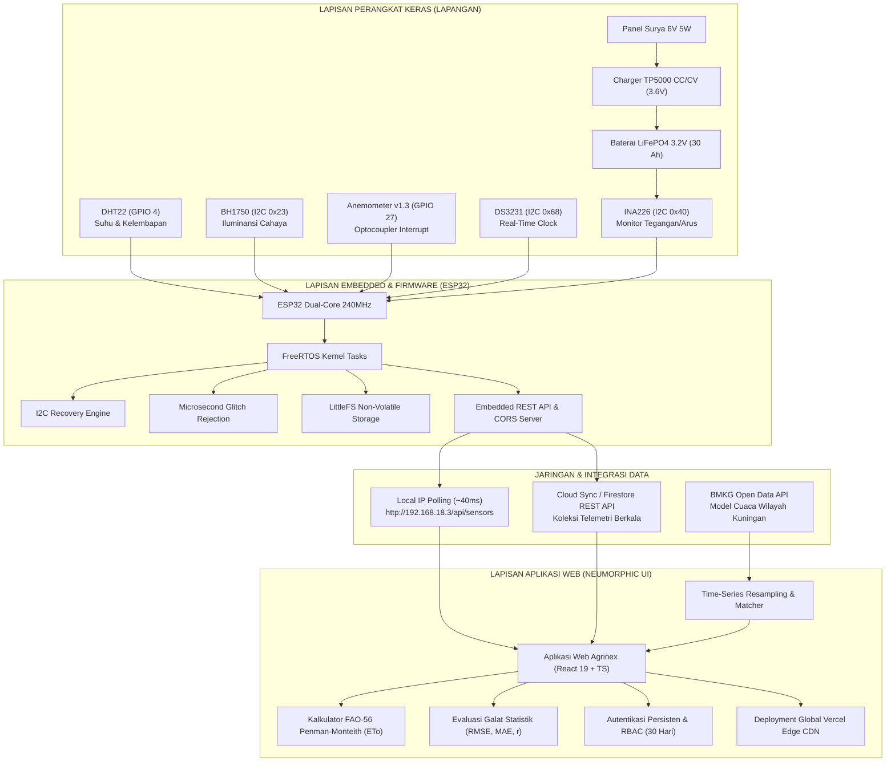

# LAPORAN TUGAS AKHIR / PROYEK RISET IOT
## SISTEM STASIUN CUACA MIKROKLIMAT PERTANIAN BERBASIS ESP32 & ESTIMASI EVAPOTRANSPIRASI (AGRINEX WEATHER STATION)

---

### IDENTITAS PROYEK
- **Nama Proyek:** Agrinex Smart Agro-Weather Station & Microclimate Comparative Analytics
- **Institusi / Laboratorium:** Laboratorium Sistem Tertanam & Rekayasa Komputasi
- **Pengembang / Mahasiswa:** Pratama Surya (ghiffa08)
- **Topik Kajian:** Internet of Things (IoT), Agrometeorologi, Embedded FreeRTOS, Sistem Penyelarasan Prediksi BMKG, dan Arsitektur Web Modern
- **Repositori Kode:** [https://github.com/ghiffa08/weather-station-agrinex](https://github.com/ghiffa08/weather-station-agrinex)
- **Aplikasi Web Live (Vercel):** [https://web-vert-tau-abafcrdbgk.vercel.app](https://web-vert-tau-abafcrdbgk.vercel.app)

---

## RINGKASAN EKSEKUTIF (EXECUTIVE SUMMARY)

Laporan komprehensif ini mendokumentasikan perancangan, implementasi perangkat keras, pengembangan *firmware* berbasis FreeRTOS, formulasi matematis agrometeorologi, serta antarmuka web *Neumorphic* dari **Agrinex Weather Station**. 

Stasiun cuaca mikroklimat ini dirancang khusus untuk memecahkan kendala presisi data cuaca skala mikro (*microclimate discrepancy*) di lahan pertanian tropis. Prakiraan cuaca berskala makro dari stasiun Badan Meteorologi, Klimatologi, dan Geofisika (BMKG) umumnya merepresentasikan wilayah grid beberapa kilometer persegi, sehingga sering kali kurang sensitif terhadap fluktuasi riil suhu tajuk tanaman, kelembapan tanah, dan angin di tingkat perkebunan.

### Inovasi & Keunggulan Utama Proyek:
1. **Perangkat Keras Mandiri Energi (Solar-Powered Autonomous Node):**
   Ditenagai oleh sel baterai **LiFePO4 3.2V (30 Ah)** yang tahan siklus tinggi dan aman terhadap panas ekstrem tropis, dipadukan modul manajemen pengisian surya **TP5000 CC/CV** serta modul sensor pemantau tegangan, arus, dan daya **INA226** dengan presisi 16-bit.
2. **Koleksi Multi-Sensor Presisi Tinggi:**
   Mengintegrasikan sensor digital **DHT22** (suhu dan kelembapan dengan algoritma kompensasi termal PCB), **BH1750** (iluminansi cahaya matahari hingga 65.535 lx dengan konversi ke radiasi surya $W/m^2$), **Anemometer v1.3** berbasis interupsi perangkat keras (*hardware interrupt*) dengan filter diskriminasi lebar pulsa (*glitch rejection filter*), dan modul waktu presisi **DS3231 TCXO RTC**.
3. **Firmware FreeRTOS Tangguh & LittleFS:**
   Dilengkapi *I2C Bus Recovery Machine* untuk memulihkan *bus freeze* secara otomatis saat terjadi gangguan daya (*brownout*), REST API Web Portal mandiri di ESP32, penyimpanan konfigurasi JSON di memori *flash* LittleFS, serta kapabilitas pembaruan nirkabel (OTA).
4. **Formulasi Matematis & Agrometeorologi Terapan:**
   Mengimplementasikan perhitungan laju kehilangan air tanaman acuan (**FAO-56 Penman-Monteith Evapotranspiration / $ET_0$**) secara otomatis dari data sensor harian, serta mesin analitik statistik (**RMSE, MAE, MAPE, MBE, Pearson Correlation $r$, dan Willmott Index of Agreement $d$**) untuk menguji deviasi data sensor lapangan terhadap model data resmi BMKG.
5. **Antarmuka Web Modern & Desain Neumorphic:**
   Dibangun dengan **React 19, TypeScript, Tailwind CSS v4, dan Recharts**, menghadirkan tema *Neumorphic Soft UI* (`#e6e9ef`) yang ergonomis di bawah terik matahari, sesi persisten 30 hari anti-logout saat penyegaran peramban (*NextAuth-style session*), *wizard* penyiapan mandiri sekali pakai, serta modul kelola akun pengguna *inline* tanpa *popup* yang mengganggu.
6. **Arsitektur Jaringan Dual-Stream:**
   Mendukung komunikasi lokal langsung via protokol REST HTTP IP lokal dengan latensi super rendah ($\approx 40 - 100\text{ ms}$) saat terhubung pada jaringan lokal stasiun, serta sinkronisasi awan (*Cloud Telemetry Log*) untuk akses jarak jauh di mana pun melalui internet.

---

## DAFTAR ISI LAPORAN

Laporan ini disusun secara sistematis dan mendalam menjadi dokumen-dokumen terpisah untuk memudahkan peninjauan akademis oleh dosen pembimbing dan penguji:

| Bab | Berkas Dokumen Markdown | Cakupan & Fokus Pembahasan |
| :---: | :--- | :--- |
| **Bab I** | [**`01_ARSITEKTUR_SISTEM_DAN_HARDWARE.md`**](./01_ARSITEKTUR_SISTEM_DAN_HARDWARE.md) | Desain topologi sistem, spesifikasi mikrokontroler ESP32, karakteristik sensor (DHT22, BH1750, Anemometer v1.3, INA226, DS3231), sistem catu daya LiFePO4 & TP5000, serta skematik perkabelan & proteksi EMI. |
| **Bab II** | [**`02_FIRMWARE_DAN_EMBEDDED_SYSTEM.md`**](./02_FIRMWARE_DAN_EMBEDDED_SYSTEM.md) | Arsitektur *firmware* C++ PlatformIO, *FreeRTOS multi-threading*, *I2C Bus Recovery State Machine*, penanganan interupsi anemometer (*anti-chatter*), REST API Web Portal ESP32, dan penyimpanan konfigurasi LittleFS. |
| **Bab III** | [**`03_PEMBAHASAN_ALGORITMA_DAN_MATEMATIKA.md`**](./03_PEMBAHASAN_ALGORITMA_DAN_MATEMATIKA.md) | Formulasi matematis lengkap FAO-56 Penman-Monteith ($ET_0$), konversi Lux ke radiasi surya ($W/m^2$ & $MJ/m^2/\text{hari}$), hukum logaritmik angin ketinggian 2m ($u_2$), algoritma kalibrasi dinamis, dan metrik validasi statistik BMKG. |
| **Bab IV** | [**`04_DESAIN_UI_DAN_FRONTEND_WEB.md`**](./04_DESAIN_UI_DAN_FRONTEND_WEB.md) | Prinsip desain *Neumorphic Soft UI*, arsitektur React 19 + TypeScript, sesi persisten 30 hari tanpa logout, RBAC, Onboarding Wizard sekali pakai, modul kelola pengguna *inline*, dan implementasi visual Recharts. |
| **Bab V** | [**`05_PENGUJIAN_DAN_HASIL_BENCHMARK.md`**](./05_PENGUJIAN_DAN_HASIL_BENCHMARK.md) | Metodologi pengujian, analisis latensi komunikasi REST API, uji stabilitas sesi browser, evaluasi akurasi kalibrasi terhadap data rujukan BMKG Kuningan (560 mdpl), serta evaluasi efisiensi daya panel surya. |

---

## DIAGRAM ARSITEKTUR SISTEM GLOBAL

---

## SPESIFIKASI TEKNOLOGI & LINGKUNGAN PENGEMBANGAN

| Komponen | Spesifikasi & Versi |
| :--- | :--- |
| **Mikrokontroler** | ESP32-WROOM-32D (Tensilica Xtensa Dual-Core 32-bit @ 240 MHz, 4MB Flash) |
| **Framework Firmware** | Arduino ESP32 Core v2.0.x / PlatformIO Core v6.x, Standar C++17 |
| **Pustaka Utama Firmware** | Adafruit Unified Sensor, DHT sensor library, BH1750, Adafruit INA226, RTClib, ArduinoJson v6 |
| **Frontend Framework** | React 19.2, TypeScript 6.0, Vite 8.2 |
| **Styling & UI Design** | Tailwind CSS v4, Lucide React, CSS Variables Neumorphic Dual-Shadow |
| **Komponen Visualisasi** | Recharts v3.10 (AreaChart bergradien, CartesianGrid, Tooltip adaptif) |
| **Hosting & Jaringan** | Cloudflare Tunnel Zero Trust (Local Test) & Vercel Edge Network (Production Deploy) |
| **Target Operasional** | Mikroklimat Pertanian Desa/Kecamatan Kuningan, Jawa Barat (Elevasi 560 mdpl) |

---
*Laporan ini dipersiapkan sebagai bentuk akuntabilitas ilmiah dan rekayasa perangkat lunak sistem tertanam secara menyeluruh.*
